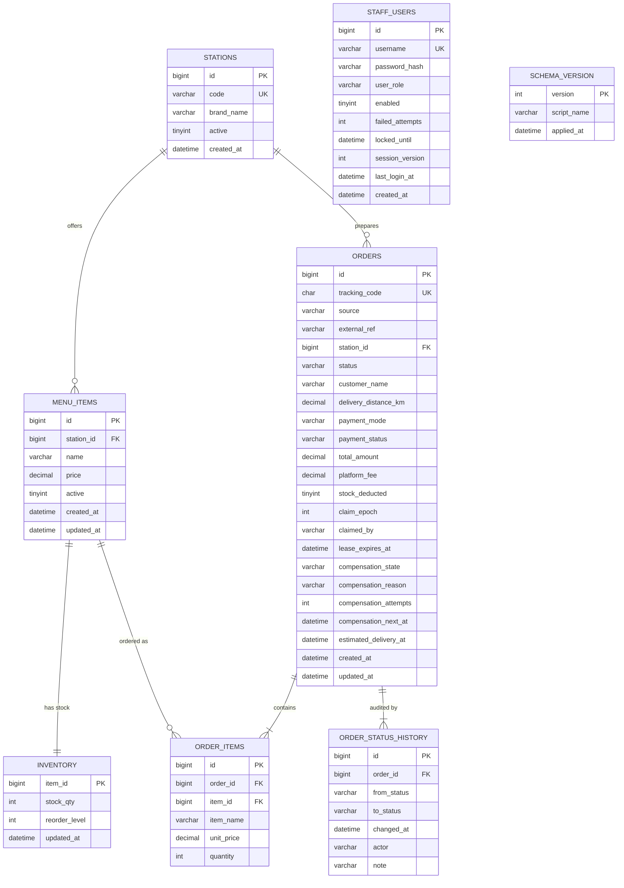

# Database Design

**Status:** Planned design. No SQL script exists yet; the scripts will be written in Phase 3 from this document.
**Related:** [SDD §5, §13](SDD.md) · [SRS](SRS.md) · [TRACEABILITY](TRACEABILITY.md)

---

## 1. Principles and portability rules

| # | Rule |
|---|---|
| P-1 | Engine InnoDB; database and every table `utf8mb4`; default collation `utf8mb4_unicode_ci` (exists in both MySQL 8 and MariaDB). Columns that must compare exactly (external references) use `utf8mb4_bin`. Collations specific to one vendor (`utf8mb4_0900_ai_ci`, `uca1400_*`) are forbidden. |
| P-2 | Money: `DECIMAL(10,2)`. Time: `DATETIME(3)` holding **UTC**, written by the application (`Instant`), never `NOW()`/`CURRENT_TIMESTAMP` defaults, never `TIMESTAMP` (avoids time-zone conversion and the 2038 limit). Sessions set `time_zone = '+00:00'` as a safeguard. |
| P-3 | Identifiers `lower_snake_case`; tables plural; primary key `id BIGINT AUTO_INCREMENT` (exception: `inventory.item_id`). Names avoid reserved/vendor keywords (`user_role`, not `role`). |
| P-4 | Allowed constructs: `CREATE TABLE`, `PRIMARY KEY`, `UNIQUE`, `FOREIGN KEY ... REFERENCES`, `INDEX`, `CHECK` (enforced in MariaDB >= 10.2 and MySQL >= 8.0.16), `AUTO_INCREMENT`, `INSERT`, `UPDATE`, `SELECT ... FOR UPDATE`, `LIMIT/OFFSET`, `COUNT/SUM`, `GROUP BY`, `LIKE`. |
| P-5 | Forbidden: `ENUM`/`SET` types (statuses are `VARCHAR` + `CHECK` + Java enum), `JSON`, generated columns, triggers, stored procedures/functions, events, views, window functions/CTEs, `RETURNING`, `SKIP LOCKED`/`NOWAIT`, `INSERT ... ON DUPLICATE KEY` (use explicit logic), `NOW()`, `ON UPDATE CURRENT_TIMESTAMP`, backtick-quoted identifiers. `SqlPortabilityTest` enforces this list. |
| P-6 | One statement per `;` at end of line; no `;` inside string literals or comments (the simple script splitter in `SchemaInitializer` depends on it). Comments use `-- ` only. |
| P-7 | Foreign keys are `ON DELETE RESTRICT` (no cascading deletes; nothing in the application deletes business rows). |
| P-8 | Status and source strings are the Java enum `name()`s and are validated by `CHECK` constraints for defence in depth. |
| P-9 | Scripts: `src/main/resources/db/V001__schema.sql` (tables, indexes), `V002__seed_reference_data.sql` (stations, menu, stock). Users are **not** seeded in SQL (passwords come from config via `UserSeeder`). Applied in order by `SchemaInitializer`, recorded in `schema_version`. |
| P-11 | Durability: the embedded server keeps `innodb_flush_log_at_trx_commit = 1` (committed transactions survive a crash). Verified in spike S-17 and never relaxed by `DbBootstrap` (SDD §13.1, TXR-7). |
| P-10 | Switching to real MySQL 8 is a configuration change (`db.mode=external`, `db.url`, `db.user`, `db.password`); no script change. Verified on MariaDB4j; MySQL 8 verification is a manual Phase 8 check if a server is available (declared unverified otherwise). |

Connection settings (driver-specific details finalised in the Phase 1 spike): UTF-8 (`utf8mb4`) connection character set, `time_zone = '+00:00'` via Hikari `connectionInitSql`, multi-statement queries disabled, `useAffectedRows` semantics verified (conditional updates change the status/qty value, so "matched" and "changed" row counts agree either way).

---

## 2. Entity-relationship diagram

`STAFF_USERS` and `SCHEMA_VERSION` have no relationship to other tables by design (`order_status_history.actor` stores the user name as text so history survives user changes and avoids a user FK on the hot write path).

---

## 3. Table definitions

Legend: **NN** NOT NULL, **UK** unique, **PK** primary key, **FK** foreign key. All tables: `ENGINE=InnoDB DEFAULT CHARSET=utf8mb4 COLLATE=utf8mb4_unicode_ci`.

### 3.1 `stations`
One row per brand/kitchen station (exactly one station per brand).

| Column | Type | Constraints | Notes |
|---|---|---|---|
| `id` | BIGINT | PK, AUTO_INCREMENT | |
| `code` | VARCHAR(20) | NN, UK `uq_stations_code` | Brand code used in routing and thread names, e.g. `BIRYANI`; `CHECK (code = UPPER(code))` is **not** used (portability); the application upper-cases |
| `brand_name` | VARCHAR(80) | NN | Display name |
| `active` | TINYINT(1) | NN, DEFAULT 1, `CHECK (active IN (0,1))` | Inactive stations get no worker and cannot receive orders |
| `created_at` | DATETIME(3) | NN | UTC |

### 3.2 `menu_items`
| Column | Type | Constraints | Notes |
|---|---|---|---|
| `id` | BIGINT | PK, AUTO_INCREMENT | The "item_id" used in `inventory`, `order_items`, requests |
| `station_id` | BIGINT | NN, FK -> `stations(id)` | Item belongs to exactly one brand |
| `name` | VARCHAR(100) | NN | |
| `price` | DECIMAL(10,2) | NN, `CHECK (price >= 0)` | Current price; orders copy it |
| `active` | TINYINT(1) | NN, DEFAULT 1, `CHECK (active IN (0,1))` | |
| `created_at`, `updated_at` | DATETIME(3) | NN | UTC |

Constraints/indexes: `uq_menu_items_station_name (station_id, name)`; `idx_menu_items_station_active (station_id, active)`.

### 3.3 `inventory`
Item-level stock; one row per menu item (so stock is per station through the item).

| Column | Type | Constraints | Notes |
|---|---|---|---|
| `item_id` | BIGINT | PK, FK -> `menu_items(id)` | |
| `stock_qty` | INT | NN, `CHECK (stock_qty >= 0)` | Last line of defence against negative stock |
| `reorder_level` | INT | NN, DEFAULT 10, `CHECK (reorder_level >= 0)` | Low-stock when `stock_qty <= reorder_level` |
| `updated_at` | DATETIME(3) | NN | UTC |

### 3.4 `orders`
| Column | Type | Constraints | Notes |
|---|---|---|---|
| `id` | BIGINT | PK, AUTO_INCREMENT | Internal id |
| `tracking_code` | CHAR(12) | NN, UK `uq_orders_tracking_code` | Random, unguessable (A-Z0-9, `SecureRandom`); used by COULD public tracking |
| `source` | VARCHAR(16) | NN, `CHECK (source IN ('SWIGGY','ZOMATO','IN_HOUSE'))` | |
| `external_ref` | VARCHAR(64) | NN, COLLATE `utf8mb4_bin` | Source's order id; case-sensitive |
| `station_id` | BIGINT | NN, FK -> `stations(id)` | |
| `status` | VARCHAR(20) | NN, `CHECK (status IN ('PLACED','VALIDATED','ROUTED','PREPARING','PACKED','OUT_FOR_DELIVERY','DELIVERED','CANCELLED','FAILED'))` | Transition rules live in `OrderStatus`, not the DB |
| `customer_name` | VARCHAR(100) | NN | Personal data: never logged |
| `delivery_distance_km` | DECIMAL(5,2) | NN, `CHECK (delivery_distance_km >= 0)` | |
| `payment_mode` | VARCHAR(20) | NN, `CHECK (payment_mode IN ('PREPAID_AGGREGATOR','CASH','UPI','CARD'))` | |
| `payment_status` | VARCHAR(10) | NN, `CHECK (payment_status IN ('PENDING','PAID','FAILED'))` | From `processPayment()` |
| `total_amount` | DECIMAL(10,2) | NN, `CHECK (total_amount >= 0)` | Server-computed subtotal |
| `platform_fee` | DECIMAL(10,2) | NN, DEFAULT 0.00 | From `processPayment()` |
| `stock_deducted` | TINYINT(1) | NN, DEFAULT 0, `CHECK (stock_deducted IN (0,1))` | 1 while this order holds deducted stock; flipped to 0 atomically when stock is restored; 0 for orders recovered from a snapshot |
| `claim_epoch` | INT | NN, DEFAULT 0, `CHECK (claim_epoch >= 0)` | **Fencing token** for worker ownership. Incremented by each lease acquisition, never reset (not even at startup); every worker status update requires `claim_epoch = <token>` (SDD §7.11) |
| `claimed_by` | VARCHAR(40) | NULL | Lease owner `<STATION_CODE>#<generation>`; NULL when unleased |
| `lease_expires_at` | DATETIME(3) | NULL | UTC. The order is being processed iff this is in the future. Renewed by every worker step and heartbeat; cleared on terminal status, release, expiry by the monitor, and for all rows at startup |
| `compensation_state` | VARCHAR(10) | NULL, `CHECK (compensation_state IS NULL OR compensation_state IN ('PENDING','RESOLVED'))` | **Durable pending-compensation marker** (SDD §7.10). `PENDING` = a failed queue insertion must be compensated; the order must never be processed. `RESOLVED` = it left `VALIDATED` for `FAILED`/`CANCELLED`. Meaningful only while `status = 'VALIDATED'` |
| `compensation_reason` | VARCHAR(30) | NULL | `QUEUE_FULL`, `INTERRUPTED`, `STATION_UNAVAILABLE`, `QUEUE_CLOSED`; reused as the history note |
| `compensation_attempts` | INT | NN, DEFAULT 0, `CHECK (compensation_attempts >= 0)` | Failed attempts (backoff and alerting) |
| `compensation_next_at` | DATETIME(3) | NULL | UTC time of the next allowed attempt; NULL = due now |
| `estimated_delivery_at` | DATETIME(3) | NN | UTC |
| `created_at`, `updated_at` | DATETIME(3) | NN | UTC |

Constraints/indexes:
* `uq_orders_source_ref UNIQUE (source, external_ref)` — idempotency guarantee (FR-ORD-04).
* `idx_orders_status (status)` — startup recovery (`status NOT IN (terminal)`), dashboard counts.
* `idx_orders_station_status (station_id, status)` — per-station views.
* `idx_orders_created (created_at)` — list ordering and daily reports.
* `idx_orders_status_updated (status, updated_at)` — orphan sweeper candidate query (SDD §7.9).
* `idx_orders_compensation (compensation_state, compensation_next_at)` — due pending compensations (SDD §7.10.8).
* `idx_orders_claimed_by (claimed_by)` — expire the leases of a retired worker generation (SDD §7.11.5).

#### Schema change record (2026-10-10, user-requested; not a change to the locked lifecycle)
The seven columns `claim_epoch`, `claimed_by`, `lease_expires_at`, `compensation_state`, `compensation_reason`, `compensation_attempts`, `compensation_next_at` and the two indexes above are **additions** to `orders`. They are needed because (1) pending compensation must survive a restart and be enforced by database predicates (SDD §7.10), and (2) proof that an order is being processed must be database state, not an in-memory set (SDD §7.11). `OrderStatus` and the transition table are untouched; no new status was introduced (the PENDING marker is an orthogonal attribute). They are created in `V001__schema.sql` (Phase 3) because nothing has been implemented yet; no migration is involved.

### 3.5 `order_items`
| Column | Type | Constraints | Notes |
|---|---|---|---|
| `id` | BIGINT | PK, AUTO_INCREMENT | |
| `order_id` | BIGINT | NN, FK -> `orders(id)` | |
| `item_id` | BIGINT | NN, FK -> `menu_items(id)` | |
| `item_name` | VARCHAR(100) | NN | Name at order time |
| `unit_price` | DECIMAL(10,2) | NN, `CHECK (unit_price >= 0)` | Price at order time |
| `quantity` | INT | NN, `CHECK (quantity BETWEEN 1 AND 20)` | |

Constraints/indexes: `uq_order_items_order_item (order_id, item_id)`; `idx_order_items_item (item_id)`.

### 3.6 `order_status_history`
Append-only audit of every transition (FR-LIF-03/04).

| Column | Type | Constraints | Notes |
|---|---|---|---|
| `id` | BIGINT | PK, AUTO_INCREMENT | Tie-breaker for equal timestamps |
| `order_id` | BIGINT | NN, FK -> `orders(id)` | |
| `from_status` | VARCHAR(20) | NULL | NULL only for the first row (`-> PLACED`) |
| `to_status` | VARCHAR(20) | NN | Same status vocabulary as `orders.status` (CHECK in list) |
| `changed_at` | DATETIME(3) | NN | UTC |
| `actor` | VARCHAR(50) | NN | `SYSTEM`, `worker:<CODE>#<generation>`, `simulator`, `admin:<username>`, or a username |
| `note` | VARCHAR(255) | NULL | e.g. `QUEUE_FULL`, `RECOVERED_FROM_SNAPSHOT`; no PII |

Indexes and constraints:
* `idx_history_order (order_id, changed_at, id)`.
* `uq_history_order_edge UNIQUE (order_id, from_status, to_status)`: the lifecycle is acyclic, so each edge occurs at most once per order. This is a database-level backstop for invariant I-4 ([SDD §7.8.2](SDD.md)): if a bug ever tried to record the same transition twice, the insert fails and the surrounding transaction (status update, stock restore) rolls back, so no duplicate transition or double restore can be committed. The first row (`from_status` NULL) is unique by construction because the order is created once; MySQL and MariaDB allow several NULLs in a unique index, which is harmless here.

`note` values in use (no PII): `COMPENSATION_MANUAL`, `QUEUE_FULL`, `INTERRUPTED`, `STATION_UNAVAILABLE`, `QUEUE_CLOSED`, `ROUTED_BY_WORKER`, `PROCESSING_ERROR`, `RECOVERED_FROM_SNAPSHOT`.

### 3.7 `staff_users`
| Column | Type | Constraints | Notes |
|---|---|---|---|
| `id` | BIGINT | PK, AUTO_INCREMENT | |
| `username` | VARCHAR(50) | NN, UK `uq_staff_users_username` | Stored lower-case; case-insensitive collation also protects |
| `password_hash` | VARCHAR(255) | NN | `pbkdf2_sha256$iterations$salt$hash` |
| `user_role` | VARCHAR(20) | NN, `CHECK (user_role IN ('ADMIN','KITCHEN_STAFF'))` | |
| `enabled` | TINYINT(1) | NN, DEFAULT 1, `CHECK (enabled IN (0,1))` | |
| `failed_attempts` | INT | NN, DEFAULT 0, `CHECK (failed_attempts >= 0)` | **Lockout column** |
| `locked_until` | DATETIME(3) | NULL | **Lockout column**: NULL or a UTC instant; locked while `> now` |
| `session_version` | INT | NN, DEFAULT 0, `CHECK (session_version >= 0)` | **Session revocation counter.** Copied into the HTTP session at login; incremented on disable, enable and admin password reset. `AuthFilter` rejects any session whose copy differs from this value (SDD §12.10). Incremented with `session_version = session_version + 1` in the same statement that changes `enabled` |
| `last_login_at` | DATETIME(3) | NULL | |
| `created_at` | DATETIME(3) | NN | |

### 3.8 `schema_version`
| Column | Type | Constraints |
|---|---|---|
| `version` | INT | PK |
| `script_name` | VARCHAR(100) | NN |
| `applied_at` | DATETIME(3) | NN |

### 3.9 Seed reference data (V002; placeholders, renameable)

| Station `code` | `brand_name` | Menu items (5 each) | Initial `stock_qty` / `reorder_level` |
|---|---|---|---|
| `BIRYANI` | Spice Route Biryani | e.g. Chicken Biryani, Veg Biryani, Mutton Biryani, Raita, Gulab Jamun | 50 / 10 |
| `BURGER` | Burger Barn | e.g. Classic Burger, Cheese Burger, Veg Burger, Fries, Cola | 50 / 10 |
| `PIZZA` | Pizza Piazza | e.g. Margherita, Farmhouse, Pepperoni, Garlic Bread, Brownie | 50 / 10 |

Final names and prices (open point O-4 resolved in Phase 3; the user may rename them by editing `V002__seed_reference_data.sql` before the first start). Prices are fixed-scale decimals. Items are inserted in this order, so ids ascend within a brand:

| Brand | Items and prices |
|---|---|
| `BIRYANI` | Chicken Biryani 249.00, Veg Biryani 199.00, Mutton Biryani 299.00, Raita 49.00, Gulab Jamun 79.00 |
| `BURGER` | Classic Burger 149.00, Cheese Burger 169.00, Veg Burger 129.00, Fries 89.00, Cola 59.00 |
| `PIZZA` | Margherita 299.00, Farmhouse 399.00, Pepperoni 449.00, Garlic Bread 149.00, Brownie 129.00 |

The seed contains no users and no credentials; `UserSeeder` creates the first accounts from the git-ignored configuration.

---

## 4. Key statements (design of SQL, not scripts)

All use bound parameters (`?`).

| Purpose | Statement shape |
|---|---|
| Deduct stock (atomic, conditional) | `UPDATE inventory SET stock_qty = stock_qty - ?, updated_at = ? WHERE item_id = ? AND stock_qty >= ?` — rows = 1 means success |
| Restore stock | `UPDATE inventory SET stock_qty = stock_qty + ?, updated_at = ? WHERE item_id = ?` |
| Conditional transition | `UPDATE orders SET status = ?, updated_at = ? WHERE id = ? AND status = ?` — rows = 1 means this caller won |
| Mark stock held | `UPDATE orders SET stock_deducted = 1 WHERE id = ? AND stock_deducted = 0` |
| Claim restore (exactly once) | `UPDATE orders SET stock_deducted = 0 WHERE id = ? AND stock_deducted = 1` |
| Recovery set (excludes pending compensation) | `SELECT ... FROM orders WHERE status IN ('VALIDATED','ROUTED','PREPARING','PACKED','OUT_FOR_DELIVERY','PLACED') AND (compensation_state IS NULL OR compensation_state <> 'PENDING') ORDER BY id` |
| Mark compensation pending (TXC1) | `UPDATE orders SET compensation_state = 'PENDING', compensation_reason = ?, compensation_attempts = 1, compensation_next_at = ? WHERE id = ? AND status = 'VALIDATED' AND compensation_state IS NULL` |
| Compensation attempt bookkeeping (TXC3) | `UPDATE orders SET compensation_attempts = compensation_attempts + 1, compensation_next_at = ? WHERE id = ? AND compensation_state = 'PENDING'` |
| Due pending compensations | `SELECT ... FROM orders WHERE compensation_state = 'PENDING' AND status = 'VALIDATED' AND (compensation_next_at IS NULL OR compensation_next_at <= ?) ORDER BY id LIMIT ?` |
| Transition (generic) | `UPDATE orders SET status = ?, updated_at = ?, compensation_state = CASE WHEN compensation_state = 'PENDING' AND ? IN ('FAILED','CANCELLED') THEN 'RESOLVED' ELSE compensation_state END WHERE id = ? AND status = ?` (adds `AND compensation_state IS NULL` when the target is `ROUTED`) |
| Acquire lease | `UPDATE orders SET claim_epoch = claim_epoch + 1, claimed_by = ?, lease_expires_at = ? WHERE id = ? AND status NOT IN ('DELIVERED','CANCELLED','FAILED') AND compensation_state IS NULL AND (lease_expires_at IS NULL OR lease_expires_at <= ? OR claimed_by = ?)` (the last clause lets the same owner string re-acquire after a lost reply) then `SELECT claim_epoch FROM orders WHERE id = ?` in the same transaction |
| Fenced worker step (first statement of the transaction) | `UPDATE orders SET status = ?, updated_at = ?, lease_expires_at = ? WHERE id = ? AND status = ? AND claim_epoch = ? AND claimed_by = ? AND lease_expires_at > :usableAfter` (terminal target also sets `claimed_by = NULL`, `lease_expires_at = NULL`; `AND compensation_state IS NULL` when the target is `ROUTED`). Later statements (history, `claimStockRestore`, inventory) run only if it changed exactly one row |
| Renew lease (never revives) | `UPDATE orders SET lease_expires_at = ? WHERE id = ? AND claim_epoch = ? AND claimed_by = ? AND lease_expires_at > :usableAfter AND status NOT IN (terminal)`; a NULL-cleared lease never matches (`NULL > x` is unknown) |
| Release lease | `UPDATE orders SET lease_expires_at = NULL, claimed_by = NULL WHERE id = ? AND claim_epoch = ? AND claimed_by = ?` |
| Reconcile candidates (monitor, per station) | `SELECT ... FROM orders WHERE station_id = ? AND (compensation_state IS NULL OR compensation_state <> 'PENDING') AND (lease_expires_at IS NULL OR lease_expires_at <= ?) AND (status IN ('ROUTED','PREPARING','PACKED','OUT_FOR_DELIVERY') OR (status = 'VALIDATED' AND updated_at < ?)) ORDER BY id LIMIT ?` (index `idx_orders_station_status`); the result is compared with the physical in-memory queue |
| Operator compensation retry | the generic transition `VALIDATED -> FAILED` (row above) executed as the first statement of TX4, followed by history (actor `admin:<username>`, note `COMPENSATION_MANUAL`), `claimStockRestore`, inventory restore |
| Expire a retired owner | `SELECT id FROM orders WHERE claimed_by = ? AND status NOT IN (terminal) FOR UPDATE` then `UPDATE orders SET lease_expires_at = NULL, claimed_by = NULL WHERE claimed_by = ? AND status NOT IN (terminal)` |
| Clear all leases (startup) | `UPDATE orders SET lease_expires_at = NULL, claimed_by = NULL WHERE lease_expires_at IS NOT NULL` |
| Sweeper candidates | `SELECT ... FROM orders WHERE status IN (non-terminal) AND updated_at < ? AND (compensation_state IS NULL OR compensation_state <> 'PENDING') AND (lease_expires_at IS NULL OR lease_expires_at <= ?) ORDER BY updated_at, id LIMIT ?` |
| Lock user row | `SELECT ... FROM staff_users WHERE username = ? FOR UPDATE` |
| Low stock | `SELECT ... FROM inventory i JOIN menu_items m ON m.id = i.item_id WHERE i.stock_qty <= i.reorder_level` |
| Status counts | `SELECT status, COUNT(*) FROM orders GROUP BY status` |
| Daily report | `... WHERE created_at >= ? AND created_at < ? ORDER BY id` |

---

## 5. Transaction scenarios

Isolation is InnoDB default `REPEATABLE READ`. Correctness uses atomic conditional statements and row locks. A step marked (L) takes a row lock held until commit.

### TS-1 Create order (TX1)
1. Insert `orders` row (`PLACED`, `stock_deducted=0`) (L new row). 2. Insert `order_items`. 3. Insert history `NULL -> PLACED`.
4. For each item in ascending `item_id`: conditional `UPDATE inventory` (L on that row). Any 0-row result: rollback everything.
5. `UPDATE orders SET stock_deducted=1`. 6. Conditional `PLACED -> VALIDATED`. 7. History `PLACED -> VALIDATED`. Commit.
*Effects on failure:* rollback leaves nothing. *Concurrency:* two orders touching the same items lock the inventory rows in the same ascending order, so lock-order deadlocks cannot arise from stock rows; remaining deadlock risk (gap/FK locks) is covered by retry x3.

### TS-2 Route (TX2)
Conditional `VALIDATED -> ROUTED` + history. Zero rows is acceptable.

### TS-3 Worker step / cancel / fail (TX3)
Conditional transition; if 1 row -> history insert; if restore applies -> `claimStockRestore`; if that returns 1 -> `UPDATE inventory` additions in ascending `item_id`. Commit. If the conditional update returns 0, the transaction ends with no other statement executed.

### TS-4 Compensation after queue-full (TX4)
TS-3 with `from = VALIDATED`, `to = FAILED`, actor `SYSTEM`, note `QUEUE_FULL` (or `INTERRUPTED`, `STATION_UNAVAILABLE`, `QUEUE_CLOSED`). Used **only** when the id was not inserted into the queue (SDD RR-1, RR-11). Restore is guaranteed once by the winning status update plus `stock_deducted`. If the conditional update returns 0 rows (someone cancelled first) the transaction does nothing else. If it keeps failing, the order stays `VALIDATED` with stock deducted, which is a consistent live state recovered at restart (RR-10).

### TS-4d Durable compensation (SDD §7.10)
| Step | Statement / transaction | Committed state |
|---|---|---|
| Offer did not insert the id | TX4: generic transition `VALIDATED -> FAILED` (also resolves a `PENDING` marker), history, `claimStockRestore`, inventory restore | `FAILED`, flag 0, stock restored |
| TX4 cannot commit | TXC1 single `UPDATE` (no inventory rows touched) | `VALIDATED`, `PENDING`, stock still deducted |
| Neither commits | nothing | `VALIDATED` ordinary, caller got `INDETERMINATE` |
| Later attempt fails | TXC3 | attempts+1, `compensation_next_at` later |
| Later attempt succeeds, or staff cancel wins | TX4 / cancel (same statement resolves the marker) | `FAILED`/`CANCELLED`, `RESOLVED`, stock restored once |
Restart: leases cleared, pending compensations attempted, then the recovery set (which excludes `PENDING`) is enqueued.

### TS-4f Complete fencing and the first-statement rule (SDD §7.11.12, TXR-10)
Every worker mutation is one transaction: (1) the fenced conditional `UPDATE` of the `orders` row, which takes the row's exclusive lock and doubles as the ownership check; (2) only if it changed exactly one row: `order_status_history` insert, then, for `VALIDATED`/`ROUTED -> FAILED`, `claimStockRestore` and the inventory restore; (3) commit. A stale epoch, an expired or cleared lease or a status mismatch makes (1) change 0 rows and the transaction ends with nothing else executed, so `order_status_history`, `inventory` and the `stock_deducted` flag cannot be touched by a stale worker. Because the row lock is held until commit, acquire, monitor expiry, cancel and the sweeper (which need the same lock) cannot change ownership between the check and the commit. `uq_history_order_edge` is only a backstop.

### TS-4h Exact worker statement sequences (SDD §7.13.1)
`failAsOwner` with restore, in order: **S1** fenced `UPDATE orders SET status = 'FAILED', ... WHERE id = ? AND status = ? AND claim_epoch = ? AND claimed_by = ? AND lease_expires_at > ?` (0 rows: stop, nothing else executes); **S2** `INSERT INTO order_status_history`; **S3** `UPDATE orders SET stock_deducted = 0 WHERE id = ? AND stock_deducted = 1` (only if the status before was `VALIDATED`/`ROUTED`); **S4** `SELECT ... FROM order_items` then `UPDATE inventory SET stock_qty = stock_qty + ?` per item (only if S3 changed one row). A normal step is S1 + S2. Acquire, renew and release are a single S1 each. The recording DAO in `WorkerMutationFencingTest` asserts exactly these sequences.

### TS-4g Lease semantics (SDD §7.13.1 and §7.11.13)
Lease semantics use a fresh stamp `s` read inside the DAO as the last action before execution (SDD §7.11.15): *usable* iff `lease_expires_at > s + margin` (renewal, fenced steps, `failAsOwner`), *free* iff `NULL` or `<= s` (acquire, reconcile, sweeper); NULL is never usable. `:usableAfter = s + margin` (`worker.lease.margin.ms`, default 200). Acquire increments `claim_epoch` and requires a free lease or the same owner string; renew and steps require the exact epoch, owner and a valid lease; expiry is passive; reclaim by the monitor clears `claimed_by`/`lease_expires_at` for the exact retired owner string and leaves the epoch; startup clears all leases and keeps the epoch.

### TS-4e Lease and fencing (SDD §7.11)
Acquire (one `UPDATE` + read-back) gives epoch e; each worker step is one `UPDATE` carrying `claim_epoch = e` that also moves `lease_expires_at`; renew/release are single `UPDATE`s on the epoch; the monitor expires a retired owner's leases; a replacement acquire gives e+1, after which any statement of the old owner carrying e changes 0 rows. No multi-statement transaction is needed for ownership, so there is no partially applied lease state.

### TS-4b Routing windows (database view of SDD §7.8)
| State committed | `orders.status` | `orders.stock_deducted` | Consistent? |
|---|---|---|---|
| after TX1 | `VALIDATED` | 1 | yes: recoverable by the non-terminal reload |
| after the `ROUTED` update | `ROUTED` | 1 | yes |
| after a worker claim | `PREPARING` | 1 | yes: from here stock is never restored |
| after cancel/compensation from `VALIDATED`/`ROUTED` | `CANCELLED`/`FAILED` | 0 | yes: restored once |
| compensation could not commit, marker committed | `VALIDATED` + `PENDING` | 1 | yes: stock held, order never processed, retried until resolved |
| after failure from `PREPARING` or later | `FAILED` | 1 | yes: stock stays consumed |
Flag rule: `stock_deducted = 1` means the order holds or has consumed stock (live, or it reached `PREPARING` or later); `0` means stock was restored or never deducted. A live order never has flag 0 except snapshot-recovered orders (L-05).

### TS-4c Atomicity of multi-step workflows
Conditional updates and unique indexes are guards; atomicity is provided only by running each workflow in one transaction. The full workflow table (steps, rollback, idempotency key, crash behaviour, post-commit actions) is [SDD §13.1](SDD.md). Two points of the schema design depend on it: (1) `orders.stock_deducted` and the inventory restore must change in the same transaction as the status update and the history row; (2) `order_status_history` rows exist if and only if the corresponding status change committed.

### TS-5 Admin stock adjustment
Single `UPDATE inventory SET stock_qty = ?, reorder_level = ?, updated_at = ? WHERE item_id = ?`. Setting an absolute quantity can race with in-flight deductions; the UI states that the value replaces the current stock (accepted; documented).

### TS-5b Disable or enable an account (TX10)
Guard: `SELECT ... FROM staff_users WHERE user_role = 'ADMIN' AND enabled = 1 FOR UPDATE` (refuse if the target is the last one); then `UPDATE staff_users SET enabled = ?, session_version = session_version + 1 WHERE id = ?`. One transaction, so the flag and the version change together. Per-request validation reads `SELECT enabled, user_role, session_version FROM staff_users WHERE id = ?` (primary key, auto-commit, no caching).

### TS-6 Login attempt (TX7)
`SELECT ... FOR UPDATE` on the user's row serialises concurrent attempts so the failed-attempt counter and lock cannot be bypassed; counters updated; commit.

### TS-7 Recovery from snapshot (TX8)
For each snapshot order: `SELECT id FROM orders WHERE source=? AND external_ref=?`; if absent: insert order (status from snapshot, `stock_deducted=0`), items, one history row (`note='RECOVERED_FROM_SNAPSHOT'`); commit per order. Unique violation here simply means someone inserted it meanwhile (treated as present).

### TS-8 Deadlock handling
`Database.inTransaction` catches `SQLException` where `SqlErrors.isDeadlock(e)` (SQLState `40001` or vendor code `1213`), rolls back, backs off and reruns the entire work up to 3 times (also covers lock wait timeout code `1205` only if the spike shows it behaves similarly; otherwise not retried).

### TS-9 Schema initialisation
Statements run one by one in autocommit mode (DDL implicitly commits). Each script is recorded in `schema_version` only after all its statements succeed, so a failed script is rerun from the start; therefore every DDL uses `CREATE TABLE IF NOT EXISTS` and seed inserts are guarded by `NOT EXISTS`-style selects on `code`/`(station_id,name)` (kept to the portable subset). MySQL has no portable `CREATE INDEX IF NOT EXISTS`, so every index is declared inside its `CREATE TABLE` (`INDEX name (cols)`); a table therefore either exists with all its indexes or not at all. `SchemaInitializer` creates `schema_version` itself before reading it; `V001` contains the same statement for completeness.

---

## 6. Data volume and retention assumptions
Academic scale: thousands of orders. No archival or deletion is implemented; indexes are sized for tens of thousands of rows. History grows about 7 rows per delivered order.

## 7. Backup and recovery
Embedded database files live in `./data` (git-ignored); backup is a file copy while the application is stopped. The snapshots (SDD §9) are a secondary, partial safety net, not a backup.
