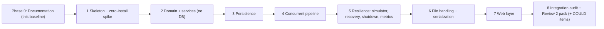

# Implementation Roadmap

**Status:** Planned. All checkboxes are unticked. A box is ticked only when the task is done **and** the supporting output is in [EVIDENCE.md](EVIDENCE.md).
**Related:** [SRS](SRS.md) · [SDD](SDD.md) · [TRACEABILITY](TRACEABILITY.md) · [TESTING_STRATEGY](TESTING_STRATEGY.md) · [../CLAUDE.md](../CLAUDE.md)

---

## 0. How phases work

### 0.1 Dependency graph



Strictly sequential: a phase starts only after the previous phase's exit gate is evidenced **and the user has approved** moving on.

### 0.2 Protocol for every phase (copy into the phase's first message)
**Start**
- [ ] Read `CLAUDE.md`, this phase's section, the SRS rows (TRACEABILITY rows whose *Phase* = this phase) and the SDD sections they reference.
- [ ] Report any conflict between documents and the plan **before** coding.
- [ ] `git status` clean; on branch `claude/cloud-kitchen-orchestration-7d1aok`.
- [ ] Resolve the **approvals** listed for the phase.

**During**
- [ ] Scope fence: do only this phase's tasks. If something from a later phase is needed, stop and report.
- [ ] Tests are written with (or before) the code they prove.
- [ ] Never commit secrets; never require a system installation.

**End (exit gate)**
- [ ] Every exit criterion met.
- [ ] Every gate command run; real output pasted into EVIDENCE.md (phase, command, output, date).
- [ ] TRACEABILITY.md statuses updated (`Done (<hash>)`).
- [ ] Viva notes filled in JAVA_CONCEPT_MAPPING.md §3 for this phase.
- [ ] Decision log updated if anything was settled (PROJECT_OVERVIEW §6.5).
- [ ] Secret scan (G-SECRET) clean.
- [ ] Commit(s) pushed to the designated branch; local tag `phase-<n>-complete` created (tag push only with user approval, A-12).
- [ ] Short phase report to the user; **stop and wait for approval**.

### 0.3 Common gate commands

| ID | Command (Windows: `mvnw.cmd`) | Expected |
|---|---|---|
| G-BUILD | `./mvnw -q clean verify` | Exit code 0, all tests green |
| G-BUILD-x3 | run G-BUILD three times in a row (phases 4-8) | Exit code 0 each time |
| G-SECRET | `git ls-files \| grep -E '^(data\|logs\|snapshots\|reports)/\|^config/application\.properties$'` and `git grep -nIE '(password\|secret)[[:space:]]*[:=][[:space:]]*"[^"]+"' -- src/main` | Both print nothing |
| G-TREE | `git status --short` | Only intended files |
| G-TAG | `git tag -a phase-<n>-complete -m "Phase <n> complete"` | Tag exists locally |

The exact test-selection commands per phase are listed in each section. Final command forms are confirmed in Phase 1 and recorded in CLAUDE.md.

---

## Phase 1: Skeleton + zero-install spike

**Goal:** prove the whole zero-install stack works before any domain code exists, and settle the driver and packaging decisions.
**Depends on:** documentation baseline approved.
**Approvals needed first:** A-01 (internet on first build), A-02 (native DB binary, no system packages), A-03/D-018 (wrapper fetch), A-04 (append to `.gitignore`), A-14 (dependency interpretation).

### Tasks
- [ ] 1.1 `pom.xml`: `packaging=war`, `maven.compiler.release=17`, UTF-8; pinned versions (A-10) for tomcat-embed-core, tomcat-embed-jasper (10.1.x), Jakarta Servlet/JSP/JSTL API + JSTL implementation, HikariCP, MySQL Connector/J, MariaDB4j (+ platform DB artifacts), SLF4J, Logback, JUnit 5; plugins: compiler, surefire (JUnit platform, `forkCount=1`), war, exec (mainClass `com.cloudkitchen.bootstrap.Launcher`, `classpathScope` per D-017), resources.
- [ ] 1.2 Maven Wrapper: `mvnw`, `mvnw.cmd`, `.mvn/wrapper/maven-wrapper.properties` ("only-script"), executable bit on `mvnw`; `.gitattributes` (`mvnw` LF, `mvnw.cmd` CRLF).
- [ ] 1.3 Append to `.gitignore` (A-04): `target/`, `data/`, `logs/`, `snapshots/`, `reports/`, `config/application.properties`, `*.ser`, `.idea/`, `*.iml`, `.vscode/`, `.DS_Store`.
- [ ] 1.4 `config/application.properties.example` (placeholders only; startup rejects placeholders for secrets) and a minimal `AppConfig` sufficient for the spike.
- [ ] 1.5 Package skeleton: directories and `package-info.java` for every package in [SDD §3](SDD.md) (one-line Javadoc each); `src/main/resources/logback.xml`.
- [ ] 1.6 Throwaway-but-kept spike code: `Launcher` (embedded Tomcat, port from config, `addWebapp`, `/spike.jsp` using JSTL, a plain servlet), `DbBootstrap` (MariaDB4j start/stop, data dir `./data`), `web.xml` with two ordered filters and a listener.
- [ ] 1.7 Spike tests `DbSpikeTest` and `EmbeddedTomcatSpikeTest` covering checklist S-01..S-16 (below); run `DbSpikeTest` once per candidate driver.
- [ ] 1.8 Decide the driver (D-002), packaging approach (D-017), wrapper (D-018), config hand-off (O-3); record versions and decisions with dates in PROJECT_OVERVIEW §6.5.
- [ ] 1.9 Record the actual first-run requirements (downloads, any OS libraries) in EVIDENCE.md and update assumptions A-01/A-02 to facts.
- [ ] 1.10 Fill in CLAUDE.md "Build / run / test commands" with the commands proven in this phase.

### Spike checklist (each item pass/fail with evidence)
| ID | Check |
|---|---|
| S-01 | `./mvnw -v` works on a machine with only JDK 17+ and Git (wrapper downloads Maven) |
| S-02 | MariaDB4j starts, creates `./data/...`, stops cleanly, leaves no orphan `mysqld`; a second start reuses the data |
| S-03 | HikariCP + MySQL Connector/J connects to it (then repeat with MariaDB Connector/J) |
| S-04 | utf8mb4 round trip of Hindi text and an emoji |
| S-05 | `DECIMAL(10,2)` <-> `BigDecimal` exact (0.01, 19.99, 99999999.99) |
| S-06 | `DATETIME(3)` UTC round trip, identical with `-Duser.timezone=Asia/Kolkata` |
| S-07 | Conditional `UPDATE` row-count semantics (1 vs 0) and `SELECT ... FOR UPDATE` |
| S-08 | `RETURN_GENERATED_KEYS` works |
| S-09 | Duplicate key error: SQLState `23000`, vendor code `1062` |
| S-10 | Two crossing transactions produce a deadlock with SQLState `40001` / code `1213` (observed with each driver) |
| S-11 | `CHECK` constraint enforced (negative `stock_qty` insert fails) |
| S-12 | `CREATE TABLE IF NOT EXISTS`, `utf8mb4_bin` column and `utf8mb4_unicode_ci` default accepted; multi-statements off |
| S-13 | Embedded Tomcat on port 0: servlet + JSP with JSTL render via `HttpClient`; filter order from `web.xml` is respected; `SessionCookieConfig.setAttribute("SameSite","Lax")` appears in `Set-Cookie`; a servlet-context attribute set by `Launcher` is visible in the listener; error-report valve can hide details |
| S-14 | `./mvnw exec:java` classpath works with the chosen scopes; Ctrl+C runs the shutdown hook and stops the DB |
| S-15 | `./mvnw package` WAR contains JSTL implementation, driver, Hikari, Logback and **no** `tomcat-embed-*` / `mariaDB4j` jars |
| S-16 | PBKDF2WithHmacSHA256 with 600,000 iterations measured (ms) on this machine |

### Exit criteria
- [ ] S-01..S-16 all pass, or any failure has a decision recorded with the user's approval via the fallback ladder (PROJECT_OVERVIEW §6.3).
- [ ] Driver chosen and recorded; DAO plan unchanged.
- [ ] No system software was installed; first-run requirements documented.
- [ ] `.gitignore` additions in place; secret scan clean.
- [ ] CLAUDE.md commands filled in.

### Gate commands
```
./mvnw -v
./mvnw -q clean verify
./mvnw -q test -Dtest='DbSpikeTest,EmbeddedTomcatSpikeTest'
./mvnw -q package && jar tf target/*.war | grep -Ei 'tomcat-embed|mariadb4j|jstl|HikariCP|connector|logback'
./mvnw exec:java        # then open http://localhost:8080/spike.jsp and press Ctrl+C
```
Plus G-SECRET, G-TREE, G-TAG (`phase-1-complete`).

**Requirements verified:** FR-ENV-01, FR-ENV-02, FR-ENV-03, NFR-SEC-01, NFR-PORT-01 (plus spike inputs to FR-ENV-04).

---

## Phase 2: Domain + services (no DB)

**Goal:** all pure-Java logic with unit tests; nothing touches a database or a servlet.
**Depends on:** Phase 1.

### Tasks
- [ ] 2.1 `domain.enums`: `OrderStatus` (transition table, `canTransitionTo`, `requireTransitionTo`, `allowedTargets`, `isTerminal`, `nonTerminal`, `isStockRestorableTo`), `OrderSource`, `PaymentMode` (`allowedFor`), `PaymentStatus`, `Role`, `WorkerState`.
- [ ] 2.2 `domain.contract`: `Trackable`, `Payable`.
- [ ] 2.3 `domain`: `Order` (abstract), `SwiggyOrder`, `ZomatoOrder`, `InHouseOrder`, `OrderItem`, `OrderFactory`, `PaymentResult`, `StatusHistoryEntry`, `Station`, `MenuItem`, `StockLevel`, `StaffUser`.
- [ ] 2.4 `exception`: full hierarchy ([SDD §4.2](SDD.md)).
- [ ] 2.5 `dto`: `OrderRequest`, `OrderItemRequest`, `SubmissionResult`, `ValidationResult`, `FieldError`, `SessionUser`, `OrderFilter`, `Page<T>`, `OrderSummary`, `StockRow`, `ReportRow`, `DashboardView`, `StationView`, `WorkerView`, `MetricsView`.
- [ ] 2.6 `util`: `MoneyUtil` (overloads), `TimeUtil` (UTC helpers).
- [ ] 2.7 `service`: `OrderValidator` (VR-01..VR-14), `MenuCatalog`, `RoutingService`, `PasswordHasher`, `LockoutPolicy`.
- [ ] 2.8 `pipeline`: `InFlightRegistry`, `MetricsRegistry`, `OrderDispatcher` (interface only).
- [ ] 2.9 `io`: `OrderEventLog` (interface), `NoOpOrderEventLog`, `EventType`.
- [ ] 2.10 `dao`: DAO **interfaces** only (signatures per [SDD §5.2](SDD.md)).
- [ ] 2.11 `config.AppConfig`: full typed loader, defaults, validation, secret masking.
- [ ] 2.12 Tests: `OrderStatusTest`, `OrderPolymorphismTest`, `OrderFactoryTest`, `OrderValidatorTest`, `MoneyUtilTest`, `PasswordHasherTest`, `LockoutPolicyTest`, `RoutingServiceTest`, `InFlightRegistryTest`, `MetricsRegistryTest`, `AppConfigTest`, `ArchitectureRulesTest`.

### Exit criteria
- [ ] All Phase 2 tests pass; `OrderStatusTest` covers all 81 pairs.
- [ ] Tests run with **no database started** (no `mysqld` process, no network).
- [ ] `ArchitectureRulesTest` green.
- [ ] Formulas in SDD §4.4 match the code (or the SDD is updated with approval).

### Gate commands
```
./mvnw -q clean verify
./mvnw -q test -Dtest='OrderStatusTest,OrderPolymorphismTest,OrderFactoryTest,OrderValidatorTest,MoneyUtilTest,PasswordHasherTest,LockoutPolicyTest,RoutingServiceTest,InFlightRegistryTest,MetricsRegistryTest,AppConfigTest,ArchitectureRulesTest'
pgrep -fl 'mysqld|mariadbd' || echo "no database process"
```
Plus G-SECRET, G-TREE, G-TAG (`phase-2-complete`).

**Requirements verified:** FR-ENV-05, FR-ORD-02, -03, -05, -06; FR-LIF-01, -02, -06; FR-RTE-01; FR-CON-09; FR-AUT-01; NFR-MNT-01.

---

## Phase 3: Persistence

**Goal:** schema, DAOs, transactions, TX1, transitions with conditional stock restore, authentication with lockout, all tested against the real embedded database.
**Depends on:** Phase 2 and the driver decision (D-002).

### Tasks
- [ ] 3.1 `V001__schema.sql`, `V002__seed_reference_data.sql` per [DATABASE_DESIGN](DATABASE_DESIGN.md); `SchemaInitializer`.
- [ ] 3.2 `db`: `DataSourceFactory`, `Database` (`inTransaction` + overload, `withConnection`, deadlock retry), `TxWork<T>`, `SqlErrors`.
- [ ] 3.3 `bootstrap.DbBootstrap` (final form), `bootstrap.UserSeeder`.
- [ ] 3.4 `dao.jdbc`: `JdbcStationDao`, `JdbcMenuItemDao`, `JdbcStockDao`, `JdbcOrderDao`, `JdbcStatusHistoryDao`, `JdbcStaffUserDao` (prepared statements only, batch item insert, UTC timestamps).
- [ ] 3.5 `service.OrderService` (`submitOrder` with TX1, `transition` + overload, `cancelOrder`, `failOrder`, `setAccepting`) using a **fake `OrderDispatcher`** (always succeeds / always full) because the real orchestrator arrives in Phase 4; events through `NoOpOrderEventLog`.
- [ ] 3.6 `service`: `AuthService` (+ lockout via `LockoutPolicy`), `MenuService`, `StockService`, `OrderQueryService` (read paths needed by tests).
- [ ] 3.7 Test support: `TestDatabase`, `TestData`, `FakeClock`, `TestSupport`.
- [ ] 3.8 Tests: `SqlPortabilityTest`, `SchemaInitializerTest`, `DatabaseTransactionTest`, `DeadlockRetryTest`, `StockDaoTest`, `OrderDaoTest`, `StatusHistoryDaoTest`, `MenuItemDaoTest`, `StaffUserDaoTest`, `OrderServiceTest`, `AuthServiceTest`, `UserSeederTest`.

### Exit criteria
- [ ] All Phase 3 tests pass against embedded MariaDB4j.
- [ ] TX1 rolls back completely on insufficient stock; restore matrix passes; restore exactly once.
- [ ] Lockout works with an injected clock.
- [ ] `ArchitectureRulesTest` still green (no `Connection` fields, only prepared statements).
- [ ] If a MySQL 8 server is available, the schema scripts were applied to it as a manual check; otherwise recorded as *unverified*.

### Gate commands
```
./mvnw -q clean verify
./mvnw -q test -Dtest='SqlPortabilityTest,SchemaInitializerTest,DatabaseTransactionTest,DeadlockRetryTest,StockDaoTest,OrderDaoTest,StatusHistoryDaoTest,MenuItemDaoTest,StaffUserDaoTest,OrderServiceTest,AuthServiceTest,UserSeederTest'
./mvnw -q test -Dtest='DeadlockRetryTest' -Duser.timezone=Asia/Kolkata
```
Plus G-SECRET, G-TREE, G-TAG (`phase-3-complete`).

**Requirements verified:** FR-ENV-04, FR-ENV-06, FR-ORD-01, -07, FR-LIF-03, -05, FR-INV-01..07, FR-RTE-02 (service side), FR-CON-06, FR-AUT-05, -07, NFR-SEC-02, -03.

---

## Phase 4: Concurrent pipeline

**Goal:** queues, workers and orchestrator working under concurrency with proven safety properties.
**Depends on:** Phase 3.

### Tasks
- [ ] 4.1 `pipeline`: `NamedThreadFactory`, `StationRuntime`, `StationWorker` (loop, claim with retry, resumable `processOrder`, pause/resume, `WorkerState`, interrupt handling), `OrderOrchestrator` (`start`, `dispatch`, `enqueueRecovered`, `pause`, `resume`, `stationViews`, basic stop).
- [ ] 4.2 Wire `OrderService` to the real `OrderDispatcher`; queue-full compensation (TX4); metrics and in-flight guard integrated in `submitOrder`.
- [ ] 4.3 Test doubles: `BlockingOrderDispatcher`, `AlwaysFullOrderDispatcher`, failing-step injector for `WorkerResilienceTest`.
- [ ] 4.4 Tests: `OrderOrchestratorTest`, `StationWorkerTest`, `QueueFullCompensationTest`, `StockDeductionConcurrencyTest`, `DuplicateSubmissionConcurrencyTest`, `ConditionalTransitionRaceTest`, `CancelVsWorkerRaceTest`, `WorkerResilienceTest`, `WorkerInterruptTest` (concurrency tests `@RepeatedTest(20)`).

### Exit criteria
- [ ] All concurrency tests 20/20, three consecutive full builds green.
- [ ] Thread names `station-<code>-worker` observed; no leaked threads.
- [ ] Stock invariant checker passes after each concurrency test.
- [ ] No `Thread.sleep` used for synchronisation in tests.

### Gate commands
```
./mvnw -q clean verify        # x3
./mvnw -q test -Dtest='OrderOrchestratorTest,StationWorkerTest,QueueFullCompensationTest,StockDeductionConcurrencyTest,DuplicateSubmissionConcurrencyTest,ConditionalTransitionRaceTest,CancelVsWorkerRaceTest,WorkerResilienceTest,WorkerInterruptTest'
```
Plus G-SECRET, G-TREE, G-TAG (`phase-4-complete`).

**Requirements verified:** FR-ORD-04, FR-RTE-02, FR-CON-01..08, -10, FR-LIF-03 (race), FR-INV-06 (race), NFR-REL-02.

---

## Phase 5: Resilience (simulator, recovery, shutdown, metrics)

**Goal:** the system survives crashes, restarts and shutdown; operators can generate load.
**Depends on:** Phase 4.

### Tasks
- [ ] 5.1 `pipeline.FeedSimulator` (`start`, `stop`, `setRate`, `isRunning`, `produced`).
- [ ] 5.2 `pipeline.RecoveryService` (DB part: reload non-terminal orders, enqueue oldest first with blocking put on `recovery-loader`; snapshot hook left as a no-op interface point for Phase 6).
- [ ] 5.3 `pipeline.ShutdownCoordinator` (ordered idempotent steps, JVM hook, drain + `awaitTermination` + `shutdownNow`), orchestrator `shutdownGracefully`.
- [ ] 5.4 `bootstrap.AppContext` (full manual wiring per [SDD §2.4](SDD.md), start/close, recovery latch, `accepting` handling). `Launcher` remains the Phase 1 spike launcher.
- [ ] 5.5 `MetricsRegistry` finalised and invariant checked; `DashboardService` data side (`stationViews`, metrics view) available.
- [ ] 5.6 Tests: `FeedSimulatorTest`, `RecoveryServiceTest`, `ResumableProcessingTest`, `ShutdownCoordinatorTest`, `GracefulShutdownTest`, `MetricsInvariantTest`.

### Exit criteria
- [ ] Recovery after abrupt stop proven (orders in every non-terminal status complete after restart).
- [ ] Shutdown triggered twice runs once; bounded by configured timeouts; no leaked threads.
- [ ] Metrics invariant holds at quiescence.
- [ ] Three consecutive full builds green; concurrency tests 20/20.

### Gate commands
```
./mvnw -q clean verify        # x3
./mvnw -q test -Dtest='FeedSimulatorTest,RecoveryServiceTest,ResumableProcessingTest,ShutdownCoordinatorTest,GracefulShutdownTest,MetricsInvariantTest'
```
Plus G-SECRET, G-TREE, G-TAG (`phase-5-complete`).

**Requirements verified:** FR-RES-01..04, FR-CON-09 (final), NFR-REL-01 (service level), NFR-REL-03.

---

## Phase 6: File handling + serialization

**Goal:** structured log, CSV export, and signed/filtered snapshots integrated with recovery and shutdown.
**Depends on:** Phase 5.

### Tasks
- [ ] 6.1 `io.NioOrderEventLog` (NIO append-only, lock, sanitising); wire `OrderEventLog` calls at every event point in services/pipeline; production wiring in `AppContext`.
- [ ] 6.2 `io.CsvReportExporter`, `service.ReportService`.
- [ ] 6.3 `snapshot.OrderSnapshotDTO`, `HmacSigner`, `SnapshotFilterFactory`, `SnapshotService` (`writeSnapshot`, `readLatestValid`, `recoverMissingOrders`, `pruneOld`), `SnapshotTask`.
- [ ] 6.4 Integrate: `RecoveryService` calls `recoverMissingOrders()`; `ShutdownCoordinator` final snapshot step; periodic task started after recovery.
- [ ] 6.5 `logback.xml` finalised (thread name in pattern; no PII).
- [ ] 6.6 Documentation check: SDD §9 contains rationale, risks and versioning; confirm the allowlist pattern in the code and update SDD §9.4 if it differs.
- [ ] 6.7 Tests: `NioOrderEventLogTest`, `OrderEventLogConcurrencyTest`, `NoPiiInLogsTest`, `CsvReportExporterTest`, `HmacSignerTest`, `SnapshotRoundTripTest`, `SnapshotTamperTest`, `SnapshotFilterTest`, `SnapshotRecoveryTest`, `SnapshotTaskTest`.

### Exit criteria
- [ ] Tamper and filter tests prove rejection **before** deserialization.
- [ ] No PII/secret in any log output of a full run.
- [ ] `ObjectInputStream` appears only in package `snapshot` (`ArchitectureRulesTest`).
- [ ] Three consecutive full builds green; concurrency tests 20/20.
- [ ] FR-SER-07 documentation review ticked.

### Gate commands
```
./mvnw -q clean verify        # x3
./mvnw -q test -Dtest='NioOrderEventLogTest,OrderEventLogConcurrencyTest,NoPiiInLogsTest,CsvReportExporterTest,HmacSignerTest,SnapshotRoundTripTest,SnapshotTamperTest,SnapshotFilterTest,SnapshotRecoveryTest,SnapshotTaskTest'
git grep -n "ObjectInputStream" -- src/main
```
Plus G-SECRET, G-TREE, G-TAG (`phase-6-complete`).

**Requirements verified:** FR-FIL-01..04, FR-SER-01..07, FR-RES-05, NFR-OBS-01.

---

## Phase 7: Web layer

**Goal:** the complete MVC web application (MUST and SHOULD items) on embedded Tomcat and in the WAR.
**Depends on:** Phase 6 (and Phase 5 `AppContext`).

### Tasks
- [ ] 7.1 `web.xml` (servlets, filter order, listener, session config, error pages, `jsp-config`), `AppBootstrapListener`, final `Launcher` (replaces spike behaviour; spike JSP removed or moved under `test`).
- [ ] 7.2 `web.support`: `BaseServlet`, `CsrfTokens`, `Flash`, `RoutePolicy`.
- [ ] 7.3 `web.filter`: `EncodingFilter`, `SecurityHeadersFilter`, `CsrfFilter`, `AuthFilter`, `RoleFilter`.
- [ ] 7.4 Controllers (MUST): `HomeServlet`, `ErrorServlet`, `LoginServlet`, `LogoutServlet`, `DashboardServlet`, `OrderListServlet`, `OrderDetailServlet`, `OrderCancelServlet`, `InventoryServlet`, `SimulatorServlet`.
- [ ] 7.5 Controllers (SHOULD): `OrderCreateServlet`, `AdminMenuServlet`, `AdminStockServlet`, `WorkerPanelServlet`, `ReportServlet`, `SnapshotServlet`; `DashboardService` and `MenuService`/`StockService` admin methods.
- [ ] 7.6 Views: JSPs, tag files, `app.css`; error pages; escaping everywhere; no scriptlets.
- [ ] 7.7 `TestApp`, `HttpTestClient`.
- [ ] 7.8 Tests: `LoginFlowWebTest`, `LockoutWebTest`, `SessionSecurityWebTest`, `CsrfWebTest`, `RoleAccessWebTest`, `OrderPrgWebTest`, `OrderDetailWebTest`, `DashboardWebTest`, `ErrorPagesWebTest`, `EncodingWebTest`, `SimulatorWebTest`, `AdminMenuStockWebTest`, `ReportWebTest`, `WorkerPanelWebTest`, `SecurityHeadersWebTest`, `XssEscapingWebTest`.
- [ ] 7.9 Manual usability checklist (NFR-USA-01) executed and recorded.

### Exit criteria
- [ ] `RoleAccessWebTest` covers every route in SDD §10.2 for all three actors.
- [ ] CSRF test covers every POST route.
- [ ] Error pages leak nothing.
- [ ] `./mvnw exec:java` serves the full UI; manual smoke (login, simulator start, dashboard refresh, cancel, logout) recorded.
- [ ] WAR contains no embedded-server jars (`jar tf`).
- [ ] Three consecutive full builds green.

### Gate commands
```
./mvnw -q clean verify        # x3
./mvnw -q test -Dtest='*WebTest'
./mvnw -q package && jar tf target/*.war | grep -Ei 'tomcat-embed|mariadb4j' || echo "no embedded server jars in WAR"
./mvnw exec:java              # manual smoke, then Ctrl+C; capture log tail showing ordered shutdown
```
Plus G-SECRET, G-TREE, G-TAG (`phase-7-complete`).

**Requirements verified:** FR-ORD-08, FR-LIF-04, FR-LIF-05 (UI), FR-INV-07 (UI), FR-INV-08, -09, FR-CON-10 (UI), FR-CON-11, FR-AUT-02, -03, -04, -06, -08, FR-WEB-01..10, -12, -13, NFR-USA-01.

---

## Phase 8: Integration audit + Review 2 pack

**Goal:** prove the whole system, close every gap, produce the review material. COULD items only if everything above is green.
**Depends on:** Phase 7.

### Tasks
- [ ] 8.1 Traceability audit: every MUST row `Done (<hash>)` with evidence; every SHOULD `Done` or `Deferred (<reason>)`; any `Conflict` resolved with the user.
- [ ] 8.2 Integration tests: `EndToEndLifecycleTest`, `CrashRecoveryTest`, `ThroughputSmokeTest`, `LauncherSmokeTest`.
- [ ] 8.3 Manual real crash drill: run the app, start the simulator, `kill -9` the JVM, restart, verify no accepted order is lost (queries + orders.log + dashboard); record in EVIDENCE.md.
- [ ] 8.4 Manual 5-minute load run at 60 orders/min; record metrics (NFR-PERF-01).
- [ ] 8.5 Security checklist walk-through (SDD §12.9) with evidence; secret scan over full history (`git log -p | grep` patterns) recorded.
- [ ] 8.6 Portability: run on the other available OS or mark unverified; MySQL 8 manual check or mark unverified; standalone Tomcat 10.1 WAR deployment check or mark unverified (NFR-PORT-01).
- [ ] 8.7 Concept coverage review: JAVA_CONCEPT_MAPPING checklist ticked with evidence; viva notes complete.
- [ ] 8.8 **COULD items** (only now, only if 8.1-8.7 are green): order search (FR-ORD-09), public tracking (FR-ORD-10), admin password reset (FR-AUT-09), dashboard charts (FR-WEB-11) with their tests (`OrderSearchWebTest`, `PublicTrackingWebTest`, `AdminPasswordResetWebTest`; charts covered in `DashboardWebTest`).
- [ ] 8.9 Review 2 pack, created now as `docs/REVIEW2_PACK.md`: architecture one-pager, demo script (step-by-step with expected output), evidence index, requirement coverage summary, known limitations, viva Q&A pulled from the notes.
- [ ] 8.10 `README.md` Quick start section appended (with user consent, A-08).
- [ ] 8.11 Final tags: `phase-8-complete` and `review2-ready`.

### Exit criteria
- [ ] Three consecutive `./mvnw -q clean verify` green on a **fresh clone** (clone to a new folder, run the commands from the README only).
- [ ] All concurrency tests 20/20 in the final run.
- [ ] Every MUST requirement `Done`; unverified platforms/environments declared honestly.
- [ ] Review 2 pack complete and consistent with EVIDENCE.md.

### Gate commands
```
git clone <repo> /tmp/fresh-clone && cd /tmp/fresh-clone && git checkout claude/cloud-kitchen-orchestration-7d1aok
./mvnw -q clean verify        # x3
./mvnw -q test -Dtest='EndToEndLifecycleTest,CrashRecoveryTest,ThroughputSmokeTest,LauncherSmokeTest'
./mvnw -q package && jar tf target/*.war | grep -Ei 'tomcat-embed|mariadb4j' || echo "no embedded server jars in WAR"
git grep -nIE '(password|secret)[[:space:]]*[:=][[:space:]]*"[^"]+"' -- src/main
```
Plus G-SECRET, G-TREE, G-TAG.

**Requirements verified:** NFR-REL-01 (full), NFR-PERF-01, NFR-PORT-01, NFR-TST-01, NFR-MNT-02, and the COULD requirements if implemented.

---

## Master checklist (tick when the phase gate is evidenced and approved)

- [ ] Phase 0 documentation baseline approved
- [ ] Phase 1 Skeleton + zero-install spike
- [ ] Phase 2 Domain + services (no DB)
- [ ] Phase 3 Persistence
- [ ] Phase 4 Concurrent pipeline
- [ ] Phase 5 Resilience
- [ ] Phase 6 File handling + serialization
- [ ] Phase 7 Web layer
- [ ] Phase 8 Integration audit + Review 2 pack
