# Software Design Document (SDD)

**Project:** Cloud Kitchen Orchestration System
**Status:** Planned design. Nothing is implemented. Class, method, table and route names below are the names the code must use.
**Related:** [SRS](SRS.md) · [DATABASE_DESIGN](DATABASE_DESIGN.md) · [JAVA_CONCEPT_MAPPING](JAVA_CONCEPT_MAPPING.md) · [TRACEABILITY](TRACEABILITY.md) · [TESTING_STRATEGY](TESTING_STRATEGY.md)

Section numbers are referenced from other documents (for example "SDD §7.4"); do not renumber without updating them.

---

## 1. Introduction

### 1.1 Goals of the design
1. Prove the mandatory Java concepts in a real, working system (see [JAVA_CONCEPT_MAPPING](JAVA_CONCEPT_MAPPING.md)).
2. Be correct under concurrency: no oversold stock, no duplicate orders, no lost orders, no double side effects.
3. Be runnable with zero system installs (embedded Tomcat + embedded MariaDB4j) yet portable to standalone Tomcat 10.1 and MySQL 8.
4. Keep the design small enough for one developer: manual wiring (no DI framework), plain JDBC, one process.

### 1.2 Conventions
* Root package `com.cloudkitchen`. Class names are `UpperCamelCase`; methods/fields `lowerCamelCase`; constants `UPPER_SNAKE`; SQL identifiers `lower_snake`; config keys `lower.dotted`.
* Entities are classic classes (private fields, constructor validation, getters, no public setters for identity fields). Read-only views and results are Java `record`s.
* Time is always `java.time.Instant` in memory and UTC in the database; a `java.time.Clock` is injected wherever "now" matters.
* Money is `BigDecimal` with scale 2 and `RoundingMode.HALF_UP`, created only through `MoneyUtil`.
* "Orchestrator" means `OrderOrchestrator`. "Station" means a kitchen station; there is exactly one per brand, identified by `code` (e.g. `BIRYANI`).

---

## 2. Architecture

### 2.1 Architecture diagram

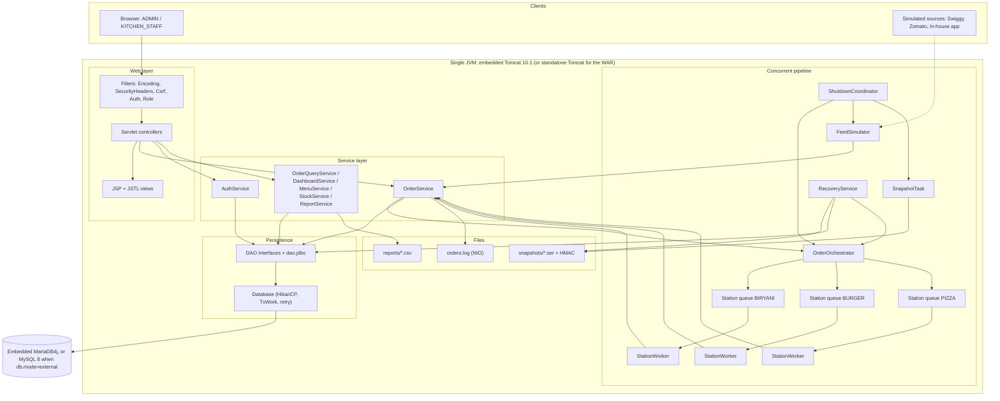

### 2.2 Layers and dependency rules

| Layer | Packages | May depend on | Must not depend on |
|---|---|---|---|
| Web (controller + view) | `web.controller`, `web.filter`, `web.listener`, `web.support`, JSPs | `service`, `dto`, `domain` (read-only), `pipeline` views via `DashboardService` | `dao`, `db`, `java.sql` |
| Service | `service` | `dao`, `db`, `domain`, `dto`, `exception`, `pipeline.OrderDispatcher`, `pipeline.InFlightRegistry`, `pipeline.MetricsRegistry`, `io.OrderEventLog` | `jakarta.servlet.*` |
| Pipeline | `pipeline` | `service` (`OrderService`), `domain`, `dto`, `io.OrderEventLog` | `jakarta.servlet.*`, `java.sql` (uses services) |
| Persistence | `dao`, `dao.jdbc`, `db` | `domain`, `exception`, `java.sql` | `service`, `web`, `pipeline` |
| Domain | `domain`, `domain.enums`, `domain.contract`, `exception` | JDK only | everything else |
| Cross-cutting | `config`, `util`, `io`, `snapshot`, `bootstrap` | as needed; `snapshot` and `bootstrap` may use `java.sql` through `db.Database` | `web` (except `bootstrap.Launcher` which starts Tomcat) |

Enforced mechanically by `ArchitectureRulesTest` (NFR-MNT-01).

### 2.3 Component diagram

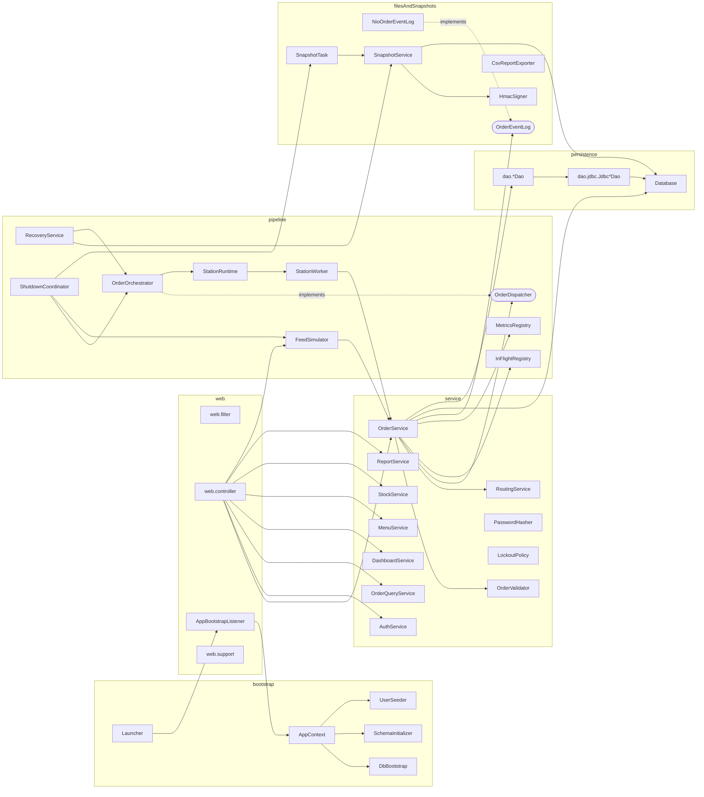

Note on the service/pipeline cycle: `OrderService` depends on the *interface* `OrderDispatcher`; `OrderOrchestrator` implements it and also depends on `OrderService` (used by workers). The cycle is broken at construction time: `AppContext` creates the orchestrator first, passes it to `OrderService` as an `OrderDispatcher`, then calls `orchestrator.start(orderService, stations)` (see §2.4).

### 2.4 Startup and composition (`AppContext`)

Manual wiring, in this order (each step logs at INFO). Any failure aborts startup after cleaning up what was already started.

1. `AppConfig` loaded and validated (`AppConfig.load()`; the embedded launcher may pass an instance through servlet-context attribute `ck.config`; tests build one with `AppConfig.fromProperties(...)`).
2. `DbBootstrap.start(config)` if `db.mode=embedded` (MariaDB4j child process, data in `./data`); no-op if `external`.
3. `DataSourceFactory.create(config)` -> HikariCP pool; `Database` facade created.
4. `SchemaInitializer.apply()` runs `V001__schema.sql`, `V002__seed_reference_data.sql` once (`schema_version`).
5. `UserSeeder.seedIfEmpty()` creates initial users from config (hash with `PasswordHasher`).
6. Create `MetricsRegistry`, `InFlightRegistry`, `NioOrderEventLog`, `RoutingService` (loaded from `StationDao`), DAOs.
7. Create `OrderOrchestrator` (queues + executor not yet running), then `OrderService(…, dispatcher = orchestrator, …)`, then `orchestrator.start(orderService)` which creates the `StationWorker`s.
8. `SnapshotService`, `SnapshotTask` (not yet scheduled), `FeedSimulator` (idle), query/report/menu/stock services.
9. `ShutdownCoordinator` created with the ordered step list (§7.6); JVM hook installed.
10. `RecoveryService.recover()` runs on thread `recovery-loader`; `OrderService.accepting` stays false until all recovered ids are enqueued (UI shows "Recovering"); then `SnapshotTask.start()` and `accepting = true`.
11. Web layer: `AppBootstrapListener.contextInitialized` performs steps 1-10 and stores the `AppContext` in servlet-context attribute `ck.app`; servlets fetch services from it. `contextDestroyed` calls `ShutdownCoordinator.shutdown()`.

`Launcher` (embedded mode) only: loads `AppConfig`, creates `Tomcat` (port from `server.port`, 0 allowed for tests), `addWebapp("", docBase)` with `target/classes` mapped to `/WEB-INF/classes`, optionally puts the config in the context attribute, starts Tomcat and blocks in `server.await()`. For the WAR on standalone Tomcat the same listener runs and loads `AppConfig` from `-Dck.config` or `config/application.properties` relative to the working directory (documented in the README at Phase 8).

Filter and servlet registration is declared in `web.xml` (not annotations) because filter order is only deterministic from the descriptor, and the same descriptor works embedded and in the WAR. Phase 1 verifies this with the spike.

---

## 3. Package structure

```
com.cloudkitchen
├── bootstrap          Launcher, DbBootstrap, SchemaInitializer, UserSeeder, AppContext
├── config             AppConfig
├── domain             Order (abstract), SwiggyOrder, ZomatoOrder, InHouseOrder, OrderItem, OrderFactory,
│                      PaymentResult, StatusHistoryEntry, Station, MenuItem, StockLevel, StaffUser
├── domain.enums       OrderStatus, OrderSource, PaymentMode, PaymentStatus, Role, WorkerState
├── domain.contract    Trackable, Payable
├── exception          CloudKitchenException, ValidationException, InvalidStatusTransitionException,
│                      InsufficientStockException, DuplicateOrderException, QueueFullException,
│                      PersistenceException, AuthenticationException, AccountLockedException,
│                      SnapshotIntegrityException, ConfigurationException
├── dto                OrderRequest, OrderItemRequest, SubmissionResult, ValidationResult, FieldError,
│                      SessionUser, OrderFilter, Page<T>, OrderSummary, StockRow, ReportRow,
│                      DashboardView, StationView, WorkerView, MetricsView
├── dao                StationDao, MenuItemDao, StockDao, OrderDao, StatusHistoryDao, StaffUserDao
├── dao.jdbc           JdbcStationDao, JdbcMenuItemDao, JdbcStockDao, JdbcOrderDao,
│                      JdbcStatusHistoryDao, JdbcStaffUserDao
├── db                 Database, TxWork<T>, DataSourceFactory, SqlErrors
├── service            OrderService, OrderValidator, MenuCatalog, RoutingService, StockService, MenuService,
│                      AuthService, PasswordHasher, LockoutPolicy, OrderQueryService, DashboardService,
│                      ReportService
├── pipeline           OrderDispatcher, OrderOrchestrator, StationRuntime, StationWorker, FeedSimulator,
│                      InFlightRegistry, MetricsRegistry, NamedThreadFactory, RecoveryService,
│                      ShutdownCoordinator
├── io                 OrderEventLog, NioOrderEventLog, NoOpOrderEventLog, EventType, CsvReportExporter
├── snapshot           OrderSnapshotDTO, SnapshotService, HmacSigner, SnapshotFilterFactory, SnapshotTask
├── util               MoneyUtil, TimeUtil
└── web
    ├── controller     ErrorServlet, HomeServlet, LoginServlet, LogoutServlet, DashboardServlet,
    │                  OrderListServlet, OrderDetailServlet, OrderCreateServlet, OrderCancelServlet,
    │                  InventoryServlet, AdminMenuServlet, AdminStockServlet, SimulatorServlet,
    │                  WorkerPanelServlet, ReportServlet, SnapshotServlet, TrackServlet (COULD),
    │                  UserAdminServlet (COULD)
    ├── filter         EncodingFilter, SecurityHeadersFilter, CsrfFilter, AuthFilter, RoleFilter
    ├── listener       AppBootstrapListener
    └── support        BaseServlet, CsrfTokens, Flash, RoutePolicy
```

Non-Java layout:

```
pom.xml                          mvnw  mvnw.cmd  .mvn/wrapper/maven-wrapper.properties
config/application.properties.example     (committed)   config/application.properties (git-ignored)
src/main/resources/db/V001__schema.sql, V002__seed_reference_data.sql
src/main/resources/logback.xml
src/main/webapp/WEB-INF/web.xml
src/main/webapp/WEB-INF/views/**  (layout/header.jspf, layout/footer.jspf, login.jsp, dashboard.jsp,
                                   orders/{list,detail,new}.jsp, inventory/list.jsp, admin/{menu,stock,simulator,workers,reports,users}.jsp,
                                   track.jsp, error/{400,403,404,500}.jsp)
src/main/webapp/static/css/app.css
src/test/java/com/cloudkitchen/...   src/test/java/com/cloudkitchen/testsupport/...
docs/  CLAUDE.md  data/ logs/ snapshots/ reports/ (runtime, git-ignored)
```

---

## 4. Domain design

### 4.1 Class diagram: domain

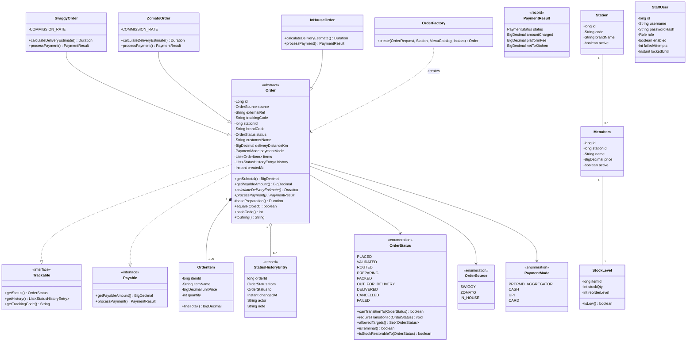

### 4.2 Catalogue of classes, interfaces and enums

Abbreviations: **E** entity class, **V** value/record, **S** service, **I** interface, **En** enum.

#### domain (`domain`, `domain.enums`, `domain.contract`)

| Type | Kind | Responsibility and key members |
|---|---|---|
| `Trackable` | I | `OrderStatus getStatus()`, `List<StatusHistoryEntry> getHistory()`, `String getTrackingCode()` |
| `Payable` | I | `BigDecimal getPayableAmount()`, `PaymentResult processPayment()` |
| `Order` | E, abstract | Common state (see diagram). Constructors: full (used by DAO) and minimal (used by factory), i.e. **overloaded**. Concrete: `getSubtotal()` (sum of `OrderItem.lineTotal()`), `getPayableAmount()`, `basePreparation()` (protected, shared by subclasses), `equals/hashCode` on `(source, externalRef)`, `toString()` (no customer name: PII). Abstract: `Duration calculateDeliveryEstimate()`, `PaymentResult processPayment()`. Collections returned are unmodifiable. |
| `SwiggyOrder`, `ZomatoOrder`, `InHouseOrder` | E | Implement/override the two abstract methods (formulas in §4.4); `toString()` overridden with the source label. |
| `OrderItem` | E | `itemId`, `itemName` (snapshot at order time), `unitPrice`, `quantity`; `lineTotal()`. |
| `OrderFactory` | S (static) | `static Order create(OrderRequest, Station, MenuCatalog, Instant now)`: `switch` on `OrderSource` returning the right subclass; prices copied from the catalogue; generates `trackingCode` and (for IN_HOUSE with blank ref) the external reference. Also `static Order rehydrate(...)` used by DAO/snapshot recovery. |
| `PaymentResult` | V (record) | `status`, `amountCharged`, `platformFee`, `netToKitchen`. |
| `StatusHistoryEntry` | V (record) | One row of `order_status_history`. `from` is null for the initial PLACED row. |
| `OrderStatus` | En | See §4.3. |
| `OrderSource` | En | `SWIGGY`, `ZOMATO`, `IN_HOUSE`; `label()`. |
| `PaymentMode` | En | `PREPAID_AGGREGATOR`, `CASH`, `UPI`, `CARD`; `allowedFor(OrderSource)`. |
| `PaymentStatus` | En | `PENDING`, `PAID`, `FAILED`. |
| `Role` | En | `ADMIN`, `KITCHEN_STAFF`. |
| `WorkerState` | En | `STARTING`, `IDLE`, `PROCESSING`, `PAUSED`, `STOPPING`, `STOPPED`. |
| `Station` | E | One kitchen station = one brand: `id`, `code`, `brandName`, `active`. |
| `MenuItem` | E | `id`, `stationId`, `name`, `price`, `active`. |
| `StockLevel` | E | `itemId`, `stockQty`, `reorderLevel`; `isLow()` is `stockQty <= reorderLevel`. |
| `StaffUser` | E | Login account incl. lockout state; `passwordHash` never rendered or logged (`toString()` omits it). |

#### exception (all checked unless noted)

| Exception | Extends | Thrown when |
|---|---|---|
| `CloudKitchenException` | `Exception` | Base type; carries a stable `code` string. |
| `ValidationException` | base | `OrderValidator.requireValid` fails; holds `List<FieldError>`. |
| `InvalidStatusTransitionException` | base | `OrderStatus.requireTransitionTo` on an illegal pair. |
| `InsufficientStockException` | base | Conditional deduction updates 0 rows; holds `itemId`. |
| `DuplicateOrderException` | base | Unique violation on `(source, external_ref)`; holds existing order id when known. |
| `QueueFullException` | base | Station queue `offer` timed out (or was interrupted); holds station code. |
| `PersistenceException` | base | Wraps `SQLException` (deadlock retries exhausted, connection failure). |
| `AuthenticationException` | base | Bad credentials; message is always the generic text. |
| `AccountLockedException` | `AuthenticationException` | Locked account; internal use, never shown differently. |
| `SnapshotIntegrityException` | base | HMAC mismatch, truncated or filtered snapshot. |
| `ConfigurationException` | `RuntimeException` | Missing/invalid configuration at startup (unchecked: startup-only). |

#### dto (all records unless noted)

| Type | Content |
|---|---|
| `OrderRequest` | Fields in SRS §2.6; compact constructor trims strings; list copied with `List.copyOf`. |
| `OrderItemRequest` | `long itemId`, `int quantity`. |
| `SubmissionResult` | `Outcome outcome` (`ACCEPTED`, `DUPLICATE`, `REJECTED`, `QUEUE_FULL`), `Long orderId` (nullable), `String reasonCode` (`VALIDATION`, `INSUFFICIENT_STOCK`, `TEMPORARY_FAILURE`, `STARTING_UP`, `SHUTTING_DOWN`, `QUEUE_FULL`, null), `List<FieldError> errors`. Static factories `accepted(id)`, `duplicate(id)`, `rejected(reason, errors)`, `queueFull(id)`. |
| `ValidationResult`, `FieldError` | `FieldError(String field, String code, String message)`; `ValidationResult.isValid()`, `errors()`, `merge`. |
| `SessionUser` | `userId`, `username`, `role` (immutable, stored in the HTTP session). |
| `OrderFilter` | `status?`, `source?`, `externalRefContains?`, `fromUtc?`, `toUtc?`. |
| `Page<T>` | **Generic**: `List<T> items`, `int page`, `int pageSize`, `long total`; `totalPages()`. |
| `OrderSummary` | List row: id, source, brandCode, externalRef, status, total, createdAt. |
| `StockRow` | itemId, itemName, brandCode, stockQty, reorderLevel, `low` flag. |
| `ReportRow` | Report columns (no customer data). |
| `DashboardView`, `StationView`, `WorkerView`, `MetricsView` | Snapshot of statuses, queue size/capacity, worker state, current order id, processed count, metric counters and average processing time. |

### 4.3 Order lifecycle state machine (`OrderStatus`)

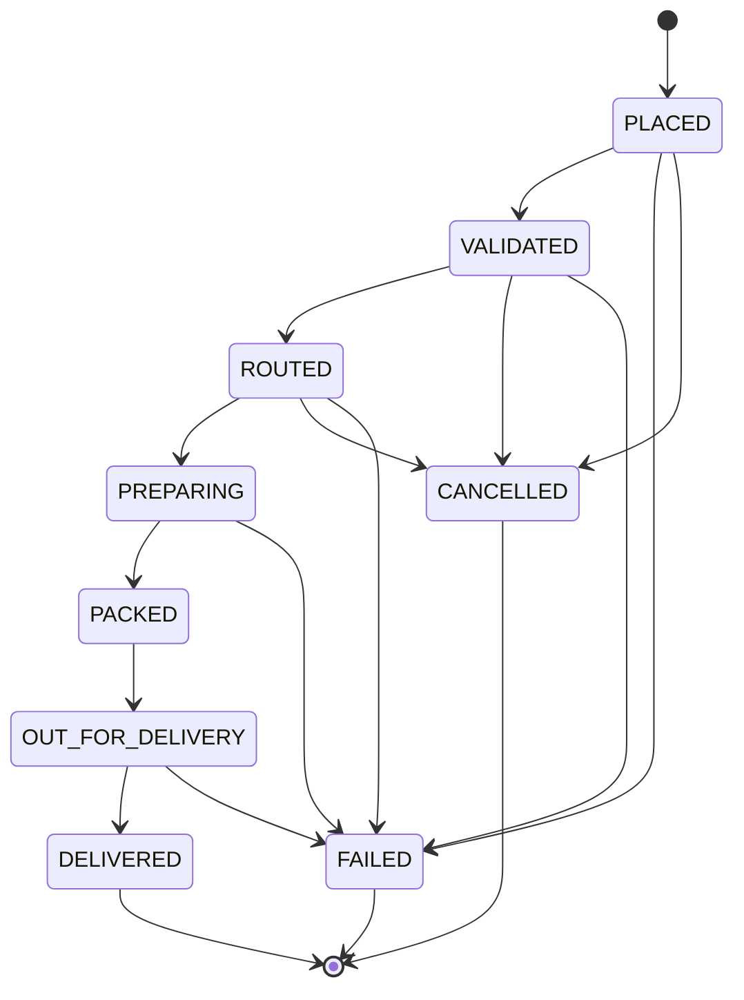

Implementation rules for `OrderStatus`:
* Each constant is declared with its allowed targets (constructor argument or a static `EnumMap<OrderStatus, Set<OrderStatus>>` initialised in a static block). **This is the only place the transition table exists.**
* `canTransitionTo(OrderStatus target)`: membership test. `requireTransitionTo(target)`: throws `InvalidStatusTransitionException(this, target)`. `allowedTargets()`: unmodifiable `EnumSet` copy. `isTerminal()`: `allowedTargets().isEmpty()`.
* `isStockRestorableTo(OrderStatus target)`: true iff `this` is `VALIDATED` or `ROUTED` and `target` is `CANCELLED` or `FAILED`. (`PLACED` never holds stock: it exists only inside TX1 before the deduction commits. `PREPARING` and later never restore.)
* Persisted as the enum `name()` in `VARCHAR(20)`; parsed with `OrderStatus.valueOf` in the DAO.
* Non-terminal statuses (recovery set) = every status except `DELIVERED`, `CANCELLED`, `FAILED` (`OrderStatus.nonTerminal()` returns an `EnumSet`).
* Note: `PLACED -> FAILED|CANCELLED` exist in the locked table. In the planned flow `PLACED` is never committed on its own (TX1 inserts PLACED and moves to VALIDATED in one transaction), so these two edges are reachable only from direct service calls and unit tests. This is deliberate and consistent with the locked decision.

### 4.4 Source-specific behaviour (illustrative formulas, finalised and tested in Phase 2)

Shared in `Order`: `basePreparation()` = 15 minutes + 1 minute per 2 items (integer division of total quantity by 2).

| Source | `calculateDeliveryEstimate()` | `processPayment()` |
|---|---|---|
| `SwiggyOrder` | `basePreparation()` + 5 min hand-off + ceil(4 x km) min | Status `PAID`; `platformFee` = 20% of subtotal (HALF_UP, scale 2); `netToKitchen` = subtotal - fee; `amountCharged` = subtotal |
| `ZomatoOrder` | `basePreparation()` + 7 min hand-off + ceil(3.5 x km) min | Status `PAID`; `platformFee` = 22% of subtotal; same arithmetic |
| `InHouseOrder` | `basePreparation()` + ceil(3 x km) min (own riders, no hand-off) | `platformFee` = 0.00; `PENDING` for `CASH`, `PAID` for `UPI`/`CARD` |

`ceil` is done with `BigDecimal.setScale(0, RoundingMode.CEILING)`. The estimate is stored as `estimated_delivery_at = created_at + estimate`; payment status/fee at creation. Rates are `private static final BigDecimal` constants; changing them is a code change (documented limitation).

---

## 5. Persistence-facing design

### 5.1 `Database` facade (package `db`)

* `DataSourceFactory.create(AppConfig)` builds a `HikariDataSource` (max size `db.pool.max.size`, connection timeout, `connectionInitSql = "SET time_zone = '+00:00'"` and `SET NAMES utf8mb4` if the driver does not already do so; leak detection threshold 30 s in dev).
* `Database` wraps the `DataSource`:
  * `<T> T inTransaction(TxWork<T> work)` and **overload** `inTransaction(TxWork<T> work, int maxRetries)`: borrows a connection, `setAutoCommit(false)`, runs the work, commits; on exception rolls back; on a deadlock (`SqlErrors.isDeadlock`: SQLState `40001` or vendor code `1213`) rolls back, pauses `tx.retry.backoff.ms * attempt` (with interrupt restore) and re-runs the **whole** work up to `tx.retry.max` (3) times; then throws `PersistenceException`. Always restores auto-commit and closes the connection (returns it to the pool).
  * `<T> T withConnection(TxWork<T> work)`: read-only/autocommit work (queries).
  * `void close()`.
* `TxWork<T>`: `@FunctionalInterface interface TxWork<T> { T run(Connection c) throws SQLException, CloudKitchenException; }` (generic functional interface).
* `SqlErrors`: `isDeadlock(SQLException)`, `isDuplicateKey(SQLException)` (SQLState `23000` and vendor code `1062`, also checks the cause chain), `isUnavailable(SQLException)`.
* Rule: no `Connection` is stored in any field or passed between threads (FR-CON-06). DAO methods receive the `Connection` as their first parameter and never commit, roll back or close it.

### 5.2 DAO catalogue (interfaces in `dao`, JDBC implementations in `dao.jdbc`)

All statements are `PreparedStatement`s with bound parameters; `Statement.RETURN_GENERATED_KEYS` for inserts; timestamps bound with a UTC `Calendar`/`Timestamp` helper in `TimeUtil`.

| DAO | Methods (first parameter is always `Connection c`) |
|---|---|
| `StationDao` | `List<Station> findAllActive(c)`, `Optional<Station> findByCode(c, code)`, `Optional<Station> findById(c, id)` |
| `MenuItemDao` | `Map<Long,MenuItem> findByIds(c, Collection<Long>)`, `List<MenuItem> findByStation(c, stationId, boolean activeOnly)`, `List<MenuItem> findAll(c)`, `long insert(c, MenuItem)`, `boolean update(c, id, price, active)` |
| `StockDao` | `boolean deduct(c, itemId, qty)` (conditional UPDATE, true iff 1 row), `void restore(c, itemId, qty)`, `List<StockRow> findAll(c)`, `List<StockRow> findLow(c)`, `void set(c, itemId, stockQty, reorderLevel)`, `Optional<StockLevel> find(c, itemId)` |
| `OrderDao` | `long insert(c, Order)`, `void insertItems(c, orderId, List<OrderItem>)`, `Optional<Order> findById(c, id)` (with items), `Optional<Long> findIdBySourceAndRef(c, source, ref)`, `boolean transition(c, orderId, from, to, Instant now)` (conditional), `boolean markStockDeducted(c, orderId)` (`WHERE stock_deducted = 0`), `boolean claimStockRestore(c, orderId)` (sets 0 `WHERE stock_deducted = 1`), `List<Order> findNonTerminal(c)`, `Map<OrderStatus,Long> countByStatus(c)` (returns `EnumMap`), `List<OrderSummary> findSummaries(c, OrderFilter, limit, offset)`, `long count(c, OrderFilter)`, `Optional<Order> findByTrackingCode(c, code)`, `List<ReportRow> findForReport(c, fromUtc, toUtc)`, `long insertRecovered(c, Order)` |
| `StatusHistoryDao` | `void insert(c, StatusHistoryEntry)`, `List<StatusHistoryEntry> findByOrderId(c, orderId)` (ordered by `changed_at, id`) |
| `StaffUserDao` | `Optional<StaffUser> findByUsername(c, name)`, `Optional<StaffUser> findByUsernameForUpdate(c, name)`, `long insert(c, StaffUser)`, `void updateLoginState(c, userId, failedAttempts, lockedUntil, lastLoginAt)`, `void updatePassword(c, userId, hash)`, `long count(c)`, `List<StaffUser> findAll(c)` |

### 5.3 Service catalogue (package `service`)

| Service | Responsibility and public methods |
|---|---|
| `OrderService` | Core use case orchestration. `SubmissionResult submitOrder(OrderRequest)`; `boolean transition(long orderId, OrderStatus from, OrderStatus to, String actor, String note)` (one transaction: conditional update + history + conditional stock restore via `isStockRestorableTo` and `claimStockRestore`); **overload** `transition(Connection, ...)` for use inside a caller's transaction; `boolean cancelOrder(long orderId, String actor)`; `boolean failOrder(long orderId, OrderStatus expectedFrom, String actor, String reason)`; `void setAccepting(boolean)`, `boolean isAccepting()`. Depends on `Database`, DAOs, `OrderValidator`, `RoutingService`, `OrderDispatcher`, `InFlightRegistry`, `MetricsRegistry`, `OrderEventLog`, `Clock`. |
| `OrderValidator` | Pure. `ValidationResult validate(OrderRequest, MenuCatalog)`; `void requireValid(OrderRequest, MenuCatalog) throws ValidationException`. Rules §11. |
| `MenuCatalog` | Immutable lookup built per submission: `Optional<MenuItem> item(long)`, `Optional<Station> station(String code)`. Factory `MenuCatalog.of(Collection<Station>, Collection<MenuItem>)`. |
| `RoutingService` | `Optional<Station> stationFor(String brandCode)`, `List<Station> stations()`, `refresh(Collection<Station>)` (copy-on-write volatile map). |
| `StockService` | `List<StockRow> listAll()`, `List<StockRow> listLow()`, `void adjust(itemId, stockQty, reorderLevel)` (validated, SHOULD). |
| `MenuService` | `Map<Long,MenuItem> findByIds(Collection<Long>)`, `List<MenuItem> listAll()`, `List<MenuItem> activeForStation(code)`, `long create(...)`, `void update(id, price, active)` (SHOULD). |
| `AuthService` | `SessionUser authenticate(String username, char[] password) throws AuthenticationException`; `void resetPassword(long userId, char[] newPassword)` (COULD). Uses `PasswordHasher`, `LockoutPolicy`, `StaffUserDao.findByUsernameForUpdate` in a transaction; clears the password array after use. |
| `PasswordHasher` | `String hash(char[])`, **overload** `hash(char[], int iterations)`, `boolean verify(char[], String stored)`, `boolean needsRehash(String stored)`, `static boolean constantTimeEquals(byte[], byte[])` (via `MessageDigest.isEqual`). Format `pbkdf2_sha256$<iterations>$<saltB64>$<hashB64>`; 16-byte salt from `SecureRandom`, 256-bit derived key. |
| `LockoutPolicy` | Pure. `record LockoutState(int failedAttempts, Instant lockedUntil)`; `boolean isLocked(LockoutState, Instant now)`; `LockoutState afterFailure(LockoutState, Instant now)` (5th failure sets `lockedUntil = now + 5 min`); `LockoutState afterSuccess()`; `LockoutState normalise(LockoutState, Instant now)` (expired lock resets the counter). |
| `OrderQueryService` | `Page<OrderSummary> list(OrderFilter, int page)`, `Optional<Order> detail(long id)` (with history), `Optional<Order> byTrackingCode(String)`, `Map<OrderStatus,Long> countByStatus()`. |
| `DashboardService` | `DashboardView snapshot()`: combines `OrderQueryService.countByStatus`, `StockService.listLow`, `OrderOrchestrator.stationViews()`, `MetricsRegistry.view()`, simulator state, recovery state. |
| `ReportService` | `Path exportDaily(LocalDate utcDay)` (query + `CsvReportExporter`), `void writeDaily(LocalDate, Writer)` for HTTP download. |

---

## 6. Order flow

### 6.1 Activity diagram: submission to routing

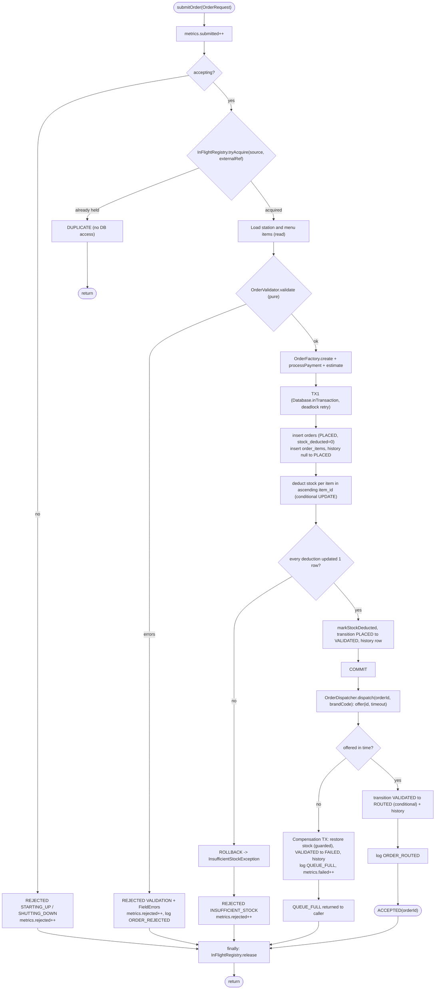

(`DUPLICATE` caused by the database unique constraint inside TX1 follows the TX1 failure branch: rollback, look up the existing order id, return `DUPLICATE(existingId)`.)

### 6.2 Sequence: successful submission

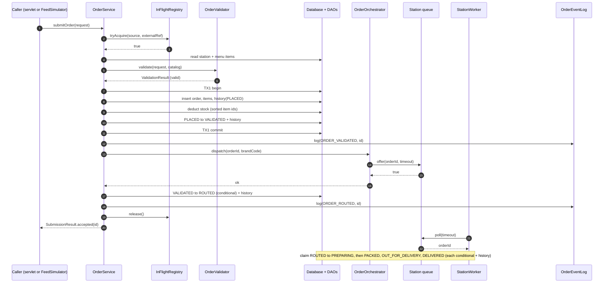

### 6.3 Sequence: queue-full compensation

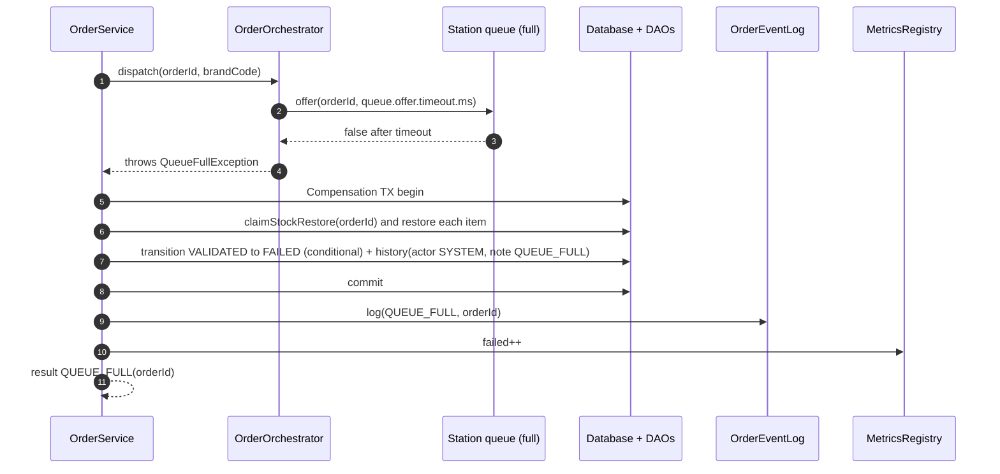

If the conditional transition affects 0 rows (for example staff cancelled the order meanwhile), the restore flag guarantees stock is returned exactly once and no `failed` increment is done.

### 6.4 Cancel and fail with conditional stock restore

`OrderService.transition(orderId, from, to, actor, note)` (single transaction):
1. `from.requireTransitionTo(to)` (throws before touching the DB).
2. `OrderDao.transition(c, orderId, from, to, now)`: `UPDATE orders SET status = ?, updated_at = ? WHERE id = ? AND status = ?`. If 0 rows: return `false` (someone else moved it; nothing else is done).
3. Insert `order_status_history` row (from, to, actor, note, now).
4. If `from.isStockRestorableTo(to)`: `claimStockRestore(c, orderId)`; if it returns true, for each order item `StockDao.restore(c, itemId, qty)`. Items are restored in ascending `item_id` order for lock-order consistency.
5. Commit; return `true`. Log event; update metrics (`failed` when `to == FAILED`; `processed` is updated only by the worker on DELIVERED).

`cancelOrder` reads the current status, calls `transition(id, current, CANCELLED, ...)`; if the status is not cancellable (`!current.canTransitionTo(CANCELLED)`) or the conditional update loses a race, it returns `false` and the controller shows a flash error.

### 6.5 Sequence: startup recovery

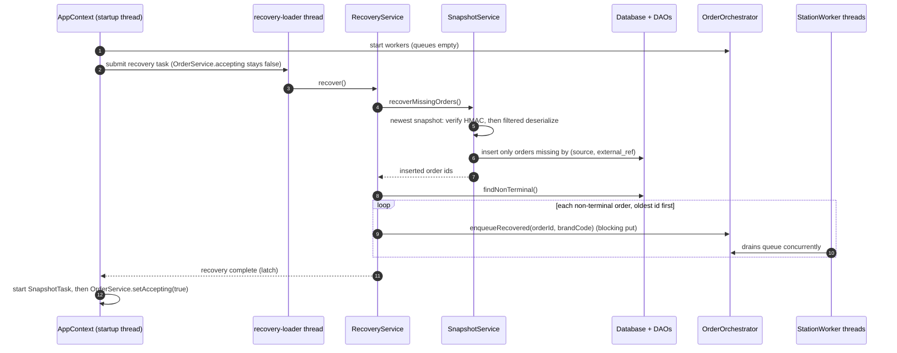

If a snapshot fails verification the failure is logged (no content) and the snapshot is ignored; the database remains the source of truth. VALIDATED orders recovered from the database are enqueued and then moved to ROUTED by the worker's claim step (§7.4). Orders in PREPARING/PACKED/OUT_FOR_DELIVERY are enqueued and resumed from their current status.

---

## 7. Concurrency design

### 7.1 Thread-ownership table

| # | Thread / pool | Name pattern | Created and owned by | Count | Started | Stopped | Runs | Shared state touched (guard) |
|---|---|---|---|---|---|---|---|---|
| 1 | Tomcat request threads | `http-nio-<port>-exec-<n>` | Tomcat (container) | pool | on request | Tomcat stop | Filters, servlets, `OrderService.submitOrder`, queries | `InFlightRegistry` (concurrent set), `MetricsRegistry` (atomics), station queues (`ArrayBlockingQueue` internal lock), DB pool (own connection per call) |
| 2 | Startup thread | `main` (embedded) / `localhost-startStop-<n>` (standalone) | Container | 1 | start | ends after startup | `AppContext.start` (§2.4); also runs `contextDestroyed` at stop | Writes `AppContext` once, published via servlet-context attribute |
| 3 | Station workers | `station-<code>-worker`, e.g. `station-BIRYANI-worker` (code exactly as stored) | `OrderOrchestrator` via `ExecutorService` = `Executors.newFixedThreadPool(n, new NamedThreadFactory(names))` | one per station | `orchestrator.start(...)` | graceful drain then `shutdownNow()` | `StationWorker.run()` | its own queue (consumer), `OrderService.transition` (DB), `MetricsRegistry`; own `volatile` state fields |
| 4 | Feed simulator | `feed-simulator` | `FeedSimulator` via `ScheduledExecutorService` (single thread) | 1 | `start(rate)` schedules the task; executor created at construction | `stop()` cancels the task; `shutdownNow()` at app shutdown | `tick()` builds an `OrderRequest` and calls `OrderService.submitOrder` | `running` (`AtomicBoolean`), `rate` (`AtomicInteger`), start/stop `synchronized` on the simulator |
| 5 | Snapshot scheduler | `snapshot-scheduler` | `SnapshotTask` via `ScheduledExecutorService` (single thread) | 1 | after recovery | `stop()` / shutdown | `SnapshotService.writeSnapshot()` | Own DB connection; file writes to a temp file then atomic move |
| 6 | Recovery loader | `recovery-loader` | `AppContext` via single-thread executor | 1, short-lived | startup | exits when done / interrupted | `RecoveryService.recover()` | Station queues (`put`), DB |
| 7 | Shutdown hook | `ck-shutdown-hook` | `ShutdownCoordinator.installJvmHook()` (`Runtime.addShutdownHook`) | 1 | JVM exit | n/a | `ShutdownCoordinator.shutdown()` | `AtomicBoolean started`, `CountDownLatch done` |
| 8 | Hikari housekeeper | `HikariPool-1 housekeeper` | HikariCP (daemon) | 1 | pool creation | `HikariDataSource.close()` | Pool maintenance | internal |
| 9 | Embedded DB | child process (MariaDB4j) + its output-pump thread | `DbBootstrap` | 1 | startup | last shutdown step | MySQL-compatible server | n/a |
| 10 | Test threads | `test-*` | tests | n/a | n/a | n/a | n/a | n/a |

Every thread-owning class has: a name, a documented stop method, and `InterruptedException` handling that restores the interrupt flag (`Thread.currentThread().interrupt()`) and exits or aborts the unit of work cleanly.

### 7.2 Queues and workers

* `StationRuntime` (one per station) holds `Station`, `ArrayBlockingQueue<Long> queue` (capacity `station.queue.capacity`, fair = false), and its `StationWorker`. Methods: `boolean tryEnqueue(long orderId, long timeoutMs) throws InterruptedException`, `void putBlocking(long orderId) throws InterruptedException` (recovery), `int size()`, `int capacity()`, `WorkerView workerView()`.
* `OrderOrchestrator implements OrderDispatcher`:
  * `void start(OrderService)`: creates a `StationRuntime` per active station from `RoutingService`, builds the executor with one thread per station, submits each `StationWorker`.
  * `void dispatch(long orderId, String brandCode) throws QueueFullException`: finds the runtime by brand code; `tryEnqueue(orderId, queue.offer.timeout.ms)`; on `false` throws `QueueFullException`; on `InterruptedException` restores the flag and throws `QueueFullException` (cause set) so the caller compensates.
  * `void enqueueRecovered(long orderId, String brandCode) throws InterruptedException`.
  * `void pause(String code)`, `void resume(String code)`, `List<StationView> stationViews()`.
  * `void shutdownGracefully(Duration drain, Duration await)`: §7.6.
* `OrderDispatcher` (interface) exposes only `dispatch(...)`, so `OrderService` and tests (`BlockingOrderDispatcher`, `AlwaysFullOrderDispatcher`) never see executors.

### 7.3 Worker loop

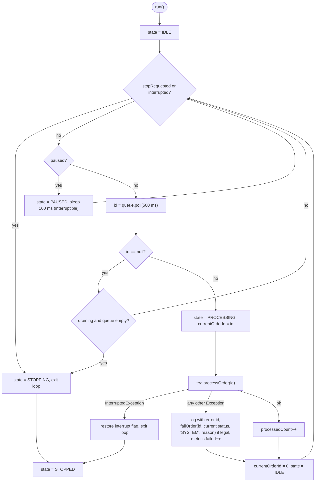

`processOrder(id)` is a state-machine loop driven by the **current** status read from the DB (this is what makes recovered orders resumable):

1. `claim(id)`: read the order; if status is `ROUTED`: `transition(ROUTED -> PREPARING)`. If status is `VALIDATED`: retry reading (up to `worker.claim.retry.count` times, `worker.claim.retry.delay.ms` apart, interruptible) until it becomes `ROUTED`, then claim; if still `VALIDATED`, perform `VALIDATED -> ROUTED` itself (conditional) then claim. If status is `PREPARING`, `PACKED` or `OUT_FOR_DELIVERY` (recovered order): continue from there. If terminal or the conditional update returns false: skip the order (duplicate id or cancelled).
2. `PREPARING`: sleep `worker.prep.ms`; `transition(PREPARING -> PACKED)`.
3. `PACKED`: sleep `worker.pack.ms`; `transition(PACKED -> OUT_FOR_DELIVERY)`.
4. `OUT_FOR_DELIVERY`: sleep `worker.delivery.ms`; `transition(OUT_FOR_DELIVERY -> DELIVERED)`; then `metrics.processed++` and `metrics.recordProcessingTime(nanos since claim)`.
5. Every `transition` returning `false` ends processing of this id silently (another actor won).
6. The actor recorded in history is `worker:<CODE>`.

Pause semantics: `pause()` takes effect between orders (the current order is finished). `resume()` clears the flag. At shutdown the coordinator clears `paused` so a paused worker can drain or stop.

### 7.4 Races, idempotence and why each is safe

| Race / duplicate | Mechanism that makes it safe |
|---|---|
| Two submissions of the same external order at once | `InFlightRegistry.tryAcquire` (fast path, in-JVM) and `UNIQUE (source, external_ref)` (authoritative, also across restarts/processes). Loser gets `DUPLICATE`. |
| Many orders competing for scarce stock | Single conditional `UPDATE ... WHERE stock_qty >= ?`; InnoDB row lock serialises; zero rows means insufficient. No read-then-write. |
| Two threads moving the same order | `UPDATE ... WHERE id = ? AND status = ?` returns 1 for exactly one thread. History row is inserted only by the winner, in the same transaction. |
| Worker dequeues before the submitter's `VALIDATED -> ROUTED` update | Worker's bounded claim retry (§7.3); either side may perform the conditional `VALIDATED -> ROUTED`, only one succeeds, both outcomes lead to the same state. |
| Cancel while a worker claims | Conditional updates: if cancel wins (`ROUTED -> CANCELLED`) the worker's claim returns 0 rows and it skips; if the worker wins, cancel sees 0 rows and reports "can no longer be cancelled". Stock restore happens only in the winning cancel/fail path, guarded by `stock_deducted`. |
| Same id queued twice (recovery overlap, bug) | The second pass finds a status it cannot claim and skips; no double effect (FR-CON-07). |
| Double stock restore (compensation + cancel) | `claimStockRestore` flips `stock_deducted` 1 -> 0 atomically; only one caller proceeds to restore. |
| Dashboard reading worker state | Fields are `volatile`; views are immutable copies; a slightly stale value is acceptable. |

### 7.5 Feed simulator

* `FeedSimulator(OrderService, RoutingService, MenuService, AppConfig, Clock, Random)`. Own `ScheduledExecutorService` created with `NamedThreadFactory("feed-simulator")`.
* `synchronized boolean start(int ratePerMinute)`: validates `1 <= rate <= simulator.max.rate.per.minute`; if already running returns false; schedules `tick()` with `scheduleWithFixedDelay(0, 60_000 / rate ms)`; sets `running`. `synchronized boolean stop()`: cancels the future, `running = false`. `synchronized void setRate(int)`: if running, cancel and reschedule; always stores the rate. `isRunning()`, `getRate()`, `produced()`.
* `tick()`: wraps everything in `try/catch (RuntimeException | CloudKitchenException)` and logs (an uncaught exception would silently cancel a scheduled task). Builds a random request: source uniformly among three, brand uniformly among active stations, 1-3 random active menu items of that brand with quantity 1-3, distance 0.5-12.0 km, name `Sim Customer <n>`, external reference `SIM-<SOURCE>-<counter>-<8 hex>`, payment mode valid for the source. Submits through `OrderService.submitOrder`.
* Interrupt handling: the executor thread honours `shutdownNow()`; `FeedSimulator.shutdown()` calls `shutdownNow()` then `awaitTermination` with interrupt restore.
* Default rate `simulator.default.rate.per.minute`; the simulator starts **stopped** at boot (admin starts it from the UI) unless `simulator.autostart=true`.

### 7.6 Graceful shutdown

`ShutdownCoordinator`:
* `register(String name, ShutdownStep step)` stores steps in order; `ShutdownStep` is `@FunctionalInterface { void run() throws Exception; }`.
* `void shutdown()`: if `started.compareAndSet(false, true)` runs the steps sequentially, **each in its own try/catch** (a failing step is logged and the next step still runs), then `done.countDown()`. Any other caller blocks on `done.await(timeout)` (restoring interrupt on failure). Idempotent and safe from two threads (listener thread and hook thread).
* `installJvmHook()`: registers thread `ck-shutdown-hook` which calls `shutdown()`.

Step order (registered by `AppContext`):

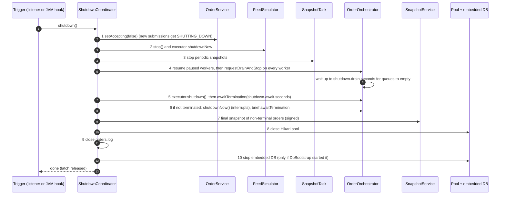

Orders still queued or mid-processing when the timeouts expire stay non-terminal in the database (the DB is the source of truth), are included in the final snapshot, and are recovered at next start. Total worst case: `shutdown.drain.seconds + shutdown.await.seconds + ~5 s` (NFR-REL-03).

### 7.7 Metrics (`MetricsRegistry`)

Fields: `AtomicLong submitted, processed, failed, rejected, totalProcessingNanos, processingSamples`.

| Counter | Incremented |
|---|---|
| `submitted` | Every call to `OrderService.submitOrder` (including those later rejected or duplicate) |
| `rejected` | A submission refused **without** creating an order: validation errors, insufficient stock, `STARTING_UP`, `SHUTTING_DOWN`, `TEMPORARY_FAILURE`, DUPLICATE |
| `failed` | An order reached `FAILED` (queue-full compensation, processing error, manual fail) |
| `processed` | A worker moved an order to `DELIVERED` |
| processing time | From the worker's successful claim to `DELIVERED`; `averageProcessingMillis = totalProcessingNanos / processingSamples / 1e6` (0 when no samples) |

Invariant at quiescence for orders submitted during the current run: `submitted = rejected + processed + failed + cancelled + inFlight`, where `cancelled` and `inFlight` (non-terminal) are counted from the database. Counters are in-memory and reset at restart (documented limitation); `MetricsView view()` returns an immutable copy.

---

## 8. File handling design

### 8.1 `orders.log` (`NioOrderEventLog`)
* Path `log.orders.path` (default `./logs/orders.log`); parent directories created. Opened once with `FileChannel.open(path, CREATE, APPEND, WRITE)`; never truncated, never rewritten (append-only).
* Thread safety: a `ReentrantLock` guards `format + write`; each event is a single UTF-8 line terminated by `\n` written with one `channel.write(ByteBuffer)`; no other thread writes the file.
* Format (logfmt-style, one event per line): `ts=2026-10-10T06:41:12.345Z event=ORDER_ROUTED orderId=42 source=SWIGGY station=BIRYANI detail="..."`. Values are sanitised (control characters and newlines replaced, quotes escaped, length capped at 200).
* API: `void log(EventType type)`, **overload** `log(EventType type, long orderId)`, **overload** `log(EventType type, long orderId, String detail)`, `void close()` (idempotent). `NoOpOrderEventLog` is the null object used by unit tests and early phases.
* `EventType`: `ORDER_REJECTED, ORDER_DUPLICATE, ORDER_VALIDATED, ORDER_ROUTED, ORDER_PREPARING, ORDER_PACKED, ORDER_OUT_FOR_DELIVERY, ORDER_DELIVERED, ORDER_CANCELLED, ORDER_FAILED, QUEUE_FULL, STOCK_RESTORED, SIMULATOR_STARTED, SIMULATOR_STOPPED, WORKER_PAUSED, WORKER_RESUMED, SNAPSHOT_WRITTEN, SNAPSHOT_REJECTED, RECOVERY_STARTED, RECOVERY_COMPLETED, SHUTDOWN_STARTED, SHUTDOWN_COMPLETED`.
* **Never logged:** customer name, address, phone, password, hash, HMAC secret, session id. Only ids, codes, statuses and counts. `NoPiiInLogsTest` plants sentinel values to prove it.
* Rotation is out of scope (limitation); the file is git-ignored (`*.log` is already ignored).

### 8.2 CSV report (`CsvReportExporter`)
* `Path export(LocalDate utcDay, List<ReportRow> rows)` writes `<report.export.dir>/orders-<yyyy-MM-dd>.csv`; **overload** `void write(Writer out, List<ReportRow> rows)` is used for HTTP download. NIO `Files.newBufferedWriter(path, UTF_8)`.
* Columns: `order_id,created_at_utc,source,brand,external_ref,status,item_count,subtotal,platform_fee,total,payment_mode,payment_status`. No customer data.
* RFC 4180 quoting (quote when value has comma, quote, CR or LF; double inner quotes). Text cells starting with `=`, `+`, `-`, `@`, tab or CR are prefixed with `'` (CSV/formula injection defence). Money as plain decimals with 2 places; timestamps ISO-8601 UTC.
* Day boundary: `[00:00:00Z, next day 00:00:00Z)` on `created_at`.

### 8.3 Application log
`logback.xml`: console appender plus rolling file `logs/app.log` (size/time based, 7 days), pattern `%d{ISO8601} [%thread] %-5level %logger{20} - %msg%n`. The pattern includes the thread name, so worker names appear. Passwords, hashes and secrets are never passed to the logger; `AppConfig.toString()` redacts secrets.

---

## 9. Serialization design

### 9.1 Why native Java serialization is used here (and why it is normally avoided)
Native serialization (`java.io.Serializable`) is used **because the course requires demonstrating Java serialization**. It is not the best engineering choice for persisting state: the database already holds all orders, and JSON/CBOR or database rows would be safer and more evolvable. In this project serialization is a *secondary safety net*: it records in-flight orders to disk so that a lost or empty database can be partially repaired, and it demonstrates the concept in a controlled, hardened way.

### 9.2 Risks of untrusted deserialization (and the controls applied)

| Risk | Explanation | Control in this design |
|---|---|---|
| Remote code execution via gadget chains | `ObjectInputStream.readObject` instantiates classes named in the stream and runs their `readObject`/`readResolve` before the caller can check the type | Allowlist `ObjectInputFilter` rejects every class not listed; applied to the stream **before** `readObject` |
| Tampering / forged files | A file in `snapshots/` could be replaced | HMAC-SHA256 over the exact bytes, verified in constant time **before** any deserialization; secret only in git-ignored config |
| Denial of service | Huge arrays, deep object graphs, reference bombs | Filter limits: `maxdepth`, `maxrefs`, `maxbytes`, `maxarray`; maximum file size check before reading |
| Information leakage | Serialized objects can contain secrets | DTO has plain business fields only: no credentials, connections, locks or thread state |
| Stale or incompatible format | Class evolves, old file read | Explicit `serialVersionUID` and `formatVersion` field; mismatch -> file rejected and logged |
| Misuse on web input | The most dangerous use | **Never**: no servlet or filter touches `ObjectInputStream`; `ArchitectureRulesTest` allows `ObjectInputStream` only in package `snapshot`; uploads are not a feature |

Residual risk (documented): anyone who knows the HMAC secret and can write to `snapshots/` can craft a valid file; the allowlist still limits what it can instantiate. Snapshots are not encrypted and contain `customer_name` (personal data), so the directory is git-ignored and should be protected by OS permissions.

### 9.3 Versioning policy
* `OrderSnapshotDTO` has `private static final long serialVersionUID = 1L;` and `int formatVersion = 1`.
* Adding an optional field: keep `serialVersionUID`, bump `formatVersion`, readers default missing fields. Removing/renaming/type-changing a field: change `serialVersionUID` **and** `formatVersion`; old snapshots are then rejected (logged as `SNAPSHOT_REJECTED`) and the database remains the recovery source. No migration code is planned (snapshots are short-lived: retention `snapshot.retain.count`).
* The allowlist is updated in the same commit as any DTO class addition.

### 9.4 Snapshot format and procedure
* `OrderSnapshotDTO implements Serializable` (plain fields, money as `String`, timestamps as epoch millis `long`): `formatVersion`, `orderId`, `source`, `externalRef`, `trackingCode`, `stationId`, `brandCode`, `status`, `customerName`, `deliveryDistanceKm`, `paymentMode`, `paymentStatus`, `platformFee`, `totalAmount`, `createdAtEpochMillis`, `estimatedDeliveryAtEpochMillis`, `stockDeducted`, `List<ItemLine> items` (an `ArrayList`) where `ItemLine` is a static nested `Serializable` class (`itemId`, `itemName`, `unitPrice` String, `quantity`).
* Files: `snapshots/snapshot-<yyyyMMdd'T'HHmmssSSS'Z'>.ser` (the serialized `ArrayList<OrderSnapshotDTO>`) and `snapshots/snapshot-<...>.ser.hmac` (hex HMAC). Written as `*.tmp`, then `Files.move(..., ATOMIC_MOVE)` with `.ser` first and `.hmac` last; a `.ser` without `.hmac` is ignored. `pruneOld()` keeps the newest `snapshot.retain.count` pairs.
* **Write** (`SnapshotService.writeSnapshot()`): load non-terminal orders (own pooled connection) -> map to DTOs -> `ObjectOutputStream` into a `byte[]` -> `HmacSigner.sign(bytes)` -> write both files -> `log(SNAPSHOT_WRITTEN)`.
* **Read** (`SnapshotService.readLatestValid()`): newest pair first: read `.ser` bytes (size cap) and `.hmac`; `HmacSigner.verify` (constant time via `MessageDigest.isEqual`) else `SnapshotIntegrityException`; only then `new ObjectInputStream(...)` with `setObjectInputFilter(SnapshotFilterFactory.create())`; cast result to `ArrayList` and check element types; on any failure log `SNAPSHOT_REJECTED` and try the next older pair.
* **Recover** (`SnapshotService.recoverMissingOrders()`): for each DTO, if `findIdBySourceAndRef` is empty, rehydrate through `OrderFactory.rehydrate` and `OrderDao.insertRecovered` (with its snapshot status, items, one history row with note `RECOVERED_FROM_SNAPSHOT`, `stock_deducted = 0` because the stock state of a lost database cannot be inferred). Unknown station or menu item (FK failure) skips that order and logs. Returns inserted ids for `RecoveryService`.
* **Allowlist** (`SnapshotFilterFactory.create()` using `ObjectInputFilter.Config.createFilter`), pattern to be confirmed in Phase 6: `com.cloudkitchen.snapshot.OrderSnapshotDTO;com.cloudkitchen.snapshot.OrderSnapshotDTO$ItemLine;java.util.ArrayList;java.lang.String;maxdepth=5;maxrefs=100000;maxbytes=<config>;maxarray=100000;!*`.
* **HMAC:** `HmacSigner` uses `Mac.getInstance("HmacSHA256")`; key = UTF-8 bytes of `snapshot.hmac.secret` (startup fails if shorter than 32 characters or equal to the placeholder from the example file).

---

## 10. Web layer

### 10.1 MVC structure
* **Model:** domain objects and read-only DTO records placed in request attributes by controllers. JSPs never call services.
* **View:** JSPs under `/WEB-INF/views/` (not directly addressable), JSP 3.1 + Jakarta JSTL (`core`, `fmt`, `functions`), EL only (no scriptlets, no SQL, no `useBean` logic). Shared fragments `layout/header.jspf`, `layout/footer.jspf` and tag files in `/WEB-INF/tags/` (`csrf.tag` renders the hidden `_csrf` input; `statusBadge.tag` renders text + CSS class for a status). Output is always escaped with `<c:out>` or `fn:escapeXml`. Dates are printed in UTC with an explicit "UTC" label via `fmt:formatDate`/pre-formatted strings.
* **Controller:** servlets extending `BaseServlet`, which provides: `AppContext app()`, `SessionUser currentUser(req)`, `render(req, resp, view)`, `redirect(req, resp, path)` (always `resp.sendRedirect(req.getContextPath() + path)`), `flashSuccess/flashError/flashInfo(req, msg)`, `intParam/longParam/enumParam(req, name)` helpers that throw a 400 (`resp.sendError`) on malformed input, and `final` `service()` handling that maps unexpected exceptions to the error pages. Servlets contain request parsing and response selection only; business logic stays in services.
* **Descriptor:** `web.xml` declares servlets, mappings, filters in a fixed order, listener, `session-timeout` 30, `cookie-config` (`http-only` true; `Secure` and `SameSite=Lax` are applied by `AppBootstrapListener` through `SessionCookieConfig.setSecure(...)` and `setAttribute("SameSite", "Lax")`), welcome file, `error-page` entries for 400/403/404/500 and `java.lang.Throwable` -> `/error`, `request-character-encoding`/`response-character-encoding` = UTF-8, and `jsp-config` (`scripting-invalid` true, `page-encoding` UTF-8).
* **Error handling:** `ErrorServlet` (mapped to `/error`, the target of every `error-page`) logs the original exception with an 8-hex-character error id at ERROR level and forwards to `/WEB-INF/views/error/{400,403,404,500}.jsp`, which show a generic message and the error id only.

### 10.2 Routes table

Legend: **Auth** = requires an authenticated session. **Role** = roles allowed (`ANY` = ADMIN or KITCHEN_STAFF). **CSRF** applies to every POST. Redirect targets are relative to the context path. Tier is the scope tier.

| # | Route | Method | Parameters | Auth | Role | Success response | Failure response | Servlet -> view | Tier |
|---|---|---|---|---|---|---|---|---|---|
| 1 | `/` | GET | - | no | public | 302 -> `/dashboard` (authenticated) or `/login` | - | `HomeServlet` | MUST |
| 2 | `/login` | GET | - | no | public | 200 `login.jsp` (creates session + CSRF token); if already authenticated 302 -> `/dashboard` | - | `LoginServlet` -> `login.jsp` | MUST |
| 3 | `/login` | POST | `username`, `password`, `_csrf` | no | public | 302 -> `/dashboard` (session id changed) | 302 -> `/login` + generic error flash; bad CSRF 403 | `LoginServlet` | MUST |
| 4 | `/logout` | POST | `_csrf` | yes | ANY | 302 -> `/login` (session invalidated) | bad CSRF 403 | `LogoutServlet` | MUST |
| 5 | `/dashboard` | GET | - | yes | ANY | 200 `dashboard.jsp` (auto-refresh 5 s) | 500 generic page | `DashboardServlet` | MUST |
| 6 | `/orders` | GET | `status?`, `source?`, `q?`, `from?`, `to?`, `page?` (default 1, size 20) | yes | ANY | 200 `orders/list.jsp` | malformed param -> 400 | `OrderListServlet` | MUST (filter by status/page); `q/source/from/to` = COULD |
| 7 | `/orders/view` | GET | `id` | yes | ANY | 200 `orders/detail.jsp` (items, totals, history, cancel button when allowed) | non-numeric 400; unknown 404 | `OrderDetailServlet` | MUST |
| 8 | `/orders/new` | GET | - | yes | ANY | 200 `orders/new.jsp` (brand/menu selection) | - | `OrderCreateServlet` | SHOULD |
| 9 | `/orders/new` | POST | `brandCode`, `customerName`, `deliveryDistanceKm`, `paymentMode`, `itemId` (repeated), `quantity` (repeated), `_csrf` | yes | ANY | 302 -> `/orders/view?id=<id>` + success flash | validation/stock: 302 -> `/orders/new` + error flash + retained input; QUEUE_FULL: 302 -> `/orders/view?id=<id>` + error flash | `OrderCreateServlet` | SHOULD |
| 10 | `/orders/cancel` | POST | `id`, `_csrf` | yes | ANY | 302 -> `/orders/view?id=<id>` + success flash | not cancellable / lost race: same redirect + error flash | `OrderCancelServlet` | MUST |
| 11 | `/inventory` | GET | - | yes | ANY | 200 `inventory/list.jsp` (stock, reorder level, low-stock flag) | - | `InventoryServlet` | MUST |
| 12 | `/admin/menu` | GET | - | yes | ADMIN | 200 `admin/menu.jsp` | 403 for staff | `AdminMenuServlet` | SHOULD |
| 13 | `/admin/menu` | POST | `action` (`create`/`update`), `itemId?`, `stationCode?`, `name?`, `price`, `active`, `_csrf` | yes | ADMIN | 302 -> `/admin/menu` + flash | invalid values: 302 + error flash | `AdminMenuServlet` | SHOULD |
| 14 | `/admin/stock` | GET | - | yes | ADMIN | 200 `admin/stock.jsp` | 403 | `AdminStockServlet` | SHOULD |
| 15 | `/admin/stock` | POST | `itemId`, `stockQty`, `reorderLevel`, `_csrf` | yes | ADMIN | 302 -> `/admin/stock` + flash | negative/NaN: 302 + error flash | `AdminStockServlet` | SHOULD |
| 16 | `/admin/simulator` | GET | - | yes | ADMIN | 200 `admin/simulator.jsp` (state, rate, produced count) | 403 | `SimulatorServlet` | MUST |
| 17 | `/admin/simulator` | POST | `action` (`start`/`stop`/`rate`), `ratePerMinute?`, `_csrf` | yes | ADMIN | 302 -> `/admin/simulator` + flash | rate out of range: 302 + error flash | `SimulatorServlet` | MUST |
| 18 | `/admin/workers` | GET | - | yes | ADMIN | 200 `admin/workers.jsp` (state, queue fill, current order, processed) | 403 | `WorkerPanelServlet` | SHOULD |
| 19 | `/admin/workers` | POST | `action` (`pause`/`resume`), `stationCode`, `_csrf` | yes | ADMIN | 302 -> `/admin/workers` + flash | unknown station: 302 + error flash | `WorkerPanelServlet` | SHOULD |
| 20 | `/admin/snapshot` | POST | `_csrf` | yes | ADMIN | 302 -> `/admin/workers` + flash (file name only) | IO error: 302 + error flash | `SnapshotServlet` | SHOULD |
| 21 | `/admin/reports` | GET | - | yes | ADMIN | 200 `admin/reports.jsp` (date picker) | 403 | `ReportServlet` | SHOULD |
| 22 | `/admin/reports/daily.csv` | GET | `date` (`yyyy-MM-dd`, UTC) | yes | ADMIN | 200 `text/csv; charset=UTF-8`, `Content-Disposition: attachment` | bad date 400 | `ReportServlet` | SHOULD |
| 23 | `/admin/users` | GET | - | yes | ADMIN | 200 `admin/users.jsp` | 403 | `UserAdminServlet` | COULD |
| 24 | `/admin/users` | POST | `userId`, `newPassword`, `_csrf` | yes | ADMIN | 302 -> `/admin/users` + flash | weak/empty password: 302 + error flash | `UserAdminServlet` | COULD |
| 25 | `/track` | GET | `code` | no | public | 200 `track.jsp` (status + timeline, no PII) | unknown code: generic "not found" text, 200 | `TrackServlet` | COULD |
| 26 | `/static/*` | GET | - | no | public | CSS (served by Tomcat default servlet) | 404 | default servlet | MUST |
| 27 | `/error` | any | (container) | no | public | generic error page for the original status | - | `ErrorServlet` -> `error/*.jsp` | MUST |

Unauthenticated access to a protected GET -> `302 /login` (no `returnTo` parameter; avoids open-redirect risk). Unauthenticated protected POST -> 302 `/login`. Authenticated but wrong role -> 403 page. `RoutePolicy` holds the same table in code (`RoutePolicy.requiredRoles(path, method)`, `RoutePolicy.allRoutes()` for tests), so filters and the access-matrix test share one source.

### 10.3 Filter chain (order is fixed in `web.xml`)

| Order | Filter | Applies to | Behaviour |
|---|---|---|---|
| 1 | `EncodingFilter` | `/*` (REQUEST, ERROR) | `setCharacterEncoding("UTF-8")` on request (before any parameter read) and response; no-op if already set |
| 2 | `SecurityHeadersFilter` | `/*` (REQUEST, ERROR, FORWARD) | `X-Content-Type-Options: nosniff`, `X-Frame-Options: DENY`, `Referrer-Policy: same-origin`, `Content-Security-Policy: default-src 'self'; style-src 'self'; script-src 'none'; frame-ancestors 'none'; form-action 'self'`, `Cache-Control: no-store` on authenticated pages |
| 3 | `CsrfFilter` | `/*` | Ensures the session has a token (`CsrfTokens.ensure(session)`); for `POST` (and any non-GET/HEAD/OPTIONS method) compares request parameter `_csrf` with the session token using `MessageDigest.isEqual`; mismatch -> `403` (logged without token values) |
| 4 | `AuthFilter` | `/*` | `RoutePolicy`: public routes pass; otherwise requires `SessionUser` in the session, else 302 `/login` |
| 5 | `RoleFilter` | `/*` | For protected routes checks `SessionUser.role()` against `RoutePolicy.requiredRoles`; else 403 |

CSRF before authentication so that the login POST is protected too (`GET /login` creates the session and token). Both `AuthFilter` and `RoleFilter` are present on every protected route; `RoleFilter` assumes `AuthFilter` already ran.

### 10.4 Session, flash and PRG
* Session attributes: `ck.user` (`SessionUser`), `ck.csrf` (token, 32 random bytes Base64url from `SecureRandom`), `ck.flash` (list of `Flash` messages, consumed on first render), `ck.form` (retained input after a failed POST, consumed once).
* Session policy: 30-minute inactivity timeout; id regenerated at login with `request.changeSessionId()` and the CSRF token rotated; logout calls `session.invalidate()`; cookie name left as the container default `JSESSIONID`; `HttpOnly`, `SameSite=Lax`, `Secure` when `server.session.cookie.secure=true`; URL-based session ids disabled via `<tracking-mode>COOKIE</tracking-mode>`.
* PRG: every POST handler ends with `redirect(...)` after storing a `Flash`; no POST renders a page directly. A `Flash` has a type (`SUCCESS`, `INFO`, `ERROR`) and a text that is escaped on output and contains no sensitive data.

### 10.5 Views

| View | Content |
|---|---|
| `login.jsp` | Username/password form with CSRF input; generic error flash; no "remember me" |
| `dashboard.jsp` | `<meta http-equiv="refresh" content="5">`; cards: order counts by status; per-station table (queue `size/capacity` as text and a bar, worker state, current order id); metrics (submitted, processed, failed, rejected, average processing ms); low-stock list with a text flag "LOW" (not colour alone); simulator state; "Recovering" banner while `OrderService.isAccepting()` is false; COULD: SVG bars |
| `orders/list.jsp` | Filter form (GET), paginated table (20/page, newest first) |
| `orders/detail.jsp` | Header (source, brand, external ref, tracking code, status badge), items table with unit price/line total, totals, payment info, estimated delivery (UTC), **status history table** (time UTC, from, to, actor, note), cancel form when `canTransitionTo(CANCELLED)` |
| `orders/new.jsp` | Brand select, menu items with quantities (only active items of that brand), name, distance, payment mode (`CASH`/`UPI`/`CARD`); retained input and field errors on failure |
| `inventory/list.jsp` | Stock per item, reorder level, LOW flag |
| `admin/*.jsp` | Menu, stock, simulator, workers, reports (and COULD users) |
| `track.jsp` | COULD |
| `error/*.jsp` | Generic message, error id, link to dashboard |

### 10.6 Permission matrix

| Capability | Anonymous | KITCHEN_STAFF | ADMIN |
|---|---|---|---|
| Log in | yes | - | - |
| Dashboard, order list/detail, inventory view | no | yes | yes |
| Enter in-house order | no | yes | yes |
| Cancel order | no | yes | yes |
| Menu and stock management | no | no | yes |
| Feed simulator control | no | no | yes |
| Worker panel (pause/resume), snapshot on demand | no | no | yes |
| CSV report | no | no | yes |
| Password reset (COULD) | no | no | yes |
| Public tracking (COULD) | yes | yes | yes |

---

## 11. Validation rules

`OrderValidator.validate(OrderRequest, MenuCatalog)` is pure (no I/O) and **collects all violations** (VR-14). Each violation is a `FieldError(field, code, message)`. Messages are user-safe and contain no internal detail.

| ID | Field | Rule | Error code |
|---|---|---|---|
| VR-01 | `source` | Non-null, one of `SWIGGY`, `ZOMATO`, `IN_HOUSE` | `SOURCE_INVALID` |
| VR-02 | `externalRef` | SWIGGY/ZOMATO: required. IN_HOUSE: optional (generated if blank). When present: 1-64 chars matching `[A-Za-z0-9._:-]+` | `EXTERNAL_REF_INVALID` |
| VR-03 | `brandCode` | Non-null, resolves to an **active** station in the catalogue | `BRAND_UNKNOWN` |
| VR-04 | `customerName` | After trimming: 1-100 chars; no Unicode control characters (category Cc) | `CUSTOMER_NAME_INVALID` |
| VR-05 | `deliveryDistanceKm` | Non-null `BigDecimal`, `0.00 <= value <= 25.00`, scale <= 2 | `DISTANCE_INVALID` |
| VR-06 | `paymentMode` | Non-null; `PREPAID_AGGREGATOR` for SWIGGY/ZOMATO; `CASH`/`UPI`/`CARD` for IN_HOUSE (`PaymentMode.allowedFor`) | `PAYMENT_MODE_INVALID` |
| VR-07 | `items` | Non-null, 1-20 lines | `ITEMS_COUNT_INVALID` |
| VR-08 | `items[i].quantity` | Integer 1-20 | `QUANTITY_INVALID` |
| VR-09 | `items[i].itemId` | No duplicate item id within the request | `ITEM_DUPLICATE` |
| VR-10 | `items[i].itemId` | Exists in the catalogue | `ITEM_UNKNOWN` |
| VR-11 | `items[i].itemId` | Item is active | `ITEM_INACTIVE` |
| VR-12 | `items[i].itemId` | Item belongs to the station of `brandCode` | `ITEM_WRONG_BRAND` |
| VR-13 | total | Server-computed subtotal > 0.00 and <= 50000.00 | `TOTAL_OUT_OF_RANGE` |
| VR-14 | request | A `null` request yields a single `REQUEST_NULL` error; otherwise all of the above are evaluated and returned together | `REQUEST_NULL` |

Web-layer parameter checks (before the service): numeric ids parse (else 400), enum parameters match (else 400), page >= 1, all string parameters capped at 200 chars (Tomcat connector also limits `maxPostSize`/`maxParameterCount`; oversize -> 400 not 500). Stock and uniqueness are **not** validator rules: they are enforced by TX1 (atomicity).

---

## 12. Security design

### 12.1 Authentication and password storage
* `PasswordHasher`: PBKDF2WithHmacSHA256 (`SecretKeyFactory.getInstance("PBKDF2WithHmacSHA256")`), per-user 16-byte random salt, 256-bit output, iterations from `security.pbkdf2.iterations` (default and minimum **600000**; `AppConfig` refuses lower). Stored as `pbkdf2_sha256$<iter>$<salt>$<hash>` so iteration count can rise later (`needsRehash` -> rehash at next successful login). Comparison with `MessageDigest.isEqual`. Password arrays (`char[]`) are cleared after use; passwords are never logged.
* Initial users: `UserSeeder` reads `bootstrap.admin.username/password` and `bootstrap.staff.username/password` from the **git-ignored** config at first bootstrap only (empty `staff_users`). Docs and commits contain no real passwords; `config/application.properties.example` uses obvious placeholders that `AppConfig` rejects (so a copied-but-unedited example fails fast). Recommendation recorded in the README: remove the bootstrap passwords from the file after first start.
* Unknown username: a dummy PBKDF2 verification is performed so response timing is similar; the response is identical to a wrong password.

### 12.2 Lockout
* Columns `failed_attempts`, `locked_until` in `staff_users` (DATABASE_DESIGN §3.7). `AuthService.authenticate` runs in one transaction using `SELECT ... FOR UPDATE` on the user row so concurrent attempts cannot bypass the counter.
* Policy (`LockoutPolicy`): 5 consecutive failures -> `locked_until = now + 5 minutes` (UTC, `Clock` injected). While locked, even the correct password fails with the same generic message. After expiry the counter is reset at the next attempt. Success resets the counter and sets `last_login_at`. Constants configurable (`security.lockout.max.attempts`, `security.lockout.minutes`) but default to the locked values.
* Message always: "Invalid credentials or account temporarily locked."

```mermaid
sequenceDiagram
    autonumber
    participant B as Browser
    participant CF as CsrfFilter
    participant LS as LoginServlet
    participant AS as AuthService
    participant DB as staff_users (DB)
    B->>LS: GET /login
    LS-->>B: 200 form + session + CSRF token
    B->>CF: POST /login (username, password, _csrf)
    CF->>CF: constant-time token check
    CF->>LS: pass
    LS->>AS: authenticate(username, password)
    AS->>DB: TX begin: SELECT user FOR UPDATE
    alt unknown user
        AS->>AS: dummy PBKDF2 verify
        AS-->>LS: AuthenticationException
    else locked (locked_until > now)
        AS->>DB: commit (no change)
        AS-->>LS: AuthenticationException (generic)
    else password wrong
        AS->>DB: failed_attempts+1 (lock 5 min at 5th), commit
        AS-->>LS: AuthenticationException
    else password correct
        AS->>DB: reset counters and last_login_at, commit
        AS-->>LS: SessionUser
        LS->>LS: request.changeSessionId() + rotate CSRF token
        LS-->>B: 302 /dashboard
    end
    LS-->>B: (on failure) 302 /login + generic flash
```

### 12.3 Sessions and cookies
See §10.4. Timeout 30 minutes; `changeSessionId()` at login; full `invalidate()` at logout; cookie `HttpOnly`, `SameSite=Lax`, `Secure` via config (HTTPS itself is out of scope, so the default is `false` for local use).

### 12.4 CSRF
Synchronizer token per session on every POST (including login and logout); `CsrfTokens.ensure(session)`, `CsrfTokens.matches(session, candidate)`; hidden field via the `csrf.tag` tag file; failures return 403 without revealing expected values. `SameSite=Lax` is defence in depth, not a replacement.

### 12.5 Authorisation
Deny by default: `RoutePolicy` returns "not found in table" for unknown routes -> treated as protected ADMIN-only until mapped (unknown paths still 404 from the container). Checks happen in filters, not inside JSPs.

### 12.6 Injection and output encoding
* SQL: `PreparedStatement` only; the single `Statement` use is `SchemaInitializer` running trusted classpath scripts; no dynamic identifiers; `LIKE` patterns built from escaped user input (`%`/`_`/`\` escaped) for search; multi-statement mode off.
* XSS: JSP output escaping, CSP `script-src 'none'`, no inline event handlers.
* Header/response splitting: no user data in headers except `Content-Disposition` file name built from a validated date.
* CSV injection: §8.2. Log injection: values sanitised (§8.1).
* Deserialization: §9.

### 12.7 Secrets and configuration
`config/application.properties`, `data/`, `logs/`, `snapshots/`, `reports/`, `target/` are git-ignored. Secrets in config: DB password, snapshot HMAC secret, bootstrap passwords. `AppConfig.toString()` masks them; `NoPiiInLogsTest`/secret scan verify. HMAC secret minimum length 32 characters.

### 12.8 Error handling
Generic pages only; the user sees an error id, the log has the stack trace. `Server` header and Tomcat version are hidden in the connector (`server=""`), and the error report valve is configured with `showReport=false`, `showServerInfo=false` (embedded: set on the `StandardHost`'s `ErrorReportValve`).

### 12.9 Threats and mitigations (summary)

| Threat | Mitigation |
|---|---|
| Credential guessing | PBKDF2 cost, lockout, uniform responses |
| Session fixation / theft | `changeSessionId`, HttpOnly, SameSite, timeout, invalidate at logout |
| CSRF | Token on every POST, SameSite=Lax |
| Privilege escalation | Filters with single route table, deny-by-default, matrix tests |
| SQL injection | Prepared statements only, `ArchitectureRulesTest` |
| XSS | Escaping, CSP |
| Data leakage in logs/errors | No PII in logs, generic error pages |
| Malicious snapshot | HMAC, allowlist filter, size limits, never from the web |
| Replay of duplicate orders | Unique constraint + in-flight guard |
| Resource exhaustion by order flood | Bounded queues, offer timeout, compensation, simulator max rate |

---

## 13. Transaction boundaries

Isolation: InnoDB default `REPEATABLE READ`; correctness relies on atomic conditional statements and row locks, not on isolation level. `autoCommit=false` inside `Database.inTransaction`. Deadlock (SQLState `40001` / error `1213`) -> rollback and rerun the whole work up to 3 times.

| ID | Transaction | Scope (all in one DB transaction) | Retry | On failure |
|---|---|---|---|---|
| TX1 | **Order creation** (`OrderService.submitOrder`) | 1) insert `orders` (status `PLACED`, `stock_deducted=0`); 2) insert `order_items`; 3) insert history (`null -> PLACED`); 4) for each item in **ascending `item_id`**: `StockDao.deduct` (0 rows => `InsufficientStockException`); 5) `markStockDeducted`; 6) conditional `PLACED -> VALIDATED`; 7) history (`PLACED -> VALIDATED`); commit | deadlock x3 | Rollback: no order, no deduction. Unique violation -> `DuplicateOrderException` (look up id after rollback). |
| TX2 | **Routing update** | conditional `VALIDATED -> ROUTED` + history | none | 0 rows is fine (cancelled/advanced meanwhile) |
| TX3 | **Transition** (worker steps, cancel, fail) | `OrderService.transition`: conditional status update; if 1 row: history insert; if `from.isStockRestorableTo(to)`: `claimStockRestore` and, when true, restore each item (ascending id); commit | deadlock x3 | Rollback leaves status unchanged; caller treats as failure |
| TX4 | **Queue-full / dispatch-failure compensation** | Same as TX3 with `from = VALIDATED`, `to = FAILED`, actor `SYSTEM`, note `QUEUE_FULL` | deadlock x3 | If it still fails, order remains VALIDATED and is re-enqueued by the next recovery; error logged |
| TX5 | **Stock adjustment** (admin) | `StockDao.set` | none | Rollback |
| TX6 | **Menu change** (admin) | insert/update `menu_items` (+ `inventory` row on create) | none | Rollback |
| TX7 | **Login attempt** | `SELECT ... FOR UPDATE` user; update counters/`last_login_at`; commit | deadlock x3 | Rollback; login fails generically |
| TX8 | **Snapshot recovery insert** (per order) | insert order (+ items, history) if missing | none | Per-order rollback, others continue |
| TX9 | **Schema/seed** | Each script statement executed with auto-commit (DDL commits implicitly); `schema_version` insert last | none | Startup aborts with message |
| R1 | Read-only queries (dashboard, lists, recovery load) | `Database.withConnection` (auto-commit, no transaction) | none | Error page |

Rules: a transaction never spans a queue `offer` (TX1 commits before dispatch) and never holds a connection while sleeping; workers hold no connection during simulated preparation time; each task borrows its own connection.

---

## 14. Failure scenarios

| ID | Scenario | Detection | System behaviour | State afterwards | Test |
|---|---|---|---|---|---|
| F-01 | Invalid request | `OrderValidator` | `REJECTED(VALIDATION)`, errors returned, event logged, `rejected++` | No rows | `OrderValidatorTest`, `OrderServiceTest` |
| F-02 | Duplicate (in flight) | `InFlightRegistry.tryAcquire` false | `DUPLICATE`, no DB access | Unchanged | `DuplicateSubmissionConcurrencyTest` |
| F-03 | Duplicate (DB) | unique violation 23000/1062 | Rollback, find existing id, `DUPLICATE(existingId)` | One order | `OrderServiceTest` |
| F-04 | Insufficient stock | deduct updates 0 rows | Rollback TX1, `REJECTED(INSUFFICIENT_STOCK)` | No rows, stock unchanged | `OrderServiceTest`, `StockDeductionConcurrencyTest` |
| F-05 | Deadlock in TX1 | SQLState 40001 / 1213 | Rollback, retry (max 3), then `TEMPORARY_FAILURE` | No rows | `DeadlockRetryTest` |
| F-06 | Queue full | `offer` timeout | TX4 compensation, `QUEUE_FULL`, `failed++` | FAILED, stock restored | `QueueFullCompensationTest` |
| F-07 | Interrupt during `offer` | `InterruptedException` | Restore flag, treat as queue failure (TX4) | FAILED, stock restored | `QueueFullCompensationTest` |
| F-08 | Worker order exception | `catch Exception` in loop | Log with error id, `failOrder` if legal, `failed++`, continue | FAILED (stock policy by status) | `WorkerResilienceTest` |
| F-09 | Worker interrupted | `InterruptedException` | Restore flag, exit loop, state STOPPED | Order stays non-terminal in DB | `WorkerInterruptTest` |
| F-10 | Worker dequeues too early | claim finds VALIDATED | Bounded retry, then routes itself | Same final state | `StationWorkerTest` |
| F-11 | Cancel vs worker | conditional update 0 rows | Loser reports/skips | Consistent final state, stock restored at most once | `CancelVsWorkerRaceTest` |
| F-12 | Duplicate id in queue | claim fails / terminal status | Skip, DEBUG log | No double effect | `StationWorkerTest` |
| F-13 | Database unreachable at runtime | `SQLException` (connection) | Workers: FAILED attempt retried by next recovery (order stays in current status); web: generic 500; submissions `TEMPORARY_FAILURE` | No loss | `ErrorPagesWebTest` (E-25) |
| F-14 | JVM crash / kill -9 | n/a | On restart `RecoveryService` reloads non-terminal orders | Orders continue | `CrashRecoveryTest` |
| F-15 | Snapshot tampered | HMAC mismatch | `SnapshotIntegrityException`, `SNAPSHOT_REJECTED`, ignore file, fall back to DB | DB recovery only | `SnapshotTamperTest` |
| F-16 | Snapshot has unlisted class | `ObjectInputFilter` rejects | Same as F-15 | Same | `SnapshotFilterTest` |
| F-17 | Snapshot write fails (disk full, permissions) | `IOException` | Logged, task continues next interval; final snapshot failure does not block shutdown | DB unaffected | `SnapshotTaskTest` |
| F-18 | Shutdown during load | `accepting=false` | New submissions `SHUTTING_DOWN`; queues drained up to timeout; remainder persisted | Non-terminal rows + snapshot | `GracefulShutdownTest` |
| F-19 | Shutdown triggered twice | `AtomicBoolean` | Second caller waits | Steps ran once | `ShutdownCoordinatorTest` |
| F-20 | Stuck worker at shutdown | `awaitTermination` timeout | `shutdownNow()` interrupt | Order recovered next start | `ShutdownCoordinatorTest` |
| F-21 | Recovery with more orders than capacity | `putBlocking` waits | Loader blocks while workers drain; `accepting` false until done | All eventually processed | `RecoveryServiceTest` |
| F-22 | Config missing/invalid | `ConfigurationException` | Startup aborts with message (no secrets) | n/a | `AppConfigTest` |
| F-23 | Embedded DB port busy / binary missing | `DbBootstrap` exception | Abort with clear message and doc pointer | n/a | Phase 1 spike |
| F-24 | Simulator tick throws | `catch` in `tick()` | Logged, next tick continues | Unchanged | `FeedSimulatorTest` |
| F-25 | CSRF failure | `CsrfFilter` | 403 generic page | Unchanged | `CsrfWebTest` |
| F-26 | Unknown order id in URL | `Optional.empty` | 404 generic page | Unchanged | `OrderDetailWebTest` |
| F-27 | Event log write fails | `IOException` | Logged via SLF4J once per minute, order flow continues (logging is best-effort and must not fail an order) | Unchanged | `NioOrderEventLogTest` |

---

## 15. Configuration reference (`config/application.properties`)

Loaded by `AppConfig` (typed getters, defaults, validation). `# secret` values are masked in `toString()` and never logged. The committed `config/application.properties.example` lists every key with safe placeholders (placeholders for secrets are rejected at startup).

| Key | Default | Meaning |
|---|---|---|
| `server.port` | `8080` | Embedded Tomcat port (`0` = random, tests) |
| `server.session.cookie.secure` | `false` | Sets the `Secure` flag on the session cookie |
| `db.mode` | `embedded` | `embedded` (MariaDB4j) or `external` (MySQL/MariaDB reachable at `db.url`) |
| `db.url` | derived for embedded | JDBC URL (required for `external`) |
| `db.name` | `cloudkitchen` | Database name |
| `db.user` | `ckapp` | Application DB user |
| `db.password` | none (required) | secret |
| `db.embedded.port` | `3307` | Port of the embedded server (`0` = random) |
| `db.embedded.data.dir` | `./data/db` | Embedded DB data directory (git-ignored) |
| `db.embedded.base.dir` | `./data/runtime` | Extracted binaries/work dir (git-ignored) |
| `db.pool.max.size` | `10` | HikariCP maximum pool size |
| `db.pool.connection.timeout.ms` | `5000` | Pool wait timeout |
| `tx.retry.max` | `3` | Deadlock retries |
| `tx.retry.backoff.ms` | `25` | Base backoff between retries |
| `station.queue.capacity` | `50` | Capacity of each station queue |
| `queue.offer.timeout.ms` | `500` | `offer` timeout before compensation |
| `worker.prep.ms` | `3000` | Simulated preparation time |
| `worker.pack.ms` | `1000` | Simulated packing time |
| `worker.delivery.ms` | `4000` | Simulated delivery time |
| `worker.claim.retry.count` | `5` | Claim retries while status is VALIDATED |
| `worker.claim.retry.delay.ms` | `50` | Delay between claim retries |
| `simulator.default.rate.per.minute` | `30` | Initial simulator rate |
| `simulator.max.rate.per.minute` | `600` | Upper bound |
| `simulator.autostart` | `false` | Start simulator at boot |
| `snapshot.dir` | `./snapshots` | Snapshot directory |
| `snapshot.interval.seconds` | `30` | Period of `SnapshotTask` |
| `snapshot.retain.count` | `10` | Snapshots kept |
| `snapshot.max.bytes` | `5242880` | Maximum accepted snapshot file size |
| `snapshot.hmac.secret` | none (required, >= 32 chars) | secret |
| `shutdown.drain.seconds` | `20` | Drain budget |
| `shutdown.await.seconds` | `10` | `awaitTermination` budget before `shutdownNow` |
| `log.orders.path` | `./logs/orders.log` | Structured order event log |
| `report.export.dir` | `./reports` | CSV output directory |
| `security.pbkdf2.iterations` | `600000` | PBKDF2 iterations (minimum 600000) |
| `security.lockout.max.attempts` | `5` | Failed logins before lock |
| `security.lockout.minutes` | `5` | Lock duration |
| `bootstrap.admin.username` / `bootstrap.admin.password` | none | First-bootstrap ADMIN; password is a secret |
| `bootstrap.staff.username` / `bootstrap.staff.password` | none | First-bootstrap KITCHEN_STAFF; password is a secret |
| `dashboard.refresh.seconds` | `5` | Locked value; key exists only so the JSP reads one number |

System property `-Dck.config=<path>` overrides the file location.

---

## 16. Exception to response mapping

| Exception | Service-level result | Web result |
|---|---|---|
| `ValidationException` / validation errors | `SubmissionResult.REJECTED(VALIDATION)` | Flash errors + retained form (PRG) |
| `InsufficientStockException` | `REJECTED(INSUFFICIENT_STOCK)` | Flash error |
| `DuplicateOrderException` | `DUPLICATE` | Flash info linking to the existing order |
| `QueueFullException` | `QUEUE_FULL` after compensation | Flash error; order page shows FAILED |
| `InvalidStatusTransitionException` | `false` from `cancelOrder`/`transition` (callers pre-check) | Flash error |
| `PersistenceException` | `REJECTED(TEMPORARY_FAILURE)` or propagated | Generic 500 page |
| `AuthenticationException` / `AccountLockedException` | login failure | Same generic flash |
| `SnapshotIntegrityException` | Snapshot skipped | Not user-visible |
| `ConfigurationException` | Startup abort | n/a |
| Any other `RuntimeException` | - | `ErrorServlet` -> generic 500 + error id |

---

## 17. Open design points (resolved in the phase noted, or require the user's decision)

| # | Point | Proposed resolution | Decide by |
|---|---|---|---|
| O-1 | JDBC driver: MySQL Connector/J first, MariaDB Connector/J if the spike shows incompatibility | Phase 1 spike checklist in IMPLEMENTATION_ROADMAP | Phase 1 |
| O-2 | `exec:java` classpath scope for `provided` embedded artifacts | Use `<classpathScope>test</classpathScope>`; fallback: Maven profile | Phase 1 |
| O-3 | Embedded Tomcat attribute hand-over (`ck.config`) vs property file reload in listener | Attribute if the spike proves it works, else `-Dck.config` | Phase 1 |
| O-4 | Brands and menu seed names | Placeholders in `V002` (3 brands, 5 items each); user may rename | Phase 3 |
| O-5 | Disabled/locked user keeps an existing session until timeout | Accepted limitation (documented); COULD: re-check enabled flag in `AuthFilter` | Phase 7 |
| O-6 | Metrics are in-memory (reset on restart) | Accepted limitation | - |
| O-7 | Stock after snapshot-only recovery is not re-deducted | Accepted limitation, documented in §9.4 | - |
