# Software Design Document (SDD)

**Project:** Cloud Kitchen Orchestration System
**Status:** Planned design. Nothing is implemented. Class, method, table and route names below are the names the code must use.
**Related:** [SRS](SRS.md) · [DATABASE_DESIGN](DATABASE_DESIGN.md) · [JAVA_CONCEPT_MAPPING](JAVA_CONCEPT_MAPPING.md) · [TRACEABILITY](TRACEABILITY.md) · [TESTING_STRATEGY](TESTING_STRATEGY.md)

Section numbers are referenced from other documents (for example "SDD §7.4"); do not renumber without updating them.

---

## 1. Introduction

### 1.1 Goals of the design
1. Prove the mandatory Java concepts in a real, working system (see [JAVA_CONCEPT_MAPPING](JAVA_CONCEPT_MAPPING.md)).
2. Be correct under concurrency: no oversold stock, no duplicate orders, no lost orders, no double side effects.
3. Be runnable with zero system installs (embedded Tomcat + embedded MariaDB4j) yet portable to standalone Tomcat 10.1 and MySQL 8.
4. Keep the design small enough for one developer: manual wiring (no DI framework), plain JDBC, one process.

### 1.2 Conventions
* Root package `com.cloudkitchen`. Class names are `UpperCamelCase`; methods/fields `lowerCamelCase`; constants `UPPER_SNAKE`; SQL identifiers `lower_snake`; config keys `lower.dotted`.
* Entities are classic classes (private fields, constructor validation, getters, no public setters for identity fields). Read-only views and results are Java `record`s.
* Time is always `java.time.Instant` in memory and UTC in the database; a `java.time.Clock` is injected wherever "now" matters.
* Money is `BigDecimal` with scale 2 and `RoundingMode.HALF_UP`, created only through `MoneyUtil`.
* "Orchestrator" means `OrderOrchestrator`. "Station" means a kitchen station; there is exactly one per brand, identified by `code` (e.g. `BIRYANI`).

---

## 2. Architecture

### 2.1 Architecture diagram

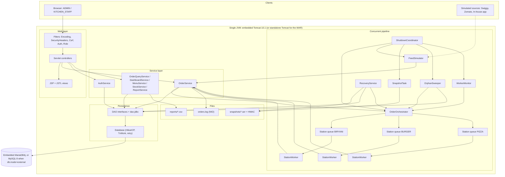

### 2.2 Layers and dependency rules

| Layer | Packages | May depend on | Must not depend on |
|---|---|---|---|
| Web (controller + view) | `web.controller`, `web.filter`, `web.listener`, `web.support`, JSPs | `service`, `dto`, `domain` (read-only), `pipeline` views via `DashboardService` | `dao`, `db`, `java.sql` |
| Service | `service` | `dao`, `db`, `domain`, `dto`, `exception`, `pipeline.OrderDispatcher`, `pipeline.InFlightRegistry`, `pipeline.MetricsRegistry`, `io.OrderEventLog` | `jakarta.servlet.*` |
| Pipeline | `pipeline` | `service` (`OrderService`), `domain`, `dto`, `io.OrderEventLog` | `jakarta.servlet.*`, `java.sql` (uses services) |
| Persistence | `dao`, `dao.jdbc`, `db` | `domain`, `exception`, `java.sql` | `service`, `web`, `pipeline` |
| Domain | `domain`, `domain.enums`, `domain.contract`, `exception` | JDK only | everything else |
| Cross-cutting | `config`, `util`, `io`, `snapshot`, `bootstrap` | as needed; `snapshot` and `bootstrap` may use `java.sql` through `db.Database` | `web` (except `bootstrap.Launcher` which starts Tomcat) |

Enforced mechanically by `ArchitectureRulesTest` (NFR-MNT-01).

### 2.3 Component diagram

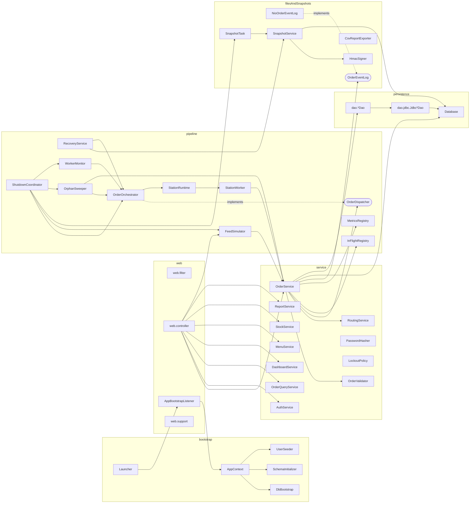

Note on the service/pipeline cycle: `OrderService` depends on the *interface* `OrderDispatcher`; `OrderOrchestrator` implements it and also depends on `OrderService` (used by workers). The cycle is broken at construction time: `AppContext` creates the orchestrator first, passes it to `OrderService` as an `OrderDispatcher`, then calls `orchestrator.start(orderService, stations)` (see §2.4).

### 2.3a Embedded database security (Phase 1 finding, EV-004/EV-005, decision D-043)

MariaDB4j starts the server with `--skip-grant-tables` and no `--bind-address`: any client, with any user name and no password, gets full access on every network interface of the host, and the installer also leaves anonymous accounts and a `test` database. `DbBootstrap` therefore does not use that configuration:

1. **One-time bootstrap** (marker file `<data dir>/.ck-hardened` absent): start the server socket-only (`--skip-grant-tables --skip-networking`, socket inside the project's `data/` tree with owner-only permissions), delete the anonymous accounts, drop `test`, create the application database (`utf8mb4`, `utf8mb4_unicode_ci`) and the application account (`db.user`, password `db.password`, granted only on that database, for `127.0.0.1` and `localhost`), stop the server, write the marker.
2. **Every start**: grants enforced (no `--skip-grant-tables`) and `--bind-address=127.0.0.1`.
3. `root` keeps the installer's `unix_socket` authentication, so it cannot be used over TCP. `db.password` must match `[A-Za-z0-9_.!@#%^*+=-]{12,128}` (it is placed in a SQL literal during bootstrap; quotes and backslashes are rejected).
4. Consequence: changing `db.password` for an existing data directory does not change the stored password; delete `data/db` (embedded data only) or change it with an administrative step in a later phase.
5. The server refuses to run as the operating-system `root` user (MariaDB's own rule); run the application as an ordinary user. See EVIDENCE.md EV-002/EV-003.

### 2.4 Startup and composition (`AppContext`)

Manual wiring, in this order (each step logs at INFO). Any failure aborts startup after cleaning up what was already started.

1. `AppConfig` loaded and validated (`AppConfig.load()`; the embedded launcher may pass an instance through servlet-context attribute `ck.config`; tests build one with `AppConfig.fromProperties(...)`).
2. `DbBootstrap.start(config)` if `db.mode=embedded` (MariaDB4j child process, data in `./data`); no-op if `external`.
3. `DataSourceFactory.create(config)` -> HikariCP pool; `Database` facade created.
4. `SchemaInitializer.apply()` runs `V001__schema.sql`, `V002__seed_reference_data.sql` once (`schema_version`).
5. `UserSeeder.seedIfEmpty()` creates initial users from config (hash with `PasswordHasher`).
6. Create `MetricsRegistry`, `InFlightRegistry`, `NioOrderEventLog`, `RoutingService` (loaded from `StationDao`), DAOs.
7. Create `OrderOrchestrator` (queues + executor not yet running), then `OrderService(…, dispatcher = orchestrator, …)`, then `orchestrator.start(orderService)` which creates the `StationWorker`s.
8. `SnapshotService`, `SnapshotTask` (not yet scheduled), `FeedSimulator` (idle), query/report/menu/stock services.
9. `ShutdownCoordinator` created with the ordered step list (§7.6); JVM hook installed.
10. `RecoveryService.recover()` runs on thread `recovery-loader`; `OrderService.accepting` stays false until all recovered ids are enqueued (UI shows "Recovering"); then `SnapshotTask.start()`, `OrphanSweeper.start()` (§7.9) and `accepting = true`.
11. Web layer: `AppBootstrapListener.contextInitialized` performs steps 1-10 and stores the `AppContext` in servlet-context attribute `ck.app`; servlets fetch services from it. `contextDestroyed` calls `ShutdownCoordinator.shutdown()`.

`Launcher` (embedded mode) only: loads `AppConfig`, creates `Tomcat` (port from `server.port`, 0 allowed for tests), `addWebapp("", docBase)` with `target/classes` mapped to `/WEB-INF/classes`, optionally puts the config in the context attribute, starts Tomcat and blocks in `server.await()`. For the WAR on standalone Tomcat the same listener runs and loads `AppConfig` from `-Dck.config` or `config/application.properties` relative to the working directory (documented in the README at Phase 8).

Filter and servlet registration is declared in `web.xml` (not annotations) because filter order is only deterministic from the descriptor, and the same descriptor works embedded and in the WAR. Phase 1 verifies this with the spike.

---

## 3. Package structure

```
com.cloudkitchen
├── bootstrap          Launcher, DbBootstrap, SchemaInitializer, UserSeeder, AppContext
├── config             AppConfig
├── domain             Order (abstract), SwiggyOrder, ZomatoOrder, InHouseOrder, OrderItem, OrderFactory,
│                      PaymentResult, StatusHistoryEntry, Station, MenuItem, StockLevel, StaffUser
├── domain.enums       OrderStatus, OrderSource, PaymentMode, PaymentStatus, Role, WorkerState
├── domain.contract    Trackable, Payable
├── exception          CloudKitchenException, ValidationException, InvalidStatusTransitionException,
│                      InsufficientStockException, DuplicateOrderException, QueueFullException,
│                      PersistenceException, LeaseStampStaleException, AuthenticationException, AccountLockedException,
│                      SnapshotIntegrityException, ConfigurationException
├── dto                OrderRequest, OrderItemRequest, SubmissionResult, ValidationResult, FieldError,
│                      SessionUser, OrderFilter, Page<T>, OrderSummary, StockRow, ReportRow,
│                      DashboardView, StationView, WorkerView, MetricsView
├── dao                StationDao, MenuItemDao, StockDao, OrderDao, StatusHistoryDao, StaffUserDao
├── dao.jdbc           JdbcStationDao, JdbcMenuItemDao, JdbcStockDao, JdbcOrderDao,
│                      JdbcStatusHistoryDao, JdbcStaffUserDao
├── db                 Database, TxWork<T>, DataSourceFactory, SqlErrors, LeaseStampContext, LeaseStampHook
├── service            OrderService, OrderValidator, MenuCatalog, RoutingService, SubmissionHook, StockService, MenuService,
│                      AuthService, PasswordHasher, LockoutPolicy, OrderQueryService, DashboardService,
│                      ReportService
├── pipeline           OrderDispatcher, OrderOrchestrator, StationRuntime, StationWorker, FeedSimulator,
│                      InFlightRegistry, MetricsRegistry, NamedThreadFactory, RecoveryService, OrphanSweeper, WorkerMonitor, WorkerHook,
│                      ShutdownCoordinator
├── io                 OrderEventLog, NioOrderEventLog, NoOpOrderEventLog, EventType, CsvReportExporter
├── snapshot           OrderSnapshotDTO, SnapshotService, HmacSigner, SnapshotFilterFactory, SnapshotTask
├── util               MoneyUtil, TimeUtil
└── web
    ├── controller     HealthServlet (Phase 1: GET /health -> 200 "OK", public), ErrorServlet, HomeServlet, LoginServlet, LogoutServlet, DashboardServlet,
    │                  OrderListServlet, OrderDetailServlet, OrderCreateServlet, OrderCancelServlet,
    │                  InventoryServlet, AdminMenuServlet, AdminStockServlet, SimulatorServlet,
    │                  WorkerPanelServlet, CompensationServlet, ReportServlet, SnapshotServlet, TrackServlet (COULD),
    │                  UserAdminServlet (COULD)
    ├── filter         EncodingFilter, SecurityHeadersFilter, CsrfFilter, AuthFilter, RoleFilter
    │                  (Phase 1 only: SpikeOrderFilterFirst, SpikeOrderFilterSecond, descriptor-order probes replaced in Phase 7)
    ├── listener       AppBootstrapListener
    └── support        BaseServlet, CsrfTokens, Flash, RoutePolicy
```

Non-Java layout:

```
pom.xml                          mvnw  mvnw.cmd  .mvn/wrapper/maven-wrapper.properties
config/application.properties.example     (committed)   config/application.properties (git-ignored)
src/main/resources/db/V001__schema.sql, V002__seed_reference_data.sql
src/main/resources/logback.xml
src/main/webapp/WEB-INF/web.xml
src/main/webapp/WEB-INF/views/**  (layout/header.jspf, layout/footer.jspf, login.jsp, dashboard.jsp,
                                   orders/{list,detail,new}.jsp, inventory/list.jsp, admin/{menu,stock,simulator,workers,reports,users}.jsp,
                                   track.jsp, error/{400,403,404,500}.jsp)
src/main/webapp/static/css/app.css
src/test/java/com/cloudkitchen/...   src/test/java/com/cloudkitchen/testsupport/...
docs/  CLAUDE.md  data/ logs/ snapshots/ reports/ (runtime, git-ignored)
```

---

## 4. Domain design

### 4.1 Class diagram: domain

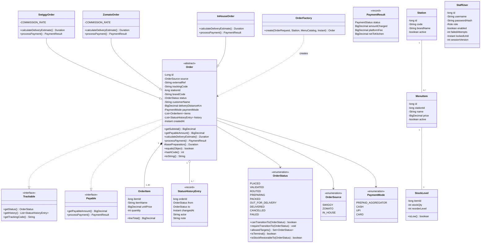

### 4.2 Catalogue of classes, interfaces and enums

Abbreviations: **E** entity class, **V** value/record, **S** service, **I** interface, **En** enum.

#### domain (`domain`, `domain.enums`, `domain.contract`)

| Type | Kind | Responsibility and key members |
|---|---|---|
| `Trackable` | I | `OrderStatus getStatus()`, `List<StatusHistoryEntry> getHistory()`, `String getTrackingCode()` |
| `Payable` | I | `BigDecimal getPayableAmount()`, `PaymentResult processPayment()` |
| `Order` | E, abstract | Common state (see diagram). Constructors: full (used by DAO) and minimal (used by factory), i.e. **overloaded**. Concrete: `getSubtotal()` (sum of `OrderItem.lineTotal()`), `getPayableAmount()`, `basePreparation()` (protected, shared by subclasses), `equals/hashCode` on `(source, externalRef)`, `toString()` (no customer name: PII). Abstract: `Duration calculateDeliveryEstimate()`, `PaymentResult processPayment()`. Collections returned are unmodifiable. |
| `SwiggyOrder`, `ZomatoOrder`, `InHouseOrder` | E | Implement/override the two abstract methods (formulas in §4.4); `toString()` overridden with the source label. |
| `OrderItem` | E | `itemId`, `itemName` (snapshot at order time), `unitPrice`, `quantity`; `lineTotal()`. |
| `OrderFactory` | S (static) | `static Order create(OrderRequest, Station, MenuCatalog, Instant now)`: `switch` on `OrderSource` returning the right subclass; prices copied from the catalogue; generates `trackingCode` and (for IN_HOUSE with blank ref) the external reference. Also `static Order rehydrate(...)` used by DAO/snapshot recovery. |
| `PaymentResult` | V (record) | `status`, `amountCharged`, `platformFee`, `netToKitchen`. |
| `StatusHistoryEntry` | V (record) | One row of `order_status_history`. `from` is null for the initial PLACED row. |
| `OrderStatus` | En | See §4.3. |
| `OrderSource` | En | `SWIGGY`, `ZOMATO`, `IN_HOUSE`; `label()`. |
| `PaymentMode` | En | `PREPAID_AGGREGATOR`, `CASH`, `UPI`, `CARD`; `allowedFor(OrderSource)`. |
| `PaymentStatus` | En | `PENDING`, `PAID`, `FAILED`. |
| `Role` | En | `ADMIN`, `KITCHEN_STAFF`. |
| `WorkerState` | En | `STARTING`, `IDLE`, `PROCESSING`, `PAUSED`, `STOPPING`, `STOPPED`, `DEAD` (monitor gave up after the restart budget, §7.11.7). |
| `Station` | E | One kitchen station = one brand: `id`, `code`, `brandName`, `active`. |
| `MenuItem` | E | `id`, `stationId`, `name`, `price`, `active`. |
| `StockLevel` | E | `itemId`, `stockQty`, `reorderLevel`; `isLow()` is `stockQty <= reorderLevel`. |
| `StaffUser` | E | Login account incl. lockout state and `sessionVersion` (session revocation counter, §12.10); `passwordHash` never rendered or logged (`toString()` omits it). |

#### exception (all checked unless noted)

| Exception | Extends | Thrown when |
|---|---|---|
| `CloudKitchenException` | `Exception` | Base type; carries a stable `code` string. |
| `ValidationException` | base | `OrderValidator.requireValid` fails; holds `List<FieldError>`. |
| `InvalidStatusTransitionException` | base | `OrderStatus.requireTransitionTo` on an illegal pair. |
| `InsufficientStockException` | base | Conditional deduction updates 0 rows; holds `itemId`. |
| `DuplicateOrderException` | base | Unique violation on `(source, external_ref)`; holds existing order id when known. |
| `QueueFullException` | base | Station queue `offer` timed out (or was interrupted); holds station code. |
| `PersistenceException` | base | Wraps `SQLException` (deadlock retries exhausted, connection failure). |
| `AuthenticationException` | base | Bad credentials; message is always the generic text. |
| `AccountLockedException` | `AuthenticationException` | Locked account; internal use, never shown differently. |
| `SnapshotIntegrityException` | base | HMAC mismatch, truncated or filtered snapshot. |
| `LeaseStampStaleException` | `PersistenceException` | A usable-lease statement or its commit slipped beyond the guard budget (S-5); the transaction is rolled back and the operation retried with a fresh stamp. |
| `ConfigurationException` | `RuntimeException` | Missing/invalid configuration at startup (unchecked: startup-only). |

#### dto (all records unless noted)

| Type | Content |
|---|---|
| `OrderRequest` | Fields in SRS §2.6; compact constructor trims strings; list copied with `List.copyOf`. |
| `OrderItemRequest` | `long itemId`, `int quantity`. |
| `SubmissionResult` | `Outcome outcome` (`ACCEPTED`, `DUPLICATE`, `REJECTED`, `QUEUE_FULL`, `INDETERMINATE`: the order exists but neither FAILED nor the PENDING marker could be committed; nothing was promised and the order continues as an ordinary order, DC-1), `Long orderId` (nullable), `boolean compensated` (meaningful for `QUEUE_FULL`: false when TX4 could not complete and the durable `PENDING` marker was committed instead, §7.10), `OrderStatus existingStatus` and `boolean compensationPending` (meaningful for `DUPLICATE`), `String reasonCode` (`VALIDATION`, `INSUFFICIENT_STOCK`, `TEMPORARY_FAILURE`, `STARTING_UP`, `SHUTTING_DOWN`, `QUEUE_FULL`, null), `List<FieldError> errors`. Static factories `accepted(id)`, `duplicate(id, existingStatus, compensationPending)`, `indeterminate(id)`, `rejected(reason, errors)`, `queueFull(id, compensated)`. |
| `ValidationResult`, `FieldError` | `FieldError(String field, String code, String message)`; `ValidationResult.isValid()`, `errors()`, `merge`. |
| `SessionUser` | `userId`, `username`, `role`, `sessionVersion` (immutable, stored in the HTTP session; validated against the database on every protected request, §12.10). |
| `FencingToken` | `orderId`, `owner` (`<CODE>#<generation>`), `epoch` (the `claim_epoch` value read back after acquiring the lease, §7.11.3). Passed to the fenced `OrderService.transition` overload and to renew/release. |
| `OrderFilter` | `status?`, `source?`, `externalRefContains?`, `fromUtc?`, `toUtc?`. |
| `Page<T>` | **Generic**: `List<T> items`, `int page`, `int pageSize`, `long total`; `totalPages()`. |
| `OrderSummary` | List row: id, source, brandCode, externalRef, status, total, createdAt. |
| `StockRow` | itemId, itemName, brandCode, stockQty, reorderLevel, `low` flag. |
| `ReportRow` | Report columns (no customer data). |
| `DashboardView`, `StationView`, `WorkerView`, `MetricsView` | Snapshot of statuses, queue size/capacity, worker state, current order id, processed count, `consecutiveFailures` (transient failures in a row, RR-8), worker `generation`, `restarts`, `heartbeatAgeMillis`, leased order id, `pendingCompensations` count and `oldestPendingCompensationAgeSeconds` (dashboard), metric counters and average processing time. |

### 4.3 Order lifecycle state machine (`OrderStatus`)

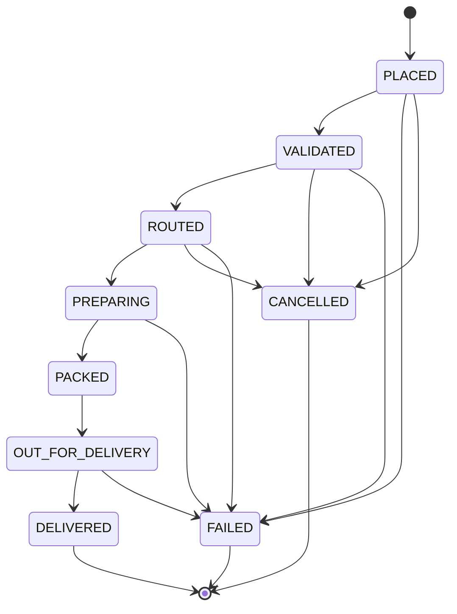

Implementation rules for `OrderStatus`:
* Each constant is declared with its allowed targets (constructor argument or a static `EnumMap<OrderStatus, Set<OrderStatus>>` initialised in a static block). **This is the only place the transition table exists.**
* `canTransitionTo(OrderStatus target)`: membership test. `requireTransitionTo(target)`: throws `InvalidStatusTransitionException(this, target)`. `allowedTargets()`: unmodifiable `EnumSet` copy. `isTerminal()`: `allowedTargets().isEmpty()`.
* `isStockRestorableTo(OrderStatus target)`: true iff `this` is `VALIDATED` or `ROUTED` and `target` is `CANCELLED` or `FAILED`. (`PLACED` never holds stock: it exists only inside TX1 before the deduction commits. `PREPARING` and later never restore.)
* Persisted as the enum `name()` in `VARCHAR(20)`; parsed with `OrderStatus.valueOf` in the DAO.
* Non-terminal statuses (recovery set) = every status except `DELIVERED`, `CANCELLED`, `FAILED` (`OrderStatus.nonTerminal()` returns an `EnumSet`).
* Note: `PLACED -> FAILED|CANCELLED` exist in the locked table. In the planned flow `PLACED` is never committed on its own (TX1 inserts PLACED and moves to VALIDATED in one transaction), so these two edges are reachable only from direct service calls and unit tests. This is deliberate and consistent with the locked decision.

### 4.4 Source-specific behaviour (illustrative formulas, finalised and tested in Phase 2)

Shared in `Order`: `basePreparation()` = 15 minutes + 1 minute per 2 items (integer division of total quantity by 2).

| Source | `calculateDeliveryEstimate()` | `processPayment()` |
|---|---|---|
| `SwiggyOrder` | `basePreparation()` + 5 min hand-off + ceil(4 x km) min | Status `PAID`; `platformFee` = 20% of subtotal (HALF_UP, scale 2); `netToKitchen` = subtotal - fee; `amountCharged` = subtotal |
| `ZomatoOrder` | `basePreparation()` + 7 min hand-off + ceil(3.5 x km) min | Status `PAID`; `platformFee` = 22% of subtotal; same arithmetic |
| `InHouseOrder` | `basePreparation()` + ceil(3 x km) min (own riders, no hand-off) | `platformFee` = 0.00; `PENDING` for `CASH`, `PAID` for `UPI`/`CARD` |

For `InHouseOrder`, `amountCharged` = subtotal and `netToKitchen` = subtotal (Phase 2 clarification; `PaymentResult` rejects any record whose net differs from charged minus fee). `ceil` is done with `BigDecimal.setScale(0, RoundingMode.CEILING)`. The estimate is stored as `estimated_delivery_at = created_at + estimate`; payment status/fee at creation. Rates are `private static final BigDecimal` constants; changing them is a code change (documented limitation).

---

## 5. Persistence-facing design

### 5.1 `Database` facade (package `db`)

* `DataSourceFactory.create(AppConfig)` builds a `HikariDataSource` (max size `db.pool.max.size`, connection timeout, `connectionInitSql = "SET time_zone = '+00:00'"` and `SET NAMES utf8mb4` if the driver does not already do so; leak detection threshold 30 s in dev).
* `Database` wraps the `DataSource`:
  * `<T> T inTransaction(TxWork<T> work)` and **overload** `inTransaction(TxWork<T> work, int maxRetries)`: borrows a connection, `setAutoCommit(false)`, runs the work, commits; on exception rolls back; on a deadlock (`SqlErrors.isDeadlock`: SQLState `40001` or vendor code `1213`) rolls back, pauses `tx.retry.backoff.ms * attempt` (with interrupt restore) and re-runs the **whole** work up to `tx.retry.max` (3) times; then throws `PersistenceException`. Always restores auto-commit and closes the connection (returns it to the pool).
  * `<T> T withConnection(TxWork<T> work)`: read-only/autocommit work (queries).
  * `void close()`.
* `TxWork<T>`: `@FunctionalInterface interface TxWork<T> { T run(Connection c) throws SQLException, CloudKitchenException; }` (generic functional interface).
* `SqlErrors`: `isTransient(Throwable)` (whitelist used by workers, RR-8), `isDeadlock(SQLException)`, `isDuplicateKey(SQLException)` (SQLState `23000` and vendor code `1062`, also checks the cause chain), `isUnavailable(SQLException)`.
* `LeaseStampContext` (package `db`): bound to the thread by `inTransaction` for the duration of a transaction; DAO lease methods register their stamp with it (earliest stamp `s0` kept); `Database` calls `verify(clock.instant())` right before `commit` and rolls back with `LeaseStampStaleException` when the guard budget `margin/2` is exceeded (§7.11.15, S-4/S-5). `LeaseStampHook` is the matching test seam (`AFTER_STAMP`, `AFTER_EXECUTE`, `BEFORE_COMMIT`).
* Rule: no `Connection` is stored in any field or passed between threads (FR-CON-06). DAO methods receive the `Connection` as their first parameter and never commit, roll back or close it.

### 5.2 DAO catalogue (interfaces in `dao`, JDBC implementations in `dao.jdbc`)

All statements are `PreparedStatement`s with bound parameters; `Statement.RETURN_GENERATED_KEYS` for inserts; timestamps bound with a UTC `Calendar`/`Timestamp` helper in `TimeUtil`.

| DAO | Methods (first parameter is always `Connection c`) |
|---|---|
| `StationDao` | `List<Station> findAllActive(c)`, `Optional<Station> findByCode(c, code)`, `Optional<Station> findById(c, id)` |
| `MenuItemDao` | `Map<Long,MenuItem> findByIds(c, Collection<Long>)`, `List<MenuItem> findByStation(c, stationId, boolean activeOnly)`, `List<MenuItem> findAll(c)`, `long insert(c, MenuItem)`, `boolean update(c, id, price, active)` |
| `StockDao` | `boolean deduct(c, itemId, qty)` (conditional UPDATE, true iff 1 row), `void restore(c, itemId, qty)`, `List<StockRow> findAll(c)`, `List<StockRow> findLow(c)`, `void set(c, itemId, stockQty, reorderLevel)`, `Optional<StockLevel> find(c, itemId)` |
| `OrderDao` | `long insert(c, Order)`, `void insertItems(c, orderId, List<OrderItem>)`, `Optional<Order> findById(c, id)` (with items), `Optional<Long> findIdBySourceAndRef(c, source, ref)`, `List<Order> findStaleNonTerminal(c, Duration orphanAfter, int limit)` (sweeper, §7.9; excludes pending compensation and unexpired leases), `List<Order> findNonTerminalForProcessing(c)` (recovery and snapshot; excludes `compensation_state = 'PENDING'`), `List<Order> findDuePendingCompensations(c, int limit)` and `List<Order> findAllPendingCompensations(c)` (§7.10), `boolean markCompensationPending(c, orderId, reason, nextAt)` (TXC1), `void recordCompensationFailure(c, orderId, nextAt)` (TXC3), `OptionalInt acquireLease(c, orderId, owner, Duration ttl)` (free lease or same owner; returns the new epoch), `boolean renewLease(c, orderId, epoch, owner, Duration ttl)` (requires a valid lease), `boolean releaseLease(c, orderId, epoch, owner)`, `List<Order> findReconcilable(c, stationId, Duration dispatchWindow, int limit)` (§7.11.14), `List<Long> expireLeasesOf(c, owner)`, `int clearAllLeases(c)` (startup). **Clock rule:** the JDBC DAO instances are constructed with the `Clock`; every lease-validity comparison and every `lease_expires_at` value uses a stamp read inside the method by the stamp helper as the last action before `executeUpdate`/`executeQuery` (L-1, §7.11.15); renewal, owner-fenced steps and `failAsOwner` additionally register the stamp with the transaction's `LeaseStampContext` and are subject to the execution and pre-commit guard (`LeaseStampStaleException`, rollback, S-5); no lease method accepts a timestamp, so no caller can pass a stale one; `boolean transition(c, orderId, from, to, FencingToken token, Duration ttl)` (owner-fenced overload: adds `AND claim_epoch = ? AND claimed_by = ? AND lease_expires_at > :usableAfter`, stamp protocol §7.11.15; for a terminal target also clears the lease), `boolean transition(c, orderId, from, to, Instant now)` (conditional; adds `AND compensation_state IS NULL` when `to = ROUTED`; sets `compensation_state = RESOLVED` in the same statement when a `PENDING` order leaves `VALIDATED` for a terminal status), `boolean markStockDeducted(c, orderId)` (`WHERE stock_deducted = 0`), `boolean claimStockRestore(c, orderId)` (sets 0 `WHERE stock_deducted = 1`), `List<Order> findNonTerminal(c)`, `Map<OrderStatus,Long> countByStatus(c)` (returns `EnumMap`), `List<OrderSummary> findSummaries(c, OrderFilter, limit, offset)`, `long count(c, OrderFilter)`, `Optional<Order> findByTrackingCode(c, code)`, `List<ReportRow> findForReport(c, fromUtc, toUtc)`, `long insertRecovered(c, Order)` |
| `StatusHistoryDao` | `void insert(c, StatusHistoryEntry)`, `List<StatusHistoryEntry> findByOrderId(c, orderId)` (ordered by `changed_at, id`) |
| `StaffUserDao` | `Optional<StaffUser> findByUsername(c, name)`, `Optional<StaffUser> findByUsernameForUpdate(c, name)`, `long insert(c, StaffUser)`, `void updateLoginState(c, userId, failedAttempts, lockedUntil, lastLoginAt)`, `void updatePassword(c, userId, hash)` (also bumps `session_version`), `Optional<SessionState> findSessionState(c, userId)` (`enabled`, `user_role`, `session_version`; primary-key lookup), `boolean setEnabled(c, userId, enabled)` (sets the flag and increments `session_version`), `long countEnabledAdmins(c)` (`FOR UPDATE`), `long count(c)`, `List<StaffUser> findAll(c)` |

### 5.3 Service catalogue (package `service`)

| Service | Responsibility and public methods |
|---|---|
| `OrderService` | Core use case orchestration. `SubmissionResult submitOrder(OrderRequest)`; `boolean transition(long orderId, OrderStatus from, OrderStatus to, String actor, String note)` (one transaction: conditional update + history + conditional stock restore via `isStockRestorableTo` and `claimStockRestore`); **overload** `transition(Connection, ...)` for use inside a caller's transaction; `boolean cancelOrder(long orderId, String actor)`; `boolean failOrder(long orderId, OrderStatus expectedFrom, String actor, String reason)`; `void setAccepting(boolean)`, `boolean isAccepting()`. Depends on `Database`, DAOs, `OrderValidator`, `RoutingService`, `OrderDispatcher`, `InFlightRegistry`, `MetricsRegistry`, `OrderEventLog`, `Clock`, a `SubmissionHook` (test seam, default no-op). Compensation outcome is durable (§7.10): `compensate(orderId, reason)` runs TX4, falls back to `markCompensationPending` (TXC1), else returns `INDETERMINATE`; `completePendingCompensation(orderId)` is called by the sweeper and by startup recovery. **Owner-fenced API used only by `StationWorker`** (F-6): `Optional<FencingToken> acquireLease(orderId, owner)`, `boolean renewLease(FencingToken)`, `void releaseLease(FencingToken)`, `boolean transitionAsOwner(FencingToken, from, to, note)` and `boolean failAsOwner(FencingToken, expectedFrom, reason)`. **Non-owner API** (staff, submitter, sweeper, operator, recovery; never from workers): `transition`, `failOrder`, `cancelOrder`, `compensate`, `completePendingCompensation`, `retryCompensation(orderId, SessionUser admin)` (§7.10.11). Infrastructure: `int clearAllLeases()`, `List<Long> reclaimLeasesOf(owner)` (monitor and recovery only). Call-site rules: §7.12.5. `submitOrder` follows the post-offer rule RR-1 and compensation rule RR-10; `cancelOrder` follows RR-7 (§7.8). |
| `OrderValidator` | Pure. `ValidationResult validate(OrderRequest, MenuCatalog)`; `void requireValid(OrderRequest, MenuCatalog) throws ValidationException`. Rules §11. |
| `MenuCatalog` | Immutable lookup built per submission: `Optional<MenuItem> item(long)`, `Optional<Station> station(String code)`. Factory `MenuCatalog.of(Collection<Station>, Collection<MenuItem>)`. |
| `RoutingService` | `Optional<Station> stationFor(String brandCode)`, `List<Station> stations()`, `refresh(Collection<Station>)` (copy-on-write volatile map). |
| `StockService` | `List<StockRow> listAll()`, `List<StockRow> listLow()`, `void adjust(itemId, stockQty, reorderLevel)` (validated, SHOULD). |
| `MenuService` | `Map<Long,MenuItem> findByIds(Collection<Long>)`, `List<MenuItem> listAll()`, `List<MenuItem> activeForStation(code)`, `long create(...)`, `void update(id, price, active)` (SHOULD). |
| `AuthService` | `SessionUser authenticate(String username, char[] password) throws AuthenticationException`; `Optional<SessionUser> validateSession(SessionUser)` (per-request account check, §12.10), `void setEnabled(long actorUserId, long targetUserId, boolean enabled)` (TX10: refuses self-disable and disabling the last enabled ADMIN; bumps `session_version`), `void resetPassword(long userId, char[] newPassword)` (COULD; bumps `session_version`). `authenticate` refuses disabled accounts with the generic message. Uses `PasswordHasher`, `LockoutPolicy`, `StaffUserDao.findByUsernameForUpdate` in a transaction; clears the password array after use. |
| `PasswordHasher` | `String hash(char[])`, **overload** `hash(char[], int iterations)`, `boolean verify(char[], String stored)`, `boolean needsRehash(String stored)`, `static boolean constantTimeEquals(byte[], byte[])` (via `MessageDigest.isEqual`). Format `pbkdf2_sha256$<iterations>$<saltB64>$<hashB64>`; 16-byte salt from `SecureRandom`, 256-bit derived key. |
| `LockoutPolicy` | Pure. `record LockoutState(int failedAttempts, Instant lockedUntil)`; `boolean isLocked(LockoutState, Instant now)`; `LockoutState afterFailure(LockoutState, Instant now)` (5th failure sets `lockedUntil = now + 5 min`); `LockoutState afterSuccess()`; `LockoutState normalise(LockoutState, Instant now)` (expired lock resets the counter). |
| `OrderQueryService` | `Page<OrderSummary> list(OrderFilter, int page)`, `Optional<Order> detail(long id)` (with history), `Optional<Order> byTrackingCode(String)`, `Map<OrderStatus,Long> countByStatus()`. |
| `DashboardService` | `DashboardView snapshot()`: combines `OrderQueryService.countByStatus`, `StockService.listLow`, `OrderOrchestrator.stationViews()`, `MetricsRegistry.view()`, simulator state, recovery state. |
| `SubmissionHook` | Test seam (interface in `service`, default no-op): `void at(Stage stage)` with `Stage` = `AFTER_TX1`, `AFTER_OFFER`, `AFTER_ROUTED`. `RoutingCrashWindowTest` installs a hook that throws a simulated crash (an `Error` subclass that no `catch` in `OrderService` handles) to emulate a process death at that point. Never set in production wiring. |
| `ReportService` | `Path exportDaily(LocalDate utcDay)` (query + `CsvReportExporter`), `void writeDaily(LocalDate, Writer)` for HTTP download. |

---

## 6. Order flow

### 6.1 Activity diagram: submission to routing

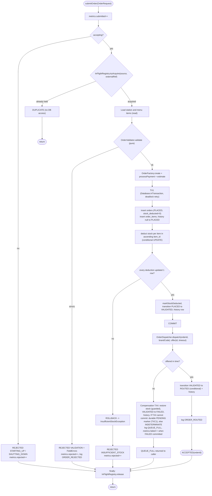

(`DUPLICATE` caused by the database unique constraint inside TX1 follows the TX1 failure branch: rollback, look up the existing order id, return `DUPLICATE(existingId)`.)

### 6.2 Sequence: successful submission

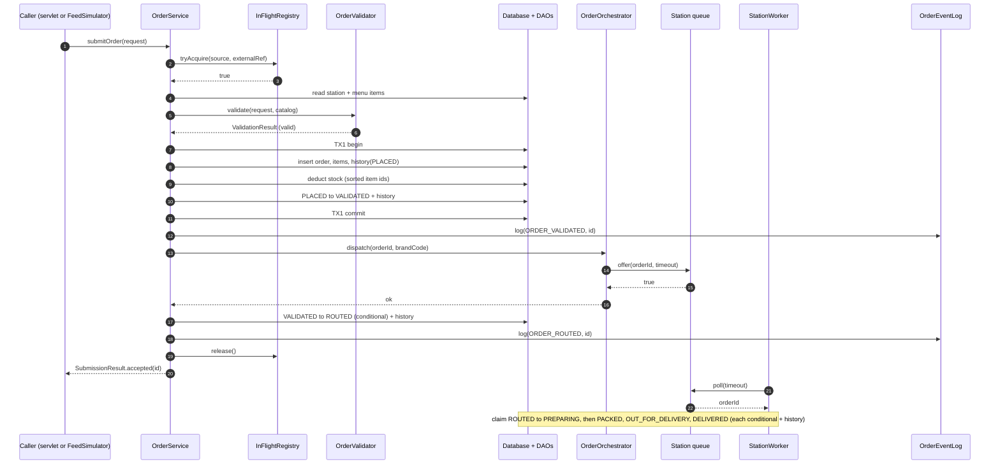

### 6.3 Sequence: queue-full compensation

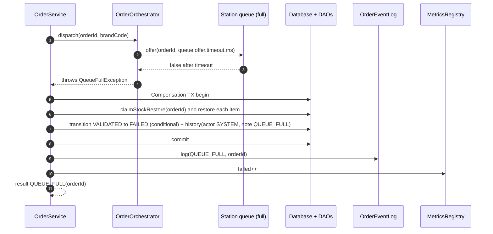

If the conditional transition affects 0 rows (for example staff cancelled the order meanwhile), nothing else is done in that transaction: no restore (the winner already did it), no history row, no `failed` increment (I-5). The compensation applies only when `offer` did **not** insert the id (RR-1, RR-11); if TX4 itself keeps failing, RR-10 applies. Full analysis: §7.8.

### 6.4 Cancel and fail with conditional stock restore

`OrderService.transition(orderId, from, to, actor, note)` (single transaction):
1. `from.requireTransitionTo(to)` (throws before touching the DB).
2. `OrderDao.transition(c, orderId, from, to, now)`: `UPDATE orders SET status = ?, updated_at = ? WHERE id = ? AND status = ?`. If 0 rows: return `false` (someone else moved it; nothing else is done).
3. Insert `order_status_history` row (from, to, actor, note, now).
4. If `from.isStockRestorableTo(to)`: `claimStockRestore(c, orderId)`; if it returns true, for each order item `StockDao.restore(c, itemId, qty)`. Items are restored in ascending `item_id` order for lock-order consistency.
5. Commit; return `true`. Log event; update metrics (`failed` when `to == FAILED`; `processed` is updated only by the worker on DELIVERED).

`cancelOrder` loops at most 3 times (RR-7): read the current status and compensation marker with a fresh auto-commit read; if the marker is `PENDING` return `false` with reason `AWAITING_COMPENSATION` (resolved only by the operator operation, §7.10.11); if the status is not cancellable (`!current.canTransitionTo(CANCELLED)`) return `false`; otherwise `transition(id, current, CANCELLED, ...)`; a `true` result ends the loop, a `false` result re-reads and tries again. It returns `false` only when the order is genuinely not cancellable, awaiting compensation (or still contended after 3 rounds), and the controller then shows a flash error.

### 6.5 Sequence: startup recovery

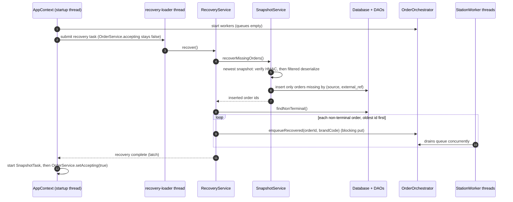

If a snapshot fails verification the failure is logged (no content) and the snapshot is ignored; the database remains the source of truth. VALIDATED orders recovered from the database are enqueued and then moved to ROUTED by the worker itself (RR-3). Orders in PREPARING/PACKED/OUT_FOR_DELIVERY are enqueued and resumed from their current status. An order whose station has no running worker is moved to FAILED with note `STATION_UNAVAILABLE` (RR-9). Per-status results: §7.8.10.

---

## 7. Concurrency design

### 7.1 Thread-ownership table

| # | Thread / pool | Name pattern | Created and owned by | Count | Started | Stopped | Runs | Shared state touched (guard) |
|---|---|---|---|---|---|---|---|---|
| 1 | Tomcat request threads | `http-nio-<port>-exec-<n>` | Tomcat (container) | pool | on request | Tomcat stop | Filters, servlets, `OrderService.submitOrder`, queries | `InFlightRegistry` (concurrent set), `MetricsRegistry` (atomics), station queues (`ArrayBlockingQueue` internal lock), DB pool (own connection per call) |
| 2 | Startup thread | `main` (embedded) / `localhost-startStop-<n>` (standalone) | Container | 1 | start | ends after startup | `AppContext.start` (§2.4); also runs `contextDestroyed` at stop | Writes `AppContext` once, published via servlet-context attribute |
| 3 | Station workers | `station-<code>-worker`, e.g. `station-BIRYANI-worker` (code exactly as stored) | `OrderOrchestrator` via `ExecutorService` = `ThreadPoolExecutor` (core = n stations, maximum = n + `worker.restart.max`, `SynchronousQueue`, `NamedThreadFactory` with an `UncaughtExceptionHandler`; each `StationWorker` sets its own final thread name on start) | one per station | `orchestrator.start(...)` | graceful drain then `shutdownNow()` | `StationWorker.run()` | its own queue (consumer), `OrderService.transition` (DB), `MetricsRegistry`; own `volatile` state fields |
| 4 | Feed simulator | `feed-simulator` | `FeedSimulator` via `ScheduledExecutorService` (single thread) | 1 | `start(rate)` schedules the task; executor created at construction | `stop()` cancels the task; `shutdownNow()` at app shutdown | `tick()` builds an `OrderRequest` and calls `OrderService.submitOrder` | `running` (`AtomicBoolean`), `rate` (`AtomicInteger`), start/stop `synchronized` on the simulator |
| 5 | Snapshot scheduler | `snapshot-scheduler` | `SnapshotTask` via `ScheduledExecutorService` (single thread) | 1 | after recovery | `stop()` / shutdown | `SnapshotService.writeSnapshot()` | Own DB connection; file writes to a temp file then atomic move |
| 6 | Recovery loader | `recovery-loader` | `AppContext` via single-thread executor | 1, short-lived | startup | exits when done / interrupted | `RecoveryService.recover()` | Station queues (`put`), DB |
| 6b | Orphan sweeper | `reconcile-scheduler` | `OrphanSweeper` via `ScheduledExecutorService` (single thread) | 1 | after startup recovery (initial delay `recovery.sweep.initial.delay.seconds`) | first shutdown steps after `setAccepting(false)` and simulator stop | `OrphanSweeper.runOnce()` | `queuedIds` hint sets (concurrent), DB leases and durable compensation markers, DB via standard transitions |
| 6c | Worker monitor | `worker-monitor` | `WorkerMonitor` via `ScheduledExecutorService` (single thread), started by `OrderOrchestrator.start` | 1 | after workers start | stopped with the sweeper before draining | `WorkerMonitor.runOnce()`: health check (D1/D2), restart/reclaim, and queue reconciliation (§7.11.14) every `worker.health.interval.seconds` | worker `volatile` heartbeat/state, `StationRuntime` (restart synchronised per runtime), physical queue snapshots, DB leases |
| 7 | Shutdown hook | `ck-shutdown-hook` | `ShutdownCoordinator.installJvmHook()` (`Runtime.addShutdownHook`) | 1 | JVM exit | n/a | `ShutdownCoordinator.shutdown()` | `AtomicBoolean started`, `CountDownLatch done` |
| 8 | Hikari housekeeper | `HikariPool-1 housekeeper` | HikariCP (daemon) | 1 | pool creation | `HikariDataSource.close()` | Pool maintenance | internal |
| 9 | Embedded DB | child process (MariaDB4j) + its output-pump thread | `DbBootstrap` | 1 | startup | last shutdown step | MySQL-compatible server | n/a |
| 10 | Test threads | `test-*` | tests | n/a | n/a | n/a | n/a | n/a |

Every thread-owning class has: a name, a documented stop method, and `InterruptedException` handling that restores the interrupt flag (`Thread.currentThread().interrupt()`) and exits or aborts the unit of work cleanly.

### 7.2 Queues and workers

* `StationRuntime` (one per station) holds `Station`, `ArrayBlockingQueue<Long> queue` (capacity `station.queue.capacity`, fair = false), and its `StationWorker`. Methods: `boolean tryEnqueue(long orderId, long timeoutMs) throws InterruptedException`, `void putBlocking(long orderId) throws InterruptedException` (recovery), `int size()`, `int capacity()`, `WorkerView workerView()`, `boolean queuedOnHealthyWorker(long orderId)`, the in-memory hint sets `queuedIds` / `activeIds` (§7.9.1; never proof of ownership, §7.11.2), the worker `generation` and its restart history.
* `OrderOrchestrator implements OrderDispatcher`:
  * `void start(OrderService)`: creates a `StationRuntime` per active station from `RoutingService`, builds the executor with one thread per station, submits each `StationWorker`.
  * `void dispatch(long orderId, String brandCode) throws QueueFullException`: finds the runtime by brand code; `tryEnqueue(orderId, queue.offer.timeout.ms)`; on `false` throws `QueueFullException`; on `InterruptedException` restores the flag and throws `QueueFullException` (cause set) so the caller compensates.
  * `void enqueueRecovered(long orderId, String brandCode) throws InterruptedException`.
  * `void pause(String code)`, `void resume(String code)`, `void repairAll()` and `void repairStation(StationRuntime)` (the shared routine of §7.13.6, called by the monitor and the sweeper), `void restartWorker(String code, long expectedGeneration, String reason)` (compare-and-set on the runtime's current generation under the runtime lock, so concurrent repairs restart once; retire the generation, reclaim leases, start generation+1 on the same queue, §7.11.5; also the admin *Restart* action), `List<StationView> stationViews()`; creates and owns the `WorkerMonitor` (§7.11.4).
  * `void shutdownGracefully(Duration drain, Duration await)`: §7.6.
* `OrderDispatcher` (interface) exposes only `dispatch(...)`, so `OrderService` and tests (`BlockingOrderDispatcher`, `AlwaysFullOrderDispatcher`) never see executors.

### 7.3 Worker loop


`processOrder(id)` is a state-machine loop driven by the **current** status read from the DB with a fresh auto-commit read (RR-4); this is what makes recovered orders resumable and duplicates harmless:

0. **Admission and lease (§7.11).** Fresh read of status and `compensation_state`: terminal -> skip (RR-5, `ORDER_SKIPPED_TERMINAL`); `PENDING` compensation -> skip (`ORDER_SKIPPED_PENDING_COMPENSATION`, §7.10.5). Check `retired` and the current generation (L-6). Then `acquireLease(orderId, "<CODE>#<generation>")`: empty -> another valid lease exists (or the order just became terminal/pending): skip (`ORDER_SKIPPED_LEASED`), nothing is lost because that owner owns the order; the lease is released and the worker exits if it turned out to be retired. Success -> a `FencingToken` (epoch) used by every mutation below. `activeIds.put(id, generation)` is a diagnostic hint only. A `0`-row result from a step or a renewal is handled by rule L-5 (stand down, or re-acquire when the lease merely expired and nobody superseded it). The lease is released in `finally` (best effort, epoch-fenced) unless the terminal step already cleared it. All history rows use actor `worker:<CODE>#<generation>` (F-8).
1. **Claim (`advanceToPreparing`)**, at most 5 read/transition iterations, no sleeping, all updates fenced by the token: read the status. Terminal -> skip (RR-5). `VALIDATED` -> conditional `VALIDATED -> ROUTED` (actor `worker:<CODE>#<generation>`, note `ROUTED_BY_WORKER`), then re-read whether it returned true or false (the submitter may have routed it first, RR-3). `ROUTED` -> conditional `ROUTED -> PREPARING`; true means claimed (processing time starts), false -> re-read. `PREPARING`, `PACKED`, `OUT_FOR_DELIVERY` -> resume from that status (recovered or parked order).
2. `PREPARING`: sleep `worker.prep.ms` (in slices, heartbeat and lease renewal between slices), then fenced `transition(PREPARING -> PACKED)`.
3. `PACKED`: sleep `worker.pack.ms`, then `transition(PACKED -> OUT_FOR_DELIVERY)`.
4. `OUT_FOR_DELIVERY`: sleep `worker.delivery.ms`, then `transition(OUT_FOR_DELIVERY -> DELIVERED)`; only if that returned true: `metrics.processed++` and `metrics.recordProcessingTime(nanos since claim)`.
5. Every `transition` returning `false` means another actor owns the step: re-read; terminal -> stop; if the epoch or lease owner changed -> stand down (`LEASE_LOST`, never retry, never touch the order again); otherwise continue from the status read (RR-6). Never an error, never a metric.
6. The actor recorded in history is `worker:<CODE>#<generation>`.
7. **Failures** are classified (RR-8): transient -> retry the same step in place with capped backoff, park after `worker.retry.max` failures and never mark the order `FAILED` for an outage; permanent -> `failAsOwner(...)`, `failed++`; interrupt -> restore the flag, leave the order untouched, exit. The outer loop catches `Throwable` per order (except `VirtualMachineError`) so the thread never dies from one order. If it dies anyway, `WorkerMonitor` replaces it (§7.11.4-§7.11.5). Parking releases the lease before re-offering the id.

Pause semantics: `pause()` takes effect between orders (the current order is finished). `resume()` clears the flag. At shutdown the coordinator clears `paused` so a paused worker can drain or stop.

### 7.4 Races, idempotence and why each is safe

| Race / duplicate | Mechanism that makes it safe |
|---|---|
| Two submissions of the same external order at once | `InFlightRegistry.tryAcquire` (fast path, in-JVM) and `UNIQUE (source, external_ref)` (authoritative, also across restarts/processes). Loser gets `DUPLICATE`. |
| Many orders competing for scarce stock | Single conditional `UPDATE ... WHERE stock_qty >= ?`; InnoDB row lock serialises; zero rows means insufficient. No read-then-write. |
| Two threads moving the same order | `UPDATE ... WHERE id = ? AND status = ?` returns 1 for exactly one thread. History row is inserted only by the winner, in the same transaction. |
| Worker dequeues before the submitter's `VALIDATED -> ROUTED` update | Worker routes the order itself (RR-3); either side may perform the conditional `VALIDATED -> ROUTED`, only one succeeds, the other re-reads or treats 0 rows as benign (RR-2). Details and tests: §7.8. |
| Cancel while a worker claims | Conditional updates: if cancel wins (`ROUTED -> CANCELLED`) the worker's claim returns 0 rows, it re-reads `CANCELLED` and skips; if the worker wins, cancel re-reads (RR-7), finds `PREPARING`, and refuses. Stock restore happens only in the winning cancel/fail transaction, guarded by `stock_deducted`. |
| Same id queued twice (recovery overlap, bug) | Entries of one station are handled sequentially by its single worker; the second pass finds a terminal status and skips (RR-5), or resumes a non-terminal order; unique edge index as a backstop; no double effect (FR-CON-07). |
| Submitter fails after a successful `offer` | RR-1: never compensate once queued; the worker owns the order from then on (I-7). |
| Worker dies or hangs mid-order | Lease + epoch fencing, monitor restart and reclaim (§7.11); sweeper as DB backstop. |
| Order awaiting compensation | Durable `PENDING` marker with four guards (§7.10.5); resolved first at restart. |
| Transient DB failure inside a worker | RR-8: in-place retry with backoff, park, never `FAILED` for an outage, never dropped (I-6). |
| Double stock restore (compensation + cancel) | `claimStockRestore` flips `stock_deducted` 1 -> 0 atomically; only one caller proceeds to restore. |
| Dashboard reading worker state | Fields are `volatile`; views are immutable copies; a slightly stale value is acceptable. |

### 7.5 Feed simulator

* `FeedSimulator(OrderService, RoutingService, MenuService, AppConfig, Clock, Random)`. Own `ScheduledExecutorService` created with `NamedThreadFactory("feed-simulator")`.
* `synchronized boolean start(int ratePerMinute)`: validates `1 <= rate <= simulator.max.rate.per.minute`; if already running returns false; schedules `tick()` with `scheduleWithFixedDelay(0, 60_000 / rate ms)`; sets `running`. `synchronized boolean stop()`: cancels the future, `running = false`. `synchronized void setRate(int)`: if running, cancel and reschedule; always stores the rate. `isRunning()`, `getRate()`, `produced()`.
* `tick()`: wraps everything in `try/catch (RuntimeException | CloudKitchenException)` and logs (an uncaught exception would silently cancel a scheduled task). Builds a random request: source uniformly among three, brand uniformly among active stations, 1-3 random active menu items of that brand with quantity 1-3, distance 0.5-12.0 km, name `Sim Customer <n>`, external reference `SIM-<SOURCE>-<counter>-<8 hex>`, payment mode valid for the source. Submits through `OrderService.submitOrder`.
* Interrupt handling: the executor thread honours `shutdownNow()`; `FeedSimulator.shutdown()` calls `shutdownNow()` then `awaitTermination` with interrupt restore.
* Default rate `simulator.default.rate.per.minute`; the simulator starts **stopped** at boot (admin starts it from the UI) unless `simulator.autostart=true`.

### 7.6 Graceful shutdown

`ShutdownCoordinator`:
* `register(String name, ShutdownStep step)` stores steps in order; `ShutdownStep` is `@FunctionalInterface { void run() throws Exception; }`.
* `void shutdown()`: if `started.compareAndSet(false, true)` runs the steps sequentially, **each in its own try/catch** (a failing step is logged and the next step still runs), then `done.countDown()`. Any other caller blocks on `done.await(timeout)` (restoring interrupt on failure). Idempotent and safe from two threads (listener thread and hook thread).
* `installJvmHook()`: registers thread `ck-shutdown-hook` which calls `shutdown()`.

Step order (registered by `AppContext`):


Orders still queued or mid-processing when the timeouts expire stay non-terminal in the database (the DB is the source of truth), are included in the final snapshot, and are recovered at next start. Total worst case: `shutdown.drain.seconds + shutdown.await.seconds + ~5 s` (NFR-REL-03).

### 7.7 Metrics (`MetricsRegistry`)

Fields: `AtomicLong submitted, processed, failed, rejected, totalProcessingNanos, processingSamples`.

| Counter | Incremented |
|---|---|
| `submitted` | Every call to `OrderService.submitOrder` (including those later rejected or duplicate) |
| `rejected` | A submission refused **without** creating an order: validation errors, insufficient stock, `STARTING_UP`, `SHUTTING_DOWN`, `TEMPORARY_FAILURE`, DUPLICATE |
| `failed` | An order reached `FAILED` (queue-full compensation, processing error, manual fail) |
| `processed` | A worker moved an order to `DELIVERED` |
| processing time | From the worker's successful claim to `DELIVERED`; `averageProcessingMillis = totalProcessingNanos / processingSamples / 1e6` (0 when no samples) |

Invariant at quiescence for orders submitted during the current run: `submitted = rejected + processed + failed + cancelled + inFlight`, where `cancelled` and `inFlight` (non-terminal) are counted from the database. Counters are in-memory and reset at restart (documented limitation); `MetricsView view()` returns an immutable copy.

### 7.8 Routing flow: concurrency and failure-recovery analysis

Scope: everything between the TX1 commit and the worker's claim, plus restart. Review date 2026-10-10. Test names are the planned tests in [TESTING_STRATEGY](TESTING_STRATEGY.md).

#### 7.8.1 Verdict on the locked sequence (TX1 commit -> enqueue -> conditional `VALIDATED -> ROUTED`)

**There is no conflict with the locked decisions.** The sequence is safe because `ROUTED` is bookkeeping ("handed to a station queue"), not a correctness gate. Correctness rests on three things that do not depend on the order of enqueue and the `ROUTED` update:
1. The database holds every non-terminal order, and recovery re-enqueues all of them; queue entries are disposable hints.
2. Every status change is a conditional update (`WHERE status = ?`) whose side effects (history row, stock restore, metrics, log event) happen only for the caller that changed one row.
3. Stock is deducted once (TX1) and restored at most once (flag `orders.stock_deducted` flipped 1 -> 0 inside the winning transaction).

Reversing the order (`ROUTED` first) would work equally well but would require a `ROUTED -> FAILED` compensation and gives no extra safety, so the locked order stays. What the review did find are **gaps in the planned worker/service behaviour around that sequence**; they are fixed by the rules below (they refine this design; none changes a locked decision).

#### 7.8.2 Invariants (every scenario must preserve them)

| ID | Invariant |
|---|---|
| I-1 | The database is the only authority. Queue contents can be lost or duplicated without changing any outcome. |
| I-2 | Stock is deducted only in TX1 (once). Stock is restored only in the transaction that wins a transition `VALIDATED/ROUTED -> CANCELLED/FAILED` **and** wins `claimStockRestore` (flag 1 -> 0). Never twice, never after `PREPARING`. |
| I-3 | A terminal order (`DELIVERED`, `CANCELLED`, `FAILED`) is never processed again: recovery never loads it, workers skip it, no conditional update can leave a terminal status. |
| I-4 | Each edge `(order, from, to)` occurs at most once in `order_status_history` (the lifecycle is acyclic; backed by a unique index, DATABASE_DESIGN §3.6). |
| I-5 | Side effects (history, restore, metrics, `orders.log`) happen only after the conditional update returned exactly one row. |
| I-6 | A committed non-terminal order is never silently lost: it is either being retried by a live worker, or is non-terminal in the DB and therefore picked up by recovery. |
| I-7 | After a successful enqueue, the submitting thread never moves the order to a terminal state (no compensation after `offer` returned `true`). |
| I-8 | All status changes go through `OrderService.transition` (single audited path). |

#### 7.8.3 Rules (RR-n; referenced by tests)

| ID | Rule |
|---|---|
| RR-1 | **Post-offer rule.** Once `offer` returned `true`, any later failure of the submitter (the `ROUTED` update returns 0 rows, throws, or the thread is interrupted) is non-fatal: no compensation, result is `ACCEPTED`. The worker will route the order itself. Interrupt flag is restored after the call. |
| RR-2 | **`ROUTED` update outcomes.** 1 row: log `ORDER_ROUTED`. 0 rows: benign (a worker already routed/advanced it, staff cancelled it, or it failed); read the status only for a DEBUG log, never branch on it. `SQLException` after the built-in deadlock retries: WARN log, still `ACCEPTED`. |
| RR-3 | **The worker routes by itself.** The claim does not wait or retry with delays: on `VALIDATED` it performs the conditional `VALIDATED -> ROUTED` (actor `worker:<CODE>#<generation>`, note `ROUTED_BY_WORKER`) and re-reads. This replaces the earlier "claim retry" design; config keys `worker.claim.retry.*` are removed. |
| RR-4 | **Fresh reads.** Status reads in the worker use an auto-commit read (`Database.withConnection`), never inside an open transaction (a `REPEATABLE READ` snapshot would hide a concurrent commit). Each step derives its `from` status from the latest read and relies on the conditional update, never on a cached status. |
| RR-5 | **Terminal check.** The worker reads the status before every step; terminal -> stop with a DEBUG `ORDER_SKIPPED_TERMINAL` and no side effect. The conditional update is the second line of defence. |
| RR-6 | **Loser stands down.** `transition` returning `false` means another actor owns the step: re-read; terminal -> stop; otherwise continue from the status read. Nothing is logged as an error and no metric changes. |
| RR-7 | **Cancel re-reads.** `cancelOrder` loops (max 3): read status and marker; refuse if the order is `PENDING` compensation (§7.10.11) or `!canTransitionTo(CANCELLED)`; else conditional transition; on `false` re-read. A cancel that loses a harmless race (for example against the `ROUTED` update) is retried instead of being reported as "no longer cancellable". |
| RR-8 | **Failure classification in the worker.** *Transient* (`SqlErrors.isTransient`: `PersistenceException` caused by `SQLTransientException`, `SQLRecoverableException`, `SQLTransactionRollbackException`, SQLState class `08`, `40001`/`1213` after the retries): the order is left exactly as it is in the DB and the same step is retried in place with capped exponential backoff (`worker.retry.backoff.ms` 200 ms doubling to a 5 s cap, interruptible, stops on shutdown). After `worker.retry.max` (8) consecutive failures the worker **parks** the id (releases its lease, then a non-blocking `offer` of the id to the tail of its own queue so other orders progress), logs `ORDER_STALLED` at ERROR (rate-limited) and carries on; if the queue is full it keeps retrying in place. It never marks an order `FAILED` because of an outage. *Permanent* (any other exception or `Throwable` except `VirtualMachineError`): `failAsOwner(token, currentStatus, "PROCESSING_ERROR")` (owner-fenced, F-1/F-2; stock restored only if the status rule allows, inside the same transaction), `failed++` after its commit, error id logged. A worker that has lost its lease does **not** fail the order (the new owner decides). If `failAsOwner` fails transiently the transient policy applies to it; if it fails permanently the order stays non-terminal and is recovered by reconcile/recovery. `InterruptedException`: restore the flag, leave the order untouched, exit. |
| RR-9 | **Recovery.** Reload every non-terminal order oldest id first and enqueue it (blocking `put`, interruptible). For an order whose station has no running worker (deactivated, unknown): conditional transition to `FAILED` via `OrderService.transition` with note `STATION_UNAVAILABLE` (restore only if `VALIDATED`/`ROUTED`), `failed++`, ERROR log. Terminal orders are never loaded. |
| RR-10 | **Compensation robustness (durable, §7.10).** TX4 gets the deadlock retries plus up to `compensation.retry.max` further attempts. If it still fails, the `PENDING` marker is committed (TXC1) and the result is `QUEUE_FULL` with `compensated = false`; if even that fails the result is `INDETERMINATE`. The sweeper completes pending compensations with backoff; recovery resolves them first at startup; a pending order is never processed (DC-5). |
| RR-11 | **Dispatch contract.** `OrderDispatcher.dispatch` returns normally **iff** the id is in the queue. It throws `QueueFullException` (reason `QUEUE_FULL`, `STATION_UNAVAILABLE`, `QUEUE_CLOSED` or `INTERRUPTED`) iff the id was not inserted (`BlockingQueue.offer(e, timeout)` returning `false` or throwing `InterruptedException` guarantees no insertion). If the thread is interrupted after a successful insert, `dispatch` still returns normally and re-sets the interrupt flag. |

#### 7.8.4 Scenario 1: a worker dequeues the order before the `ROUTED` update commits

| Case | Database state | Stock | Order history | Retry behaviour | Recovery behaviour |
|---|---|---|---|---|---|
| 1a Worker reads `VALIDATED` first, routes it itself | `VALIDATED -> ROUTED` by the worker, then `ROUTED -> PREPARING` ... | Unchanged (deducted once in TX1) | `... PLACED->VALIDATED`, `VALIDATED->ROUTED` (actor `worker:<CODE>#<generation>`, note `ROUTED_BY_WORKER`), `ROUTED->PREPARING`, ... Each edge once | None needed (RR-3). The submitter's later `ROUTED` update returns 0 rows -> benign (RR-2); result `ACCEPTED` | n/a |
| 1b Submitter's update commits just before the worker's read | `ROUTED`, then claimed | Unchanged | `VALIDATED->ROUTED` (actor `SYSTEM`/submitter), `ROUTED->PREPARING` | None; the worker's own `VALIDATED -> ROUTED` attempt (if it read `VALIDATED`) returns `false`, it re-reads `ROUTED` (RR-6) | n/a |
| 1c Both attempt `VALIDATED -> ROUTED` simultaneously | InnoDB row lock serialises: exactly one gets 1 row | Unchanged | Exactly one `VALIDATED->ROUTED` row (unique edge index, I-4); the loser writes nothing | None | n/a |

Test: `RoutingRaceTest` (@RepeatedTest(20)) using `GatedOrderDispatcher` to hold the submitter between `offer` and the `ROUTED` update; assert one routed edge, final `DELIVERED`, `ACCEPTED`, stock deducted once.

#### 7.8.5 Scenario 2: the conditional `ROUTED` update fails because another thread changed the status

| Case | Database state | Stock | Order history | Retry behaviour | Recovery behaviour |
|---|---|---|---|---|---|
| 2a Worker already routed or advanced it | `ROUTED` / `PREPARING` / ... | Unchanged | Worker's rows only | No retry; `ACCEPTED` (RR-2) | n/a |
| 2b Staff cancelled in between | `CANCELLED` | Restored once by the cancel transaction | `VALIDATED->CANCELLED` | No retry; `ACCEPTED` (the order exists; the order page shows `CANCELLED`). The id is still in the queue: the worker reads `CANCELLED`, skips (RR-5) | Terminal, never reloaded |
| 2c Status is `FAILED` (shutdown path, permanent error) | `FAILED` | Restored if the failing transaction was from `VALIDATED`/`ROUTED` | Failing actor's row | No retry; `ACCEPTED` | Terminal |
| 2d The update throws (`SQLException`, deadlock retries exhausted) | `VALIDATED`, id is in the queue | Unchanged | none new | WARN log, **no compensation** (RR-1, I-7); the worker self-routes | If the JVM dies, `VALIDATED` is reloaded and re-enqueued (Scenario 7) |

Tests: `RoutingRaceTest` (2a), `CancelVsWorkerRaceTest` (2b), `TransientFailureRecoveryTest` (2d, with a failing `OrderDao.transition` injected for the submitter).

#### 7.8.6 Scenario 3: the application crashes around the enqueue and the `ROUTED` update

The queue is memory-only, so a crash always loses queue entries; the database state is what matters. `SubmissionHook` (a test seam in `OrderService`) lets `RoutingCrashWindowTest` stop the submitter at each window with a simulated crash (an `Error` subclass that bypasses compensation), then discard all in-memory state and start a new `AppContext` on the same database.

| Window | Database state at the crash | Stock | Order history | Caller's view | Recovery behaviour |
|---|---|---|---|---|---|
| W0 Before TX1 commits | No order (transaction rolled back by the server) | Unchanged | none | Connection lost / no answer; the retry with the same `externalRef` is a new submission | n/a |
| W1 After TX1 commit, before `offer` | `VALIDATED`, `stock_deducted = 1` | Deducted once | `null->PLACED`, `PLACED->VALIDATED` | No answer; a retry returns `DUPLICATE(existing id)` | Reloaded (non-terminal), enqueued, worker self-routes (RR-3), processed normally. No second deduction (TX1 is never re-run) |
| W2 After `offer`, before the `ROUTED` update | Identical to W1 (the queue entry existed only in memory) | Same | Same | Same | Same as W1 |
| W3 After the `ROUTED` commit | `ROUTED` | Same | `... VALIDATED->ROUTED` | Order was `ACCEPTED` | Reloaded, enqueued, claimed |
| W4 During compensation (TX4) or the marker write | Atomic: `FAILED` + restored, or `VALIDATED` + `PENDING` marker, or (nothing committed) plain `VALIDATED` | Consistent in every case (restore is inside TX4) | With or without `VALIDATED->FAILED` | The caller was either answered after a durable outcome or got no answer (DC-1) | `FAILED`: terminal. `PENDING`: resolved before enqueue at restart. Plain `VALIDATED` (no answer was ever given): ordinary recovery, nothing was promised |
| W5 During a worker step | The step's transaction is atomic, so the order is in the previous or the new status | Unchanged (`PREPARING` or later never restores) | Whole rows only | n/a | Scenario 7 |

Note: the wording "DB update succeeds, then crash before/after enqueue" maps to W3 (update first) in the reverse ordering and to W2 in the locked ordering; both recover identically because recovery reads the database, not the queue.

Test: `RoutingCrashWindowTest` (W1, W2, W3, W4-pending), `CrashRecoveryTest` (Phase 8).

#### 7.8.7 Scenario 4: queue insertion fails or times out

| Case | Database state | Stock | Order history | Retry behaviour | Recovery behaviour |
|---|---|---|---|---|---|
| 4a `offer` times out (queue full) | `FAILED` after TX4 | Restored once (flag 1 -> 0) | `VALIDATED->FAILED`, actor `SYSTEM`, note `QUEUE_FULL` | TX4 gets deadlock retries x3 (RR-10) | Terminal, not reloaded |
| 4b Submitter interrupted during `offer` (before insert) | As 4a, note `INTERRUPTED` | Restored once | As 4a | Flag restored, same compensation | n/a |
| 4c Interrupted **after** a successful insert | Order stays `VALIDATED`/`ROUTED`, in the queue | Unchanged | Normal | None: `dispatch` returns normally (RR-11), flag re-set | n/a |
| 4d Station has no runtime (deactivated meanwhile) or queue closed (shutdown) | As 4a, note `STATION_UNAVAILABLE` / `QUEUE_CLOSED` | Restored once | As 4a | Same compensation | n/a |
| 4e TX4 itself keeps failing (DB outage or lock contention) | `VALIDATED`, `compensation_state = PENDING`, attempts/next time recorded, **not queued** | Still deducted (consistent with a live order) | unchanged | TX4 retries, then TXC1; result `QUEUE_FULL`, `compensated = false`; if TXC1 also fails: `INDETERMINATE`, the order continues as ordinary | Sweeper completes it with backoff while running; after a restart recovery attempts it **before** enqueueing anything and never enqueues it while pending (§7.10.6) |
| 4f Compensation finds 0 rows (staff cancelled meanwhile) | `CANCELLED` | Restored once by the cancel | `VALIDATED->CANCELLED` | No `failed++`; result `QUEUE_FULL` (the attempt failed, the order is already cancelled) | Terminal |

Metrics: 4a/4b/4d `failed++` only when TX4 won its conditional update; never `rejected++`. Tests: `QueueFullCompensationTest` (4a, 4b, 4d, 4e, 4f), `GatedOrderDispatcher`/`AlwaysFullOrderDispatcher`.

#### 7.8.8 Scenario 5: cancellation races with routing or compensation

| Case | Database state | Stock | Order history | Retry behaviour | Recovery behaviour |
|---|---|---|---|---|---|
| 5a Cancel vs the submitter's `ROUTED` update | Whoever commits first; if cancel first: `CANCELLED` | Restored once (cancel wins) or unchanged (route wins, then cancel from `ROUTED` also restores once) | One of `VALIDATED->ROUTED` then possibly `ROUTED->CANCELLED`, or `VALIDATED->CANCELLED` | Cancel that read a stale `VALIDATED` and lost gets `false`, re-reads (`ROUTED`) and retries (RR-7), so the user never sees a false "cannot cancel" | Terminal after cancel; the stale queue entry is skipped (RR-5) |
| 5b Cancel vs the worker's self-route / claim | Exactly one wins each conditional update | Cancel from `VALIDATED`/`ROUTED` restores once; once `PREPARING` the cancel is refused and nothing is restored | Consistent chain | Loser re-reads and stands down (RR-6) | n/a |
| 5c Cancel vs queue-full compensation (both from `VALIDATED`) | `CANCELLED` **xor** `FAILED` | Restored exactly once, by the winner (the loser's transaction does nothing, I-5) | Exactly one terminal edge | None | Terminal |
| 5d Two cancels at once | One `CANCELLED` | Restored once | One `VALIDATED/ROUTED->CANCELLED` row | The second returns `false` -> UI "already cancelled" | Terminal |

Why stock cannot be restored twice: restore requires (1) winning the status update in the same transaction and (2) winning `claimStockRestore`; either alone already makes a second restore impossible. Tests: `CompensationRaceTest`, `CancelVsWorkerRaceTest` (both @RepeatedTest(20)) with the stock-invariant checker.

#### 7.8.9 Scenario 6: duplicate queue entries or two workers on one order

| Case | Database state | Stock | Order history | Retry behaviour | Recovery behaviour |
|---|---|---|---|---|---|
| 6a Same id queued several times in one station queue | First entry drives the order to a terminal status; later entries find it terminal | Unchanged | One chain; no repeated edge | The single worker handles entries sequentially; later entries skip (RR-5). If the first run ended non-terminal (transient parking), a later entry simply resumes it | n/a |
| 6b Second worker on the same order (second JVM, or a bug) | Each step: one winner | Unchanged | One row per edge (unique index would reject a duplicate) | The loser's conditional update returns `false` -> re-read and stand down (RR-6) | A step orphaned by a crashed winner is recovered like Scenario 7 |
| 6c Recovery enqueue overlapping a live submission | Recovery runs while `accepting = false`; even if it overlapped, same as 6a | Unchanged | One chain | None | n/a |
| 6d Metrics double counting | `processed++`, `recordProcessingTime` only after the worker's own `OUT_FOR_DELIVERY -> DELIVERED` returned 1 row | n/a | n/a | n/a | Counters reset at restart (L-02) |
| 6e A terminal order's id is enqueued | Unchanged | Unchanged | Unchanged | Skip | Never loaded |

Note: if the first run is interrupted mid-step (shutdown), the order simply stays in its status; a later entry or the next start resumes it. Tests: `DuplicateQueueEntryTest`, `TerminalOrderNeverResumedTest`, `ConditionalTransitionRaceTest`.

#### 7.8.10 Scenario 7: restart with orders in non-terminal statuses

All orders below are reloaded by `RecoveryService` (oldest id first) while `OrderService.accepting = false`, enqueued with a blocking `put`, and processed by the normal worker logic (resumable, RR-3/RR-4). Terminal orders are not loaded (I-3).

| Status found | Database state after recovery completes | Stock | Order history added after restart | Behaviour notes |
|---|---|---|---|---|
| `VALIDATED` | `DELIVERED` (normally) | Deducted once at TX1; unchanged | `VALIDATED->ROUTED` (actor `worker:<CODE>#<generation>`, note `ROUTED_BY_WORKER`), `ROUTED->PREPARING`, ... | Never routed before the crash, or routed in memory only (W1/W2) |
| `ROUTED` | `DELIVERED` | Unchanged | `ROUTED->PREPARING`, ... | Cancellable until claimed |
| `PREPARING` | `DELIVERED` | Unchanged (no restore from `PREPARING` onward) | `PREPARING->PACKED`, ... (no second `ROUTED->PREPARING`) | The simulated preparation delay is repeated (harmless) |
| `PACKED` | `DELIVERED` | Unchanged | `PACKED->OUT_FOR_DELIVERY`, `OUT_FOR_DELIVERY->DELIVERED` | |
| `OUT_FOR_DELIVERY` | `DELIVERED` | Unchanged | `OUT_FOR_DELIVERY->DELIVERED` | |
| `VALIDATED` with `compensation_state = PENDING` | Compensation attempted **first**, before anything is enqueued (§7.10.6): `FAILED` + marker `RESOLVED`, or still `PENDING` and never enqueued | Restored once on success; deducted while pending | `VALIDATED->FAILED` (note = reason) on success | Never processed as an ordinary order; sweeper keeps retrying with backoff |
| Order with a lease from before the crash | Leases cleared at startup (workers not yet running); epoch kept, so an old owner could never act | Unchanged | Normal | Processed normally |
| Station missing / inactive (any status) | `FAILED` | Restored once if `VALIDATED`/`ROUTED`, else kept | `... ->FAILED`, note `STATION_UNAVAILABLE` | RR-9 |
| Inserted from a snapshot (`stock_deducted = 0`) | Processed normally | Never restored later (flag already 0) | Initial row note `RECOVERED_FROM_SNAPSHOT` | Documented limitation L-05 |
| More recovered orders than queue capacity | All eventually processed | Unchanged | Normal | `recovery-loader` blocks on `put` while workers drain; web accepts orders only after enqueue completes |

Tests: `RecoveryServiceTest`, `ResumableProcessingTest` (statuses `VALIDATED`, `ROUTED`, `PREPARING`, `PACKED`, `OUT_FOR_DELIVERY`, with a stock-ledger assertion), `RoutingCrashWindowTest`.

#### 7.8.11 Guarantee to mechanism to test map

| Guarantee | Mechanism | Tests |
|---|---|---|
| DB is the source of truth | Recovery reads the DB; queue ids are hints; RR-4 fresh reads | `RecoveryServiceTest`, `RoutingCrashWindowTest` |
| Stock never deducted or restored twice | TX1-only deduction; restore only in the winning transition **and** `claimStockRestore` | `CompensationRaceTest`, `CancelVsWorkerRaceTest`, `OrderServiceTest`, `StockDeductionConcurrencyTest` |
| Terminal orders never resume | Enum rule, conditional update, RR-5, recovery loads non-terminal only | `TerminalOrderNeverResumedTest`, `OrderStatusTest` |
| No duplicate transitions or side effects | Conditional updates, I-5, unique edge index | `ConditionalTransitionRaceTest`, `DuplicateQueueEntryTest`, `StatusHistoryDaoTest` |
| No silent loss on transient failure | RR-8 in-place retry and parking, RR-10, recovery | `TransientFailureRecoveryTest`, `WorkerResilienceTest`, `QueueFullCompensationTest` |
| Submitter never terminates an already queued order | RR-1, RR-11 | `RoutingRaceTest`, `QueueFullCompensationTest` |
| A pending-compensation order is never processed, also after restart | Durable marker + four guards (§7.10.5), recovery order (§7.10.6) | `PendingCompensationRaceTest`, `PendingCompensationRestartTest`, `DurableCompensationTest` |
| A dead or hung worker never loses or duplicates work | DB lease + fencing epoch, monitor restart/reclaim, sweeper backstop (§7.11) | `WorkerMonitorTest`, `WorkerHangRecoveryTest`, `DeadWorkerRaceTest`, `LeaseFencingTest` |

#### 7.8.12 Residual risks (accepted unless the user decides otherwise)

| ID | Risk | Note |
|---|---|---|
| U-1 | An order could stay non-terminal with nobody processing it | **Closed while the JVM runs** by the orphan sweeper (§7.9) plus the worker monitor and DB leases (§7.11); residual risks U-8..U-11 below |
| U-2 | ~~A caller told `QUEUE_FULL` may see the order processed after a crash~~ **Closed 2026-10-10 (§7.10):** QUEUE_FULL is only answered after FAILED or the durable PENDING marker committed; otherwise the answer is INDETERMINATE. Remaining: an INDETERMINATE caller must look at the order or retry with the same reference (DUPLICATE shows the status) | By design |
| U-3 | After resume, simulated preparation/delivery time is spent again | Harmless simulation artefact |
| U-4 | Misclassifying a permanent error as transient would retry/park forever | Classification is a whitelist of known transient types (`SqlErrors.isTransient`); everything else is permanent; unit-tested |
| U-5 | Two application instances on one database are unsupported (A-09); they would be safe for status/stock but would waste work | Documented |
| U-6 | Absolute stock adjustment by an admin can race with in-flight deductions | Out of scope for this review (DATABASE_DESIGN TS-5) |
| U-8 | Lost-id window between `poll` and registering the id after a worker `Error` | **Closed by the audit (§7.11.14, F-C1):** durable state plus the monitor's reconcile pass recover it within one health interval, no orphan timeout. Remaining: the scheduler threads themselves (monitor and sweeper) dying, visible via their last-pass times (P9) |
| U-9 | Lease writes add database load (one extra column set per step plus a heartbeat) | Acceptable at this scale; interval configurable |
| U-10 | A hung thread cannot be killed in Java and may hold a connection or memory until it returns | Fencing makes it harmless to data; executor maximum size bounds accumulation; pool leak detection logs it |
| U-11 | After the restart budget is exhausted a station stays `DEAD` | ERROR log, dashboard, admin *Restart* action (§7.11.7) |
| U-12 | **Timing limitation:** an application-level check cannot guarantee that commit I/O finishes before wall-clock lease expiry; with commit I/O slower than `M - G` a non-locking reader may see the lease as expired while the renewal is still committing | Safety invariant unaffected (row lock, current-read predicates, epoch, §7.11.15 item 3); effect limited to a duplicate queue entry or a failed premature reclaim; the assumption behind the invariant is verification item S-19 |

### 7.9 Orphan sweeper (`OrphanSweeper`)

Approved by the user on 2026-10-10 (decision D-032), revised the same day to use database leases (§7.11), durable compensation (§7.10) and, after the final audit (§7.12), the role of a **coarse backstop**: the primary recovery of lost ids is the monitor's reconcile pass (§7.11.14, within one health interval); the sweeper additionally retries due pending compensations, handles orders of missing stations and catches anything both other mechanisms missed after `recovery.orphan.after.seconds`. It closes residual risk U-1 of §7.8.12 for the lifetime of a running JVM: a non-terminal order that nobody is going to process is found and handed back to its station queue. It adds **no** new way to change order state: every effect still goes through the standard conditional transitions.

#### 7.9.1 Components
* `OrphanSweeper` (package `pipeline`): owns a single-thread `ScheduledExecutorService` with thread name `reconcile-scheduler` (`NamedThreadFactory`). API: `start()`, `stop()` (idempotent, `shutdownNow` + `awaitTermination`, restores the interrupt flag), `runOnce()` (package-visible, used by tests), `stats()` (immutable view: passes, re-enqueued, compensations completed, last run time; its own `AtomicLong`s, separate from the five locked metrics). Every pass starts with `OrderOrchestrator.repairAll()` (the same routine as the monitor, §7.11.4), so recovery of workers and lost ids does not depend on the monitor being alive.
* `StationRuntime` keeps two in-memory **hints** (never proof): `queuedIds` (`ConcurrentHashMap.newKeySet()`, a de-duplication aid) and `activeIds` (`ConcurrentHashMap<Long, Long>` order id -> worker generation, diagnostics and clean-up of a retired generation). Queue membership is decided from the **physical queue**: `boolean inPhysicalQueue(long id)` and `Set<Long> physicalQueueSnapshot()` copy `queue` under its own lock; `boolean queuedOnHealthyWorker(long id)` = `inPhysicalQueue(id)` and `workerHealthy()`. **`workerHealthy()` is evaluated on demand** from the worker's own state (task `Future` not done, heartbeat age <= `worker.stall.seconds`, state not `DEAD`), never from a flag set by the monitor, so it is correct when the monitor is dead.
* Proof of "being processed" is the **database lease** (§7.11): `OrderDao.findStaleNonTerminal(c, cutoff, now, limit)` returns only orders with `lease_expires_at IS NULL OR lease_expires_at <= now`.
* `OrderDao.findStaleNonTerminal`: `SELECT ... WHERE status IN (<non-terminal>) AND updated_at < ? AND (compensation_state IS NULL OR compensation_state <> 'PENDING') AND (lease_expires_at IS NULL OR lease_expires_at <= ?) ORDER BY updated_at, id LIMIT ?`, served by `idx_orders_status_updated (status, updated_at)`.
* `OrderDao.findDuePendingCompensations(c, now, limit)` (§7.10.8) and `RecoveryService.reenqueueOrFail(Order)` (shared with startup recovery, RR-9).

#### 7.9.2 Scheduling and configuration
`scheduleWithFixedDelay(runOnce, initialDelay, interval)` so passes never overlap. Keys (SDD §15): `recovery.sweep.enabled` (true), `recovery.sweep.initial.delay.seconds` (30), `recovery.sweep.interval.seconds` (60, minimum 5), `recovery.orphan.after.seconds` (120, minimum 30, at least 10 x `queue.offer.timeout.ms`, at least 2 x `worker.lease.ttl.seconds` **and** greater than the submitter's full compensation retry window), `recovery.sweep.batch` (100). `AppConfig` rejects values below the minima. The sweeper is started by `AppContext` after startup recovery has finished and `accepting` is true; together with the worker monitor it is the first thing `ShutdownCoordinator` stops.

#### 7.9.3 One pass (`runOnce`)
Exit immediately if the sweeper is disabled, the application is not accepting orders (recovering or shutting down) or the thread is interrupted. Each pass is wrapped in `try/catch` so a failure never cancels the schedule.

0. **Repair (shared with the monitor).** `OrderOrchestrator.repairAll()`: for each station `repairStation(runtime)` = health check, `restartWorker(code, expectedGeneration, reason)` when unhealthy, lease reclaim for a retired generation, and queue reconciliation (§7.11.14). Idempotent and safe to run concurrently with the monitor.
1. **Durable pending compensations (separate path, §7.10.8).** Select due `PENDING` orders and attempt the standard compensation for each (TX4). Success: `COMPENSATION_COMPLETED`, `failed++`. 0 rows (cancelled or moved meanwhile): nothing. Exception: `compensation_attempts + 1`, backoff, `COMPENSATION_STUCK` after the alert threshold. These orders are excluded from the orphan query, so they are never re-enqueued.
2. **Candidates:** `findStaleNonTerminal(recovery.orphan.after.seconds, batch)` (orders not modified for at least that long, no valid lease, not pending).
3. **Per candidate**, in order:
   1. Resolve the `StationRuntime`; none -> `reenqueueOrFail` (moves the order to `FAILED`, note `STATION_UNAVAILABLE`; restore only if `VALIDATED`/`ROUTED`).
   2. Skip if `runtime.queuedOnHealthyWorker(id)` (physical queue): a healthy worker will get to it.
   3. Fresh auto-commit re-read (RR-4): skip if terminal, pending compensation, `updated_at >= cutoff`, or **lease unexpired**.
   4. `runtime.tryEnqueue(id, 0)` (non-blocking, adds to `queuedIds` first). `false` (queue full): stop this station's candidates for the pass. `true`: log `ORDER_REENQUEUED` (id, status; no PII) and bump the sweeper counter.
4. Log a one-line summary at INFO only when something was done.

#### 7.9.4 What "genuinely orphaned" means, and why interference is avoided
An order is orphaned only if **all** hold: (a) non-terminal in the database; (b) untouched for at least the threshold (every legitimate step updates `updated_at`; orders waiting in a long queue are also stale, hence (c)); (c) **no unexpired database lease** and not queued on a healthy worker; (d) not awaiting compensation (excluded in SQL); (e) re-verified fresh immediately before the enqueue. The in-memory `activeIds` is deliberately **not** consulted: a stale or wrong in-memory entry can neither hide a genuine orphan nor cause a false reclaim; only the lease can prove active processing.

| Situation | Why the sweeper leaves it alone (or takes it) |
|---|---|
| Waiting in a healthy station's queue | `queuedOnHealthyWorker` is true (physical queue) |
| Being processed, including long simulated steps or transient-retry backoff | Lease unexpired (renewed by the heartbeat) |
| Worker died or hung | Lease expires (or is expired by the monitor) -> becomes a genuine orphan, reclaimed by the monitor first, by the sweeper as backstop |
| Station paused by an admin | Ids stay in `queuedIds`, worker healthy |
| Parked after repeated transient failures | Back in `queuedIds`, lease released |
| Just committed by TX1, offer in progress | `updated_at` is fresh |
| Awaiting compensation | Excluded in SQL, handled in step 1 |
| Terminal | Not selected; re-checked before enqueue |

#### 7.9.5 Why re-enqueueing cannot duplicate a side effect
Putting an id on a queue changes nothing in the database. Everything that does (status, history row, stock restore, metrics, log events) is produced only by the caller whose conditional update changed a row (I-5), once per edge (I-4, unique index), fenced by the lease epoch for worker steps (§7.11.3), and terminal orders are skipped (RR-5). A duplicate entry is processed sequentially by the single worker of the station: the later one finds a terminal order, a foreign unexpired lease (`ORDER_SKIPPED_LEASED`) or resumes from the current status. The sweeper's own writes are limited to paths that already use the standard transition (compensation, `STATION_UNAVAILABLE`) and the compensation bookkeeping update.

#### 7.9.6 Limits
* A worker that died or hung is repaired by the shared `repairStation` routine, run by the monitor every health interval **and** by the sweeper every sweep interval, so either scheduler alone suffices (§7.13.6); if both schedulers are dead, nothing recovers in the running JVM, the dashboard shows their stale last-pass times, and startup recovery repairs everything after a restart.
* Single JVM only (A-09). The sets are per process; leases are database state but are cleared at startup on that assumption.

Tests: `OrphanSweeperTest`, `OrphanSweeperRaceTest` (@RepeatedTest(20)), `CompensationPendingSweepTest`, `ShutdownCoordinatorTest` (sweeper and monitor stop first), `AppConfigTest` (validation).

### 7.10 Durable compensation (resolves residual risk U-2)

Review date 2026-10-10, user-requested. An order awaiting compensation must never be processed as an ordinary order, not even after a restart. The earlier in-memory `pendingCompensations` map is **removed**; the database is the only record.

#### 7.10.1 Rules

| ID | Rule |
|---|---|
| DC-1 | **Answer only after a durable outcome.** The caller is told `QUEUE_FULL` only after either (a) the `VALIDATED -> FAILED` compensation (TX4) committed (`compensated = true`) or (b) the `PENDING` marker committed (`compensated = false`). If neither could be committed the result is `INDETERMINATE` (with the order id) and the order simply continues as an ordinary order (nothing was promised). A crash before any answer leaves the same "no promise" situation. |
| DC-2 | The marker is orthogonal to the locked lifecycle: `OrderStatus` is unchanged; the marker is only meaningful while `status = VALIDATED`. |
| DC-3 | Setting the marker never touches stock. Stock stays deducted (`stock_deducted = 1`) until the compensation transaction restores it. |
| DC-4 | Restore idempotency is unchanged: stock is restored only in the transaction that wins the status update **and** `claimStockRestore` (§13.1.5). Marker bookkeeping can be repeated any number of times without effect on stock. |
| DC-5 | A pending order is never processed: four independent guards (§7.10.5). |
| DC-6 | Compensation is retried forever with backoff, never abandoned, never turned into `FAILED` without restoring stock. An ADMIN can retry it immediately (§7.10.11); nobody can resolve it without the guarded restore. |

#### 7.10.2 Representation (schema change, DATABASE_DESIGN §3.4 and §7)

Four columns on `orders` (all nullable or defaulted, so existing rows are unaffected):

| Column | Meaning |
|---|---|
| `compensation_state` | `NULL` (none), `PENDING` (awaiting compensation), `RESOLVED` (the order left `VALIDATED` for `FAILED`/`CANCELLED` while the marker existed) |
| `compensation_reason` | Why compensation is needed: `QUEUE_FULL`, `INTERRUPTED`, `STATION_UNAVAILABLE`, `QUEUE_CLOSED` (used as the history note when the compensation finally commits) |
| `compensation_attempts` | Number of failed attempts so far (drives backoff and alerting) |
| `compensation_next_at` | UTC time of the next allowed attempt (backoff); `NULL` = due now |

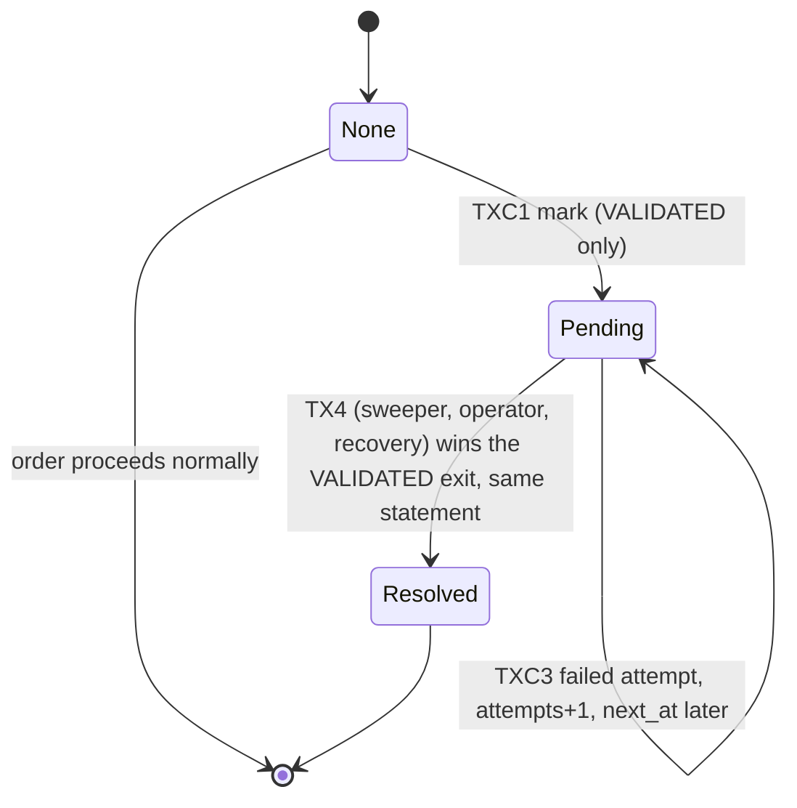

#### 7.10.3 Transaction boundaries

| ID | Transaction | Statements | Atomicity and idempotency |
|---|---|---|---|
| TX4 | Compensation (complete) | Standard transition `VALIDATED -> FAILED` (`OrderService.transition`): one `UPDATE` sets `status`, `updated_at` **and** `compensation_state = CASE WHEN compensation_state = 'PENDING' THEN 'RESOLVED' ELSE compensation_state END`; history row (note = reason); `claimStockRestore`; inventory restore in ascending `item_id` | One transaction; marker resolution is inside the winning `UPDATE`, so "FAILED but marker still PENDING" cannot be committed. Repeat: 0 rows, nothing else executes. |
| TXC1 | Mark pending | `UPDATE orders SET compensation_state = 'PENDING', compensation_reason = ?, compensation_attempts = 1, compensation_next_at = ? WHERE id = ? AND status = 'VALIDATED' AND compensation_state IS NULL` | A single statement in its own transaction (deadlock retry x3). 1 row = durable marker; 0 rows = the order already left `VALIDATED` or is already marked (re-read; terminal or pending both mean "someone else handled it"). It touches no inventory rows, so it succeeds in situations where TX4 deadlocked or timed out. |
| TXC3 | Failed-attempt bookkeeping (sweeper) | `UPDATE orders SET compensation_attempts = compensation_attempts + 1, compensation_next_at = ? WHERE id = ? AND compensation_state = 'PENDING'` | Idempotent in effect; losing it only delays backoff accounting. |

Submitter sequence after `dispatch` throws `QueueFullException`: TX4 (deadlock retries + `compensation.retry.max` further attempts) -> on success answer `QUEUE_FULL(compensated=true)`; else TXC1 -> on success `QUEUE_FULL(compensated=false)`, log `COMPENSATION_PENDING`; else `INDETERMINATE`. The answer is sent after the commit (post-commit rule, §13.1.4).

#### 7.10.4 Stock-restoration idempotency

No new mechanism: the stock flag `stock_deducted` and the winning status update protect restoration (DC-4). Cases: sweeper completes it -> restores once; the operator retry wins first -> it restores once and the same `UPDATE` resolves the marker, the sweeper's later attempt gets 0 rows; two sweeper passes -> second gets 0 rows. A crash inside any of these transactions rolls everything back, including the marker resolution.

#### 7.10.5 Why a pending order is never processed (layered guards)

1. **Database predicate on lease acquisition:** `acquireLease` contains `AND compensation_state IS NULL`; a worker cannot obtain the lease, so it cannot do anything to the order (`ORDER_SKIPPED_PENDING_COMPENSATION`).
2. **Database predicate on the first step:** any `VALIDATED -> ROUTED` update contains `AND compensation_state IS NULL` (so even a non-worker path cannot route it); `ROUTED -> PREPARING` is unreachable.
3. **Worker check:** the worker reads `compensation_state` with the status and skips pending orders.
4. **Selection queries:** startup recovery, the sweeper's orphan query and the snapshot writer all exclude `compensation_state = 'PENDING'`; pending orders are selected only by the dedicated compensation query.
5. Pending orders are not in any queue by construction (the offer did not insert the id).

Guards 1 and 2 hold across restarts because they live in the database.

#### 7.10.6 Startup recovery ordering (`RecoveryService.recover`, runs while `accepting = false`)
1. Verify and read the newest valid snapshot; insert missing orders (snapshots exclude pending orders, §9.4).
2. **Clear all leases** (`UPDATE orders SET lease_expires_at = NULL, claimed_by = NULL WHERE lease_expires_at IS NOT NULL`; safe because workers are not running yet and a single instance is assumed, A-09; the fencing epoch is never reset).
3. **Resolve pending compensations:** `findPendingCompensations` (all, ignoring `compensation_next_at`), attempt TX4 for each with the normal retries; successes log `COMPENSATION_COMPLETED`; failures keep the marker and update the bookkeeping (TXC3). Startup does not wait indefinitely: each order gets one attempt round.
4. Load non-terminal orders **excluding** those still `PENDING`; apply RR-9 (missing station) and enqueue oldest first.
5. Set `accepting = true`, start the snapshot task, sweeper and monitor.

Orders that stay pending keep being retried by the sweeper (§7.10.8).

#### 7.10.7 Duplicate-submission behaviour
The external reference of a pending, `FAILED` or `CANCELLED` order stays consumed (`UNIQUE (source, external_ref)`). A repeated submission returns `DUPLICATE` carrying `existingStatus` and `compensationPending`; it never revives or re-routes the order and never deducts stock again. A caller that wants to retry must use a new external reference. The in-flight guard behaves as before (released in `finally`).

#### 7.10.8 Repeated failure policy
* The sweeper's step 1 selects due pending orders: `compensation_state = 'PENDING' AND status = 'VALIDATED' AND (compensation_next_at IS NULL OR compensation_next_at <= now)`, oldest first, batch-limited; attempts TX4.
* On failure: `compensation_attempts + 1`, `compensation_next_at = now + min(compensation.backoff.seconds * 2^attempts, compensation.backoff.max.seconds)` (defaults 30 s base, 600 s cap).
* From `compensation.alert.attempts` (default 10) attempts the sweeper logs `COMPENSATION_STUCK` at ERROR once per cap interval for that order (id, attempts, reason; no PII) and the dashboard shows the count and the oldest age of pending compensations.
* It never gives up, never marks the order `FAILED` without restoring stock, never processes it. Escape hatch: the ADMIN operation *Retry compensation* (§7.10.11) runs the same TX4 immediately. Staff cancel is refused for pending orders. The order page shows a banner "awaiting compensation" and no Cancel button; the dashboard and `/admin/compensations` list them.
* A permanent failure of the restore itself (for example a corrupted inventory row) is indistinguishable from a transient one by the sweeper; the ERROR log plus dashboard make it visible for manual correction followed by retry/cancel.

#### 7.10.9 Interplay
TX4 attempts (sweeper, operator, recovery) race exactly as in §7.8.8 (one wins; the loser gets 0 rows). A staff cancel is refused for pending orders (OP-7). The snapshot writer skips pending orders: if the database were lost, a pending order disappears together with the failure the caller was told about (consistent). Metrics: `failed++` when TX4 commits (including from the sweeper, the operator or after a restart).

#### 7.10.10 Tests
`DurableCompensationTest` (fault injection at every step, INDETERMINATE), `PendingCompensationRaceTest` (@RepeatedTest(20)), `PendingCompensationRestartTest`, `CompensationBackoffTest`, `CompensationPendingSweepTest`, plus updates to `QueueFullCompensationTest`, `OrderDaoTest`, `RecoveryServiceTest`, `SnapshotRecoveryTest`, `DuplicateSubmissionConcurrencyTest`.

#### 7.10.11 Operator retry of a stuck compensation (authorized staff operation)

**Operation.** `OrderService.retryCompensation(long orderId, SessionUser admin)`, exposed on `/admin/compensations` (ADMIN only, POST + CSRF, PRG; GET lists pending orders with reason, attempts, age, next attempt; the order page shows a banner and a link for ADMIN). It is the *only* manual operation on a pending order. There is deliberately **no** operation that clears the marker, marks the order resolved, re-queues it as ordinary work, or "undoes" the compensation: the caller was told the order failed.

| ID | Rule |
|---|---|
| OP-1 | **Authorization:** ADMIN only (route policy, `RoleFilter`, and the service re-checks `admin.role() == ADMIN`). KITCHEN_STAFF cannot invoke it. |
| OP-2 | **Preconditions** (fresh auto-commit read): `status = VALIDATED` and `compensation_state = PENDING`; otherwise refuse with "already resolved" (idempotent). |
| OP-3 | **Transaction boundary:** exactly the standard compensation TX4 (`OrderService.transition` `VALIDATED -> FAILED`): first statement the conditional status update that also sets the marker to `RESOLVED`; **only if 1 row:** history row, `claimStockRestore`, inventory restore (ascending item id). One transaction, rolled back as a unit on any failure. |
| OP-4 | **Backoff:** ignores `compensation_next_at` (that is the point of the manual retry) but never the restore guard. On failure the transaction rolls back and TXC3 records the attempt (`attempts + 1`, new `next_at`); stock and status are unchanged. |
| OP-5 | **Stock-restoration idempotency:** unchanged mechanism (§13.1.5). A double click, the sweeper, or a restart racing the operator: the loser's conditional update changes 0 rows and nothing else executes (no history row, no restore, no `failed++`). |
| OP-6 | **Audit:** history row `VALIDATED -> FAILED` with actor `admin:<username>` and note `COMPENSATION_MANUAL`; `orders.log` events `COMPENSATION_RETRY_REQUESTED` (user id, order id) and, on success, `COMPENSATION_COMPLETED`; failed attempts are visible in `compensation_attempts` and the log. |
| OP-7 | **No bypass:** (a) `cancelOrder` refuses an order whose marker is `PENDING`; if a cancel nevertheless races the marker write, its generic transition still performs the guarded restore, so stock cannot be skipped; (b) the compensation columns are written only by `markCompensationPending`, `recordCompensationFailure` and the generic transition (marker resolution in the same statement); (c) `OrderDao.transition` is called only from `OrderService` (§7.12.5); (d) a `PENDING` order is never leased, routed, enqueued or processed (guards, §7.10.5). |
| OP-8 | The operation does not enqueue anything; completion makes the order `FAILED` (terminal). |

Concrete interleaving (operator vs sweeper vs a stale cancel): order 77 `VALIDATED`/`PENDING`, stock for item X deducted by 2. `t1` sweeper starts TX4 and its conditional update locks the row. `t2` ADMIN presses *Retry compensation*: fresh read still shows PENDING, TX4 starts and blocks on the row lock. `t3` KITCHEN_STAFF presses Cancel: `cancelOrder` reads PENDING and refuses. `t4` sweeper commits: `FAILED`, marker `RESOLVED`, flag 0, stock +2, history actor `SYSTEM`. `t5` operator's update re-evaluates the predicate on the committed row (`status = 'VALIDATED'` false) -> 0 rows -> no history row, no restore -> flash "already resolved". Net: stock +2 exactly once, one terminal edge. Invariant I-12 (below).

Tests: `CompensationOperatorTest`, `CompensationOperatorWebTest`, `PendingCompensationRaceTest`, `CompensationBackoffTest`, `ArchitectureRulesTest`.

### 7.11 Worker health monitoring, leases and fencing (resolves the dead-worker risk)

Review date 2026-10-10, user-requested. In-memory sets (`queuedIds`, `activeIds`) are **hints only**: they are never the proof that an order is being processed. The proof is a database lease with a fencing epoch.

#### 7.11.1 Failure modes
| Mode | Cause | Effect without this design |
|---|---|---|
| Worker **died** | `Error` (OOM, StackOverflow, linkage), a bug outside the per-order `try`, or the thread ended | Queue ids stay "known", nobody consumes; the id it had taken stays in `activeIds` |
| Worker **hung** | Blocked in a database call, deadlocked, infinite loop | Same, but the thread still exists and may wake up later (zombie) and act on an order a replacement already took |
| Lost id window | `Error` between `poll` and registering the id | Id in neither queue nor memory set; order non-terminal in the DB |

#### 7.11.2 Ownership model: three signals, one proof
| Signal | Where | Role |
|---|---|---|
| `queuedIds` | memory | Hint: "id is in this station's queue" (optimisation to avoid duplicate entries) |
| `activeIds` (`ConcurrentHashMap<Long, Long>`: order id -> worker generation) | memory | Diagnostics and clean-up when a worker generation is retired; **not** used to decide that an order is being processed |
| **Lease** (`orders.claim_epoch`, `claimed_by`, `lease_expires_at`) | **database** | **Proof of ownership**: an order is being processed iff its lease is unexpired; the epoch is the fencing token |

`claimed_by` = `<STATION_CODE>#<generation>` (e.g. `BIRYANI#2`). Lease times use the injected `Clock` (UTC); one JVM only (A-09), so there is no clock-skew problem (multi-instance would need DB time; out of scope).

#### 7.11.3 Lease and fencing lifecycle
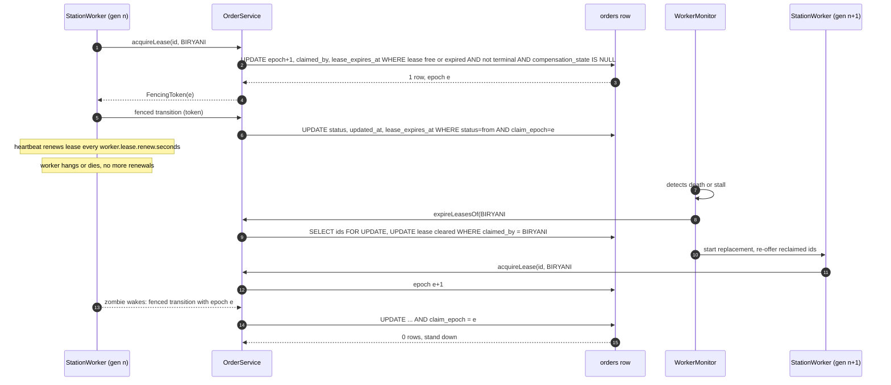

Operations (all single statements, deadlock-retried, own short transactions; `OrderDao` methods in §5.2):
* **acquire** (`acquireLease`): free lease or same owner string (§7.11.13, §7.13.1 WM-1). Returns the new epoch read back in the same transaction.
* **fenced step** (`transitionAsOwner`, `failAsOwner`): the standard conditional status update plus `AND claim_epoch = ? AND claimed_by = ? AND lease_expires_at > :usableAfter` (stamp protocol S-1..S-7, §7.11.15) as the **first statement** of the transaction; it also moves `lease_expires_at` (or clears the lease for a terminal target). 0 rows -> nothing else executes (F-2) and the worker applies rule L-5.
* **renew** (heartbeat): `UPDATE orders SET lease_expires_at = :newExpiry WHERE id = ? AND claim_epoch = ? AND claimed_by = ? AND lease_expires_at > :usableAfter`, with `:usableAfter = stamp + margin` taken inside the DAO immediately before execution (§7.11.15); the worker sleeps in slices of at most `worker.lease.renew.seconds` and renews between them, also during transient-retry backoff. 0 rows = lost or expired = rule L-5. It can never revive an expired, cleared, superseded or within-margin lease.
* **release** (parking, skip after acquire, interrupt, normal finish without terminal step): `UPDATE ... SET lease_expires_at = NULL, claimed_by = NULL WHERE id = ? AND claim_epoch = ? AND claimed_by = ?` (best effort; if it fails the lease simply expires).
* **expire owner** (`expireLeasesOf(owner)`): used by the monitor for a retired generation (only touches rows whose `claimed_by` equals that exact owner).
* **clear all** at startup (§7.10.6).
Cancel, compensation, operator retry and recovery transitions are **not** fenced (they act on `VALIDATED`/`ROUTED` orders and rely on the status predicate, with the same first-statement rule); a cancel that wins makes the worker's next fenced update return 0 rows. Complete catalogue and rules: §7.11.12.

#### 7.11.4 Detection (`WorkerMonitor`)
Own single-thread `ScheduledExecutorService`, thread `worker-monitor`, every `worker.health.interval.seconds` (default 10, `scheduleWithFixedDelay`, whole pass in `try/catch`). Each pass calls `OrderOrchestrator.repairAll()` = `repairStation` per runtime: health check, `restartWorker(code, expectedGeneration, ...)`, lease reclaim, reconcile. The sweeper calls the same routine, so the two are redundant by design. Health is evaluated on demand (`StationWorker.isHealthy()`), never read from a monitor-owned flag. Skips everything when the orchestrator is stopping. For each `StationRuntime`:
* **D1 died:** the worker's task `Future.isDone()` (or `StationWorker.run` set `state = DEAD`/exited through its outer `finally` without a stop request). The cause comes from the `Future` / an `UncaughtExceptionHandler` installed by `NamedThreadFactory` (class name only is logged, `WORKER_DIED`).
* **D2 stalled:** `clock.millis() - worker.lastHeartbeat > worker.stall.seconds` while the application is not stopping. `lastHeartbeat` (volatile) is updated at every loop iteration (poll timeout is 500 ms), every sleep slice and every retry backoff slice, so a paused worker (sleeps in 100 ms slices) and a long transient retry both keep beating; only a truly blocked or dead thread stops beating. `WORKER_STALLED` is logged.
* **D3 reconcile and backstop:** every monitor pass also runs the queue reconciliation of §7.11.14 (durable state versus the physical queue), so lost ids are recovered within one health interval; independently, leases expire by themselves and the sweeper (§7.9) is the coarse database backstop if the monitor itself fails.

#### 7.11.5 Restart and reclaim (`OrderOrchestrator.restartWorker(code, expectedGeneration, reason)`, synchronized per runtime)
1. **Retire** the old generation: set `retired = true` (the loop checks it first and exits without touching the database), `future.cancel(true)` to interrupt if the thread still exists.
2. **Reclaim ownership from the database:** in one transaction select ids with `claimed_by = '<CODE>#<oldGen>'` and non-terminal status (`FOR UPDATE`), then clear their leases (`expireLeasesOf`). Remove the old generation's entries from `activeIds` (and any ids it had registered).
3. **Start a replacement:** `StationWorker` generation+1 on the **same** `ArrayBlockingQueue` (queue contents are untouched), executor task submitted; the executor is a `ThreadPoolExecutor` with core size = number of stations and maximum = core + `worker.restart.max` so a hung old thread that ignores the interrupt does not block the new one; the worker sets its own thread name on start (`station-<CODE>-worker`, or `station-<CODE>-worker-g<generation>` for restarts).
4. **Re-offer** the reclaimed ids to the queue (non-blocking; if full they stay non-terminal in the database; the reconcile pass of §7.11.14 re-offers anything still missing, so a crash of the monitor between steps 2 and 4 loses nothing; duplicate entries are harmless, §7.4).
5. Log `WORKER_RESTARTED` (station, generation, reason, number of reclaimed ids), update `WorkerView`.
The id a dead worker had *taken but not yet registered* (or registered but not yet leased) has no lease and is in no queue: the **same monitor pass** reconciles it from durable state (§7.11.14, P1-P3); it does not wait for the orphan threshold.

#### 7.11.6 How duplicate processing is prevented
* **Fencing:** the replacement acquires the lease with a higher epoch; every status update of a zombie carries the old epoch and changes zero rows.
* **Lease check before work:** a replacement cannot acquire a lease that is still unexpired (a worker that is slow but alive keeps renewing; if it truly stopped, expiry or `expireLeasesOf` frees the order).
* **Retired flag:** the zombie exits at its next loop iteration.
* **Unchanged guards:** conditional status updates, unique history edge, skip of terminal orders, effects only for the caller whose update changed a row (I-5).
* A zombie may still *sleep* through its simulated step or write a DEBUG log; it cannot change the database or metrics.

#### 7.11.7 Restart budget and DEAD
`worker.restart.max` (default 5) restarts within `worker.restart.window.seconds` (default 300). Beyond that the monitor sets `WorkerState.DEAD`, logs `WORKER_GAVE_UP` at ERROR (no more automatic restarts, to avoid a crash loop) and leaves queued ids queued and orders non-terminal in the database. ADMIN can press *Restart* in the worker panel (resets the budget) or restart the application. New orders for a DEAD station are still accepted until the queue fills, then compensated (queue-full path).

#### 7.11.8 Effect on the sweeper (§7.9)
Orphan decision of the sweeper's generic query = non-terminal AND stale AND **no valid database lease** AND not present in the *physical* queue of a healthy worker AND not pending compensation. It follows the shared repair step, so the primary lost-id recovery (reconcile, §7.11.14, no staleness wait) runs from either scheduler. Neither consults `activeIds` for ownership.

#### 7.11.9 Shutdown
`ShutdownCoordinator` stops the monitor and the sweeper before draining, so no restart or reclaim happens during shutdown; `requestDrainAndStop` and `shutdownNow` do not trigger restarts. Leases still held at exit simply expire or are cleared at the next startup.

#### 7.11.10 Tests and fault injection
`WorkerHook` (interface in `pipeline`, default no-op; stages `AFTER_POLL`, `AFTER_LEASE`, `BEFORE_RENEW`, `BEFORE_STEP`, `AFTER_STEP`, `BEFORE_PARK_OFFER`; each stage receives the order id and the step so a test can throw an `Error` or block on a latch at an exact point) lets tests kill or stall a worker deterministically. Time is controlled with `FakeClock`; passes are driven by calling `WorkerMonitor.runOnce()` / `OrphanSweeper.runOnce()` directly, never by sleeping. Tests: `LeaseFencingTest`, `WorkerMutationFencingTest`, `StaleWorkerWakeTest` (@RepeatedTest(20)), `LeaseExpiryReacquireTest`, `PollToLeaseCrashWindowTest`, `QueueReconcileTest`, `WorkerMonitorTest`, `WorkerHangRecoveryTest` (@RepeatedTest(20)), `DeadWorkerRaceTest` (@RepeatedTest(20)), and updates to `StationWorkerTest`, `OrphanSweeperTest`, `OrphanSweeperRaceTest`, `ShutdownCoordinatorTest`, `WorkerPanelWebTest`.

#### 7.11.11 Residual risks
* U-8: closed by queue reconciliation (§7.11.14); only the death of the scheduler threads themselves remains (P9).
* U-9: each processing step writes the lease columns (roughly one extra column set per step plus a heartbeat every renew interval): small database load, acceptable at this scale.
* U-10: a hung thread cannot be killed in Java; it may hold memory or a connection until it returns (pool timeouts and `leakDetectionThreshold` help); the executor maximum size bounds how many such threads can accumulate.
* U-12: timing limitation, not a safety hole (§7.11.15 items 2-3); verification item S-19.
* U-11: after the restart budget is exhausted a station stays `DEAD` until an admin restart or application restart.

#### 7.11.12 Complete fencing: catalogue of every worker mutation

Principle: **a worker never changes the database except through a transaction whose first statement is a fenced conditional update of the order row.** That statement is the ownership check (no separate check-then-act), it takes the row's exclusive lock, and the lock is held until commit.

| ID | Worker mutation | Statements, in order | Transaction boundary | How stale ownership is rejected | Partial side effect prevented by |
|---|---|---|---|---|---|
| WM-1 | Acquire lease | `UPDATE orders SET claim_epoch = claim_epoch + 1, claimed_by = :o, lease_expires_at = :now + ttl WHERE id AND status NOT IN (terminal) AND compensation_state IS NULL AND (lease_expires_at IS NULL OR lease_expires_at <= :now OR claimed_by = :o)`; then read back the epoch (exact form: §7.13.1) | One short transaction; the read-back happens while the row is locked | Self-validating: 0 rows if another owner's lease is valid, order terminal or pending. The `claimed_by = :o` clause lets the **same owner** re-acquire after a lost reply (FI-6). A *retired* worker checks its `retired` flag and generation before and after acquiring and releases immediately on mismatch | Only one statement writes; nothing else depends on it |
| WM-2 | Renew lease (heartbeat) | `UPDATE orders SET lease_expires_at = :newExpiry WHERE id AND claim_epoch = ? AND claimed_by = ? AND lease_expires_at > :usableAfter AND status NOT IN (terminal)` (fresh in-DAO stamp, §7.11.15) | One statement | Epoch, owner and **usable-at-execution** predicates: cannot revive an expired, NULL-cleared, superseded or within-margin lease | Single statement |
| WM-3 | Release lease (park, skip, finish without terminal step) | `UPDATE orders SET lease_expires_at = NULL, claimed_by = NULL WHERE id AND claim_epoch = ? AND claimed_by = ?` | One statement | Epoch and owner: a stale owner cannot free a new owner's lease | Single statement; failure just lets the lease expire |
| WM-4 | Self-route `VALIDATED -> ROUTED` | Fenced status update (status, epoch, owner, unexpired lease, `compensation_state IS NULL`; sets `lease_expires_at`) -> **only if 1 row:** history insert | One transaction (`transitionAsOwner`) | The fenced update changes 0 rows | Rule F-2: nothing after a 0-row update |
| WM-5 | Step transitions `ROUTED->PREPARING`, `PREPARING->PACKED`, `PACKED->OUT_FOR_DELIVERY`, `OUT_FOR_DELIVERY->DELIVERED` | Fenced status update (terminal target also clears `claimed_by`/`lease_expires_at`) -> history insert | One transaction | As WM-4 | As WM-4; metrics and log only after commit of a 1-row update |
| WM-6 | Permanent-failure handling `failAsOwner` | Fenced update to `FAILED` (+ marker resolution if any) -> history insert -> **if** `from.isStockRestorableTo(FAILED)`: `claimStockRestore` -> inventory restore per item (ascending id) | One transaction | The fenced update changes 0 rows, so the restore statements never run | F-2; restore flag and stock change in the same transaction (TXR-2) |
| WM-7 | Park a transiently failing order | WM-3, then non-blocking queue `offer` (memory) | WM-3 only | As WM-3 | The queue op is not a database effect; a lost offer is repaired by reconcile (§7.11.14) |
| WM-8 | Retry/backoff scheduling | none in the database (in-memory backoff in the worker thread) | n/a | n/a | Nothing can be written by a stale worker |
| WM-9 | Metrics, `orders.log` | in memory / file, **after** commit | n/a | Emitted only when the preceding fenced update returned 1 and the transaction committed | I-5 |

Not performed by workers (listed to show nothing else mutates on a worker's behalf): lease expiry by the monitor (`expireLeasesOf`, matches the exact owner string) and startup `clearAllLeases`; compensation marker writes and bookkeeping (`markCompensationPending`, `recordCompensationFailure`) by the submitter, sweeper or operator; unfenced `transition`/`failOrder`/`cancelOrder`/`compensate` by staff, submitter, sweeper and recovery. Those actors only move `VALIDATED`/`ROUTED` orders to `CANCELLED`/`FAILED` (or `VALIDATED -> ROUTED` by the submitter), take the row lock with their own first conditional statement, and are detected by a leased worker through the status mismatch (0 rows) on its next fenced statement. They cannot create partial effects because they obey the same first-statement rule (F-1, F-2). RR-9 (`STATION_UNAVAILABLE`) acts only on stations without a worker, so no lease exists to violate.

**Fencing rules**

| ID | Rule |
|---|---|
| F-1 | The first statement of every worker transaction is the fenced conditional `UPDATE` of the `orders` row. |
| F-2 | Every later statement (history insert, `claimStockRestore`, inventory restore) executes **only** if F-1 returned exactly one row; otherwise the transaction ends without executing anything else. A stale worker whose update affects zero rows therefore leaves no partial side effect. |
| F-3 | The exclusive row lock taken by F-1 is held until commit. Acquire, monitor expiry, staff cancel and the sweeper all need that lock for their own conditional update, so ownership validated by F-1 cannot change before the commit that makes the mutation visible. There is no gap between "check" and "act" because they are one statement. |
| F-4 | Metrics, log events and flash messages are post-commit and only for a 1-row update (I-5). |
| F-5 | Statements on other rows (inventory) occur only inside a transaction that passed F-1 and F-2. |
| F-6 | `StationWorker` calls only the owner-fenced API: `OrderService.acquireLease/renewLease/releaseLease/transitionAsOwner/failAsOwner`. The unfenced methods (`transition`, `failOrder`, `cancelOrder`, `compensate`) are for non-owner actors. `ArchitectureRulesTest` enforces this (§7.12.5). |
| F-7 | A worker that learns it lost ownership (0 rows or `LEASE_LOST`) performs no further database write for that order except the epoch-fenced release (which is a no-op if superseded). |
| F-8 | The history `actor` is `worker:<CODE>#<generation>` so the audit trail shows which generation acted. |

#### 7.11.13 Lease definition: acquisition, renewal, expiry, reclaim

State per order: `(claim_epoch E, claimed_by O, lease_expires_at X)`. At time `t` the lease is **valid** iff `X IS NOT NULL AND X > t`; otherwise it is **free** (expired or cleared). SQL three-valued logic is relied upon: `NULL > t` and `NULL <= t` are unknown, so a NULL-cleared lease never satisfies "valid" and acquire's `(X IS NULL OR X <= now)` is explicit.

| Operation | Predicate (all in the `WHERE`) | Effect | Notes |
|---|---|---|---|
| Acquire | `status` non-terminal, `compensation_state IS NULL`, lease free at `now` **or** `claimed_by` equals the caller's owner string | `E = E + 1`, `O = owner`, `X = now + ttl` | Epoch strictly increases; two acquirers are serialised by the row lock, the second sees the first's valid lease and gets 0 rows (unless it is the same owner, for example after a lost reply) |
| Renew | `claim_epoch = E_mine`, `claimed_by = O_mine`, lease **usable** at the fresh stamp (`X > s + M`), status non-terminal | `X = s + ttl` | Cannot revive an expired lease (X <= s + M), a cleared one (X NULL, O NULL) or a superseded epoch |
| Fenced step | `status = from`, `claim_epoch = E_mine`, `claimed_by = O_mine`, lease **usable** at the fresh stamp (`X > s + M`) | status change, `X = s + ttl` (or lease cleared for a terminal target) | A step is also an implicit renewal and obeys the same non-revival rule |
| Release | `claim_epoch = E_mine`, `claimed_by = O_mine` | `X = NULL`, `O = NULL` (epoch unchanged) | Allowed even if expired (harmless); useless against a superseded epoch |
| Expiry | none (time passes) | lease becomes free | No write |
| Reclaim by monitor | `claimed_by = <retired owner string>` and status non-terminal | `X = NULL`, `O = NULL` (epoch unchanged) | Matches the exact generation string, never a newer generation |
| Startup clear | `lease_expires_at IS NOT NULL` | `X = NULL`, `O = NULL` | Workers are not running yet (A-09); epoch kept so any old owner stays fenced out |

Rules:

| ID | Rule |
|---|---|
| L-1 | **Time source.** Lease-validity timestamps are read only inside the DAO by the stamp helper, as the last action before the statement executes (never passed in, never cached, never taken earlier by a caller); UTC; the same clock for all TTL arithmetic. Full protocol: §7.11.15 (S-1..S-7). |
| L-2 | **Safety versus freshness.** Mutual exclusion (never two effective owners) comes from the epoch and the row lock and does not depend on time. Freshness (an expired lease can neither be extended nor used) comes from the usable predicate with a fresh stamp plus the execution and pre-commit guard (S-5); a worker that is late by time and whose lease expired **fails** its renewal or step and must re-acquire (L-5). |
| L-3 | **No revival.** Renewal and steps require the exact epoch and owner and a lease usable at execution (`X > stamp + margin`). A monitor-cleared lease (O and X NULL) fails the owner predicate; a superseded epoch fails the epoch predicate; an expired or within-margin lease fails the time predicate; a statement or commit that slips beyond the guard budget is rolled back (S-5). |
| L-4 | **Gap between ownership check and commit.** There is no gap: the ownership check is the `WHERE` clause of the mutating statement (F-1/F-3). Between steps (while sleeping) ownership may be lost, which is exactly why every step is fenced. |
| L-5 | **Continue, re-acquire or stand down.** When a fenced step or a renewal returns 0 rows the worker re-reads the row with a fresh auto-commit read and decides: **terminal or pending compensation** -> stand down; **`claim_epoch` differs from mine** (someone superseded me) -> stand down, do not re-offer, do not write; **epoch, owner and a valid lease are still mine and the status is beyond the step I attempted** -> my earlier attempt committed and only its reply was lost: **continue** from the status read (no second history row can result because S1 matches only the old status); **epoch equal, lease free (expired or cleared), order non-terminal, worker not retired, generation still current** -> the lease merely expired: `acquireLease` again (new epoch) and continue from the committed status, at most `worker.reacquire.max` (default 3) times per processing session, then park; **worker retired or generation stale** -> stop and ensure re-registration (re-offer the id, or leave it to reconcile). This is why an expiry during a database blip or a long GC pause, or a lost reply, never drops the id. |
| L-6 | **Retired workers never acquire.** `StationWorker` checks `retired` and `runtime.currentGeneration == myGeneration` before acquiring and immediately after; on mismatch it releases (epoch-fenced) and exits. The remaining micro-window is harmless: the late acquirer becomes the single valid owner by epoch and its lease expires after the TTL. |
| L-7 | **Clock anomalies.** A forward jump shortens leases (premature expiry -> stand down/re-acquire, safe); a backward jump lengthens them (reclaim delayed by at most the jump). Neither can produce two valid owners because of the epoch. Single JVM (A-09); multi-instance would require database time. |

Deterministic timeline used by `StaleWorkerWakeTest` (FakeClock, TTL 30 s, renew 10 s): `t=0` A acquires epoch 5, X=30; `t=5` A claims `ROUTED->PREPARING` (X=35) and blocks at the `BEFORE_STEP` hook; `t=70` monitor retires A, clears its lease, starts B; B acquires epoch 6 (X=100), resumes `PREPARING`, `PREPARING->PACKED`; `t=71` A is released: its fenced `PREPARING->PACKED` changes 0 rows (status is `PACKED`, epoch is 6), renewal 0 rows, `failAsOwner` 0 rows, release 0 rows; A stands down (L-5 first/second case) and does not re-offer; B finishes; the history has each edge once, inventory and metrics unchanged by A.

#### 7.11.14 Lost-id recovery: every death point, and queue reconciliation

Durable truth: an order that must be worked on is *non-terminal, not pending compensation, and has no valid lease*. Anything that satisfies this and is not in the station's physical queue is eligible for re-offer.

| Death/hang point | Queue | Lease | Database status | Recovery path | Worst-case delay |
|---|---|---|---|---|---|
| P0 blocked in `poll` (nothing taken) | unchanged | none | unchanged | none needed | 0 |
| P1 after `poll`, before any registration | id **gone** | none | unchanged | Monitor D1 restarts the worker in the same pass in which reconcile sees the order unleased and absent from the physical queue and re-offers it | <= `worker.health.interval.seconds` (10 s) |
| P2 after registering in `activeIds`, before `acquireLease` | gone | none | unchanged | Same as P1; the stale `activeIds` entry is removed with the generation | <= 10 s |
| P3a during the lease transaction, before commit | gone | none (rolled back) | unchanged | Same as P1 | <= 10 s |
| P3b lease committed, worker dies before using it | gone | valid for <= ttl | unchanged | Monitor expires the retired owner's lease (D1), then the same pass reconciles and re-offers; if D1 missed it, the lease expires by itself and reconcile runs on the next pass | <= 10 s (died), <= `worker.stall.seconds` or ttl + 10 s (hung) |
| P4 inside a fenced step transaction | gone | valid | old or new status (atomic) | As P3b; processing resumes from the committed status | as P3b |
| P5 mid-processing (sleeping, in transient retry) | gone | valid until it stops renewing | in-flight status | As P3b | as P3b |
| P6 between releasing the lease and re-offering (parking) | not yet in queue | none | unchanged | Reconcile (same as P1) | <= 10 s |
| P7 after the terminal commit | n/a | cleared | terminal | nothing to recover | 0 |
| P8 monitor dies after `expireLeasesOf`, before re-offer | gone | none | unchanged | Next monitor pass reconciles from the database (the state is durable and the operation idempotent) | <= 10 s |
| P9 monitor **or** sweeper thread itself is dead | gone | none | unchanged | The other scheduler runs the same `repairStation` routine (§7.13.6), at its own interval; dashboard shows both last-pass times | <= the surviving scheduler's interval |
| P10 monitor **and** sweeper both dead | gone | none | unchanged | No live recovery; visible on the dashboard; startup recovery after a restart repairs everything from the database | until restart (documented residual) |

**Reconcile algorithm** (`OrderOrchestrator.reconcileStation(runtime)`, called from `repairStation` by both the monitor and the sweeper, only for stations whose worker is healthy and only when not shutting down):
1. `rows = OrderDao.findReconcilable(c, stationId, now, dispatchCutoff, limit)`: `station_id = ? AND (compensation_state IS NULL OR compensation_state <> 'PENDING') AND (lease_expires_at IS NULL OR lease_expires_at <= now) AND (status IN ('ROUTED','PREPARING','PACKED','OUT_FOR_DELIVERY') OR (status = 'VALIDATED' AND updated_at < dispatchCutoff))`, ordered by id, limit `worker.reconcile.batch` (default 200). The `VALIDATED` cutoff (`recovery.dispatch.window.seconds`, default 30, validated to exceed the offer timeout plus the compensation retry window) protects the submitter's window between TX1 commit and a successful offer.
2. `present = new HashSet<>(queue)` copy of the **physical** queue contents (a snapshot taken under the queue's own lock), not the `queuedIds` hint.
3. For each row not in `present`: add to `queuedIds` hint, non-blocking `queue.offer(id)`; queue full -> stop for this station until the next pass. Log `QUEUE_RECONCILED` (count only).
No in-memory set decides *ownership*: ownership is the database lease; the physical queue is used only to avoid needless duplicates, and a wrong "absent" answer produces a duplicate entry, never a lost order (a queue entry can never be falsely present).

**Why duplicate entries are safe** (also covers the benign duplicates this algorithm can create, for example for an id a healthy worker polled a microsecond earlier):
1. The worker's admission reads status and marker first (terminal/pending -> skip).
2. `acquireLease` returns empty while another valid lease exists (`ORDER_SKIPPED_LEASED`), so two workers can never process one order.
3. After a legitimate takeover the earlier owner is fenced (epoch).
4. Each lifecycle edge is a conditional update plus a unique history edge, effects occur only for the 1-row winner.
5. Entries of one station are consumed by one worker generation at a time (the retired flag keeps the old generation from polling).
Worst case a duplicate costs one skipped dequeue.

Concrete interleaving (replaces the old behaviour where the id waited for the orphan threshold): `12:00:00.000` order 42 is `ROUTED`, `updated_at` 12:00:00, in queue; `12:00:00.500` worker A polls 42 and the JVM throws `OutOfMemoryError` before `activeIds.put`; thread dead. State: DB `ROUTED`, no lease, queue empty, memory sets empty. Old baseline: sweeper requires `updated_at < now - 120 s` -> picked up around 12:02:00 to 12:03:00. New: `12:00:10` monitor pass: D1 sees A's task done -> `WORKER_DIED`, restart as gen 2; same pass reconcile sees 42 unleased and absent from the physical queue -> `offer`; gen 2 polls, leases epoch 1, claims, delivers. Invariant I-11 holds throughout: at no time is 42 without a durable path back to a worker.

Config: `worker.reconcile.batch` (200), `recovery.dispatch.window.seconds` (30), `worker.reacquire.max` (3).

#### 7.11.15 Lease stamp protocol: fresh validity at execution, no revival (added after the review of RI-3)

The earlier wording of L-2 tolerated a worker that is "late by time but not superseded" still committing, and RI-3 described a renewal using a timestamp computed before the lease expired. Both are withdrawn. A renewal or step must never extend a lease that is expired at the time the statement executes.

**Definitions.** `M` = `worker.lease.margin.ms` (default 200 ms, 50-2000), `G = M / 2` = guard budget. For a statement with stamp `s`: a lease is **usable** iff `lease_expires_at > s + M`; **free** iff `lease_expires_at IS NULL OR lease_expires_at <= s`. The interval `(s, s + M]` is a dead zone (not usable by the owner, not yet free for others); it lasts at most `M`.

| ID | Rule |
|---|---|
| S-1 | **Single source of time.** Lease-validity timestamps come only from `LeaseStampContext.stamp()` called inside the JDBC DAO method. No DAO or `OrderService` lease method has a timestamp parameter; `StationWorker` and `OrderService` never compute a validity time or keep one in a field. `ArchitectureRulesTest` enforces both. |
| S-2 | **Stamp last.** The DAO prepares the statement and sets all non-time parameters first; the stamp `s` is read as the very last action before `executeUpdate`, and `:now = s`, `:usableAfter = s + M`, `:newExpiry = s + ttl` are bound from it. A pause before the DAO call (the worker holds its token, or is blocked at `BEFORE_RENEW`) is therefore irrelevant: the stamp is taken when the thread resumes. |
| S-3 | **Usable predicate.** Renewal (WM-2), owner-fenced steps (WM-4/5) and `failAsOwner` (WM-6) require `claim_epoch = :e AND claimed_by = :o AND lease_expires_at > :usableAfter` (plus their status predicates). Acquire (WM-1) and the read-only reconcile/sweeper queries use the *free* predicate `<= :now` and need no guard (a late execution only makes their judgement more conservative). |
| S-4 | **Registration.** `Database.inTransaction` binds a `LeaseStampContext` to the thread for the duration of the transaction (one transaction per thread, no connection sharing); every usable-predicate statement registers its stamp, the earliest one `s0` is kept. |
| S-5 | **Execution-gap and commit guard.** Right after each stamped statement returns, and again immediately before `commit`, the context checks `clock.instant() <= s0 + G`. If not, the transaction is rolled back and `LeaseStampStaleException` is thrown. Lock waits, GC pauses and slow statements all count, because they all happen inside `[s, check]`. |
| S-6 | **Abort is clean.** After `LeaseStampStaleException` nothing was committed. `OrderService` retries the whole operation with a fresh stamp, at most `worker.lease.stamp.retry` (default 3) times; if it stays stale the result is a transient failure (RR-8). A stale stamp is never reported as success and is not by itself treated as loss of ownership: the fresh retry decides (and fails if the lease expired meanwhile). |
| S-7 | **Test seam.** `LeaseStampHook` (default no-op) with phases `AFTER_STAMP`, `AFTER_EXECUTE`, `BEFORE_COMMIT` lets tests stall at exactly these points and advance the `FakeClock`. |

**What is guaranteed, what is not, and the invariant that matters.**

1. **Fencing guarantee (enforced by the database).** When every protected mutation follows the documented transaction and fencing protocol (first statement = fenced conditional `UPDATE` with epoch, owner and status; later statements only after a 1-row result; one transaction), a stale or superseded worker cannot commit any conflicting protected mutation (status, history, restore flag, inventory, lease columns).
2. **Timing limitation (application level, bounded, not absolute).** The stamp, the usable predicate (`lease_expires_at > s + M`) and the guard (`statement and pre-commit check within G = M/2 of the stamp`) ensure that a renewal or step was *decided and executed* while the lease was unexpired, as measured by the single JVM clock (A-09). An application-level check **cannot guarantee that the physical commit I/O finishes before the wall-clock expiry**. If commit I/O takes longer than the remaining slack (`M - G`, 100 ms by default), a non-locking reader (reconcile, sweeper) may read the old, expired-looking lease while the renewal is still committing, and the renewal's commit may complete after the old expiry time. The design does not claim to prevent this (residual U-12).
3. **Required safety invariant: commit latency must never let two workers commit conflicting state.** It is preserved, independently of timing, by the locking and fencing rules:
   * every protected mutation starts with a conditional `UPDATE` of the order row, which takes the row's exclusive lock; InnoDB holds that lock until the transaction commits or rolls back, so any competing acquire, step, cancel, compensation or lease clear on the same row **blocks** until then;
   * when the lock is granted, the competitor's predicate is evaluated against the **committed** row (an `UPDATE` uses a current read), so it sees the extended lease, the new status or the new epoch and changes 0 rows if it no longer matches;
   * the epoch increases only inside acquire, which needs the same lock; a worker that committed under epoch `e` therefore either finished before any acquire (the acquire then sees a valid lease and fails) or was superseded before it started (its own statement then changes 0 rows);
   * history, restore flag and inventory writes are in the same transaction behind the 1-row first statement.
   Slow commit I/O therefore only makes competitors wait; it cannot let two commits interleave. The observable consequence of the timing limitation is confined to non-locking readers: a premature reclaim attempt or a duplicate queue entry, both of which fail or are skipped safely (RI-3c).
4. **Unproven assumption, recorded as a verification item.** That the chosen driver and the embedded server behave as described (a competing conditional `UPDATE` blocks until the first transaction commits and then re-evaluates its predicate on the committed row, with no lost update and no stale-predicate success, under `REPEATABLE READ`, also with an injected delay between the `UPDATE` and the commit, and how `innodb_lock_wait_timeout` interacts) is **not verified**. It is spike item **S-19** in Phase 1 and must be recorded in EVIDENCE.md before the fencing design is called verified.

**Reconcile has already observed the lease as expired.** If a reader (reconcile or the sweeper) read the committed lease as free at `r` (`X <= r`), a renewal can only succeed if `s + M < X <= r`, i.e. its stamp is older than `r` by more than `M` and its commit must already have begun before `r + ...` within the guard budget; any renewal stamped at or after `r` fails its usable predicate. Hence:
1. **Renewal after the observation fails** (0 rows). The worker applies L-5: fresh read; epoch unchanged, lease free, not retired -> `acquireLease` again, which yields a **new epoch and a new expiry** (a new lease, not a revival); superseded -> stand down.
2. **The duplicate entry** offered by reconcile is acceptable: when polled it is skipped (`acquireLease` empty because another valid lease exists, or the order is terminal), or it is consumed by the same worker after it finished the order.
3. The old lease's `lease_expires_at` is never overwritten by a failed renewal (the statement changed 0 rows or was rolled back).

Tests: `LeaseRenewalFreshStampTest` (pause before the DAO call, advance the clock beyond expiry, renewal fails), `LeaseStampGuardTest` (stall inside the DAO and before commit, rollback), `LeaseFencingTest`, `ReconcileLeaseSafetyTest`, `LeaseExpiryReacquireTest`, `ArchitectureRulesTest`.

### 7.12 Final adversarial audit (2026-10-10)

Scope: the routing, lease, worker-health and compensation design of §7.8-§7.11. Method: for each of four issues, construct a concrete failure interleaving against the previous baseline, state the invariant that must hold, record the fix and the deterministic test that proves the exact race window (planned, **not yet written or run**).

#### 7.12.1 Invariants added by this audit (I-1..I-8 are in §7.8.2)

| ID | Invariant |
|---|---|
| I-9 | **Single effective owner.** For each order only the holder of the current `claim_epoch` with a valid lease can have a worker mutation commit; the epoch never decreases; any mutation by an older epoch changes zero rows and nothing else. |
| I-10 | **Ownership is checked by the mutating statement itself.** Every worker transaction starts with the fenced conditional update; later statements run only if it changed one row; the row lock is held to commit (F-1..F-3). |
| I-11 | **Always a durable path back to a worker.** A non-terminal, non-pending order is at every instant either queued, validly leased, or recoverable from durable state by the next monitor pass (no dependence on in-memory sets or on the orphan timeout). |
| I-12 | **Pending compensation exits only through the guarded restore.** A `PENDING` order leaves that state only in the transaction that moves it out of `VALIDATED` to a terminal status together with the `claimStockRestore` guard and inventory restore; it is never leased, routed, queued or processed. |

#### 7.12.2 Issue 1: complete fencing

*Finding F-A1 (defect in the previous baseline): `failOrder` for permanent worker errors was not fenced.* Interleaving: (1) worker A (epoch 5) is in `PREPARING`, its thread stalls; (2) the monitor retires A, clears its lease; worker B (gen 2) acquires epoch 6 and resumes `PREPARING`; (3) A wakes and hits an exception from its own stale state; (4) A calls the unfenced `failOrder(PREPARING -> FAILED)`; the status predicate matches, so the order becomes `FAILED` with a history row by A; (5) B's `PREPARING -> PACKED` now changes 0 rows and B stands down: a healthy order was failed by a stale worker.
*Finding F-A2 (rule gap): nothing stated that statements after a zero-row update must not run.* Interleaving for a naive implementation: `UPDATE status ... (0 rows)` then `INSERT history` then `claimStockRestore`+restore executed regardless: duplicate history and double stock.
*Fix:* mutation catalogue WM-1..WM-9 and rules F-1..F-8 (§7.11.12); `failAsOwner`/`transitionAsOwner` are the only worker entry points; `ArchitectureRulesTest` forbids `StationWorker` from calling unfenced methods.
*Invariants:* I-9, I-10, I-5.
*Tests:* `WorkerMutationFencingTest` (every WM-4..WM-6 mutation under stale epoch / expired / cleared / superseded: asserts zero rows in `orders`, `order_status_history`, `inventory`, no metric, no log), `StaleWorkerWakeTest`, `LeaseFencingTest`, `ArchitectureRulesTest`.

#### 7.12.3 Issue 2: lease correctness

*Finding F-B1: renewal predicate lacked owner and expiry.* Interleaving: (1) A holds epoch 5, `X = 12:00:30`; (2) 12:00:31 the monitor clears A's lease (`X = NULL`, `claimed_by = NULL`, epoch still 5) intending to re-offer; (3) 12:00:32 A's heartbeat `UPDATE ... SET lease_expires_at = ? WHERE id = ? AND claim_epoch = 5` matches and **revives** the lease with `claimed_by = NULL`; (4) 12:00:33 B cannot acquire (lease valid) and the order sits until 12:01:02.
*Finding F-B2: time-of-check/time-of-use.* Interleaving for code that checks ownership with a SELECT then updates: (1) 12:00:29 `SELECT` says A owns a valid lease; (2) A pauses; (3) 12:00:31 B acquires epoch 6; (4) 12:00:35 A executes its update whose predicate is only the status; it succeeds.
*Fix:* precise operation table and rules L-1..L-7 (§7.11.13): renewal and steps require epoch, owner and a **valid** lease; ownership is checked inside the mutating statement (L-4/F-3); expiry without supersession leads to re-acquire (L-5) rather than dropping the id; retired workers never acquire (L-6); `now` is read inside the DAO right before execution (L-1).
*Invariants:* I-9, I-10.
*Tests:* `LeaseFencingTest` (renewal after expiry / after monitor clear / after supersession returns 0 rows; release by a stale owner does not free the new owner's lease; NULL semantics), `LeaseExpiryReacquireTest`, `StaleWorkerWakeTest` (a stale worker waking after lease expiry), `WorkerMutationFencingTest`.

#### 7.12.4 Issue 3: lost-id recovery

*Finding F-C1: the previous baseline recovered an id lost after `poll` only through the sweeper's `updated_at < now - 120 s` rule, and its decision partly trusted in-memory sets.* Interleaving: (1) order 42 `ROUTED`, `updated_at` 12:00:00, in queue; (2) 12:00:00.500 worker A polls 42 and dies (`Error`) before registering it; (3) queue empty, `activeIds` empty, no lease; (4) the sweeper skips 42 because `updated_at` is only seconds old; the order is stuck for about two to three minutes (or longer if the clock/threshold were configured higher).
*Finding F-C2: after a worker retired itself on `LEASE_LOST` without superseding owner the id was dropped.* Interleaving: DB blip makes renewals fail, the lease expires, nobody else took the order, A's next step returns 0 rows, A stands down and drops the id.
*Fix:* queue reconciliation by the monitor against the **physical** queue and durable state every health interval (§7.11.14), death-point table P0..P9, L-5 re-acquire rule, sweeper demoted to a coarse backstop.
*Invariants:* I-11, I-1, I-9.
*Tests:* `PollToLeaseCrashWindowTest` (crash right after `poll`, and after the lease commit before use, recovered by one monitor pass without advancing the clock to the orphan threshold), `QueueReconcileTest`, `DeadWorkerRaceTest`, `WorkerMonitorTest` (monitor death between expire and re-offer), `DuplicateQueueEntryTest`, `LeaseExpiryReacquireTest`.

#### 7.12.5 Issue 4: compensation recovery, and call-site restrictions

*Finding F-D1: staff cancel was the documented escape hatch for a PENDING order.* Problems: the caller was told the order failed but the audit would show `CANCELLED`; KITCHEN_STAFF could change an outcome that belongs to the compensation path; and a future "mark resolved" shortcut could skip the stock restore. Interleaving of the shortcut: (1) order 77 `VALIDATED`/`PENDING`, stock deducted 2; (2) a hypothetical admin action sets `compensation_state = RESOLVED` without calling the transition; (3) order stays `VALIDATED` with marker resolved, no longer excluded from recovery -> it is processed as an ordinary order after the caller was told it failed, or it is cancelled later with `stock_deducted` still 1 (consistent) but the audit trail has no compensation.
*Fix:* §7.10.11 operation `retryCompensation` (ADMIN, TX4, audited, idempotent), `cancelOrder` refuses PENDING orders, no operation clears or rewrites the marker, call-site restrictions below, ADMIN page `/admin/compensations`.
*Invariants:* I-12, I-2, I-3.
*Tests:* `CompensationOperatorTest`, `CompensationOperatorWebTest`, `PendingCompensationRaceTest`, `CompensationBackoffTest`, `ArchitectureRulesTest`.

**Call-site restrictions** (enforced by `ArchitectureRulesTest` as a source scan; each row names the only allowed callers):

| Method | Allowed callers |
|---|---|
| `OrderDao.transition(... )` unfenced | `OrderService.transition` only |
| `OrderDao.transition(..., FencingToken, ...)` fenced | `OrderService.transitionAsOwner`, `OrderService.failAsOwner` only |
| `OrderDao.acquireLease/renewLease/releaseLease` | `OrderService` lease methods only |
| `OrderDao.expireLeasesOf`, `clearAllLeases` | `OrderOrchestrator.restartWorker`, `WorkerMonitor`, `RecoveryService` only |
| `OrderDao.markCompensationPending`, `recordCompensationFailure` | `OrderService.compensate`, `completePendingCompensation`, `retryCompensation` only |
| `OrderDao.claimStockRestore`, `StockDao.restore` | the restore helper inside `OrderService.transition`/`transitionAsOwner`/`failAsOwner` only |
| `OrderService.transition/failOrder/cancelOrder/compensate/retryCompensation` | never from `StationWorker` |
| `StationWorker` | only `acquireLease`, `renewLease`, `releaseLease`, `transitionAsOwner`, `failAsOwner`, read methods |

#### 7.12.6 Other defects found and fixed in this audit

| ID | Finding | Fix |
|---|---|---|
| F-E1 | History actor without the generation (`worker:<CODE>`) hid which generation acted | `worker:<CODE>#<generation>` (F-8) |
| F-E2 | A retired worker could re-acquire after its lease was cleared | L-5/L-6: retired or stale-generation workers never acquire |
| F-E3 | Orphan threshold could be shorter than the submitter's compensation retry window | `AppConfig` cross-validation: `recovery.orphan.after.seconds` and `recovery.dispatch.window.seconds` must exceed `queue.offer.timeout.ms` plus the full compensation retry window |
| F-E4 | Sweeper treated `queuedIds` hint as proof of queue membership | It now compares with the physical queue; hints are only de-duplication aids |
| F-E5 | Staff cancel could pre-empt the compensation audit | Refused for PENDING orders; ADMIN operation instead |
| F-E6 | No bound on lease re-acquisition churn | `compensation.retry.max` | `3` |

#### 7.12.7 Verification status
This audit is a design review of the documents. **No test has been written or run**; every test named here is planned (status "Planned" in TRACEABILITY.md). Verification performed so far: cross-document consistency scripts (class names, test names, section references, requirement and test counts), and a manual walk-through of the interleavings above.


### 7.13 Final verification review: fencing protocol and queue reconciliation (2026-10-10)

Scope: exactly two questions. (1) Do all worker-owned mutations follow one transaction-scoped fencing protocol, and can a stale owner commit any side effect? (2) Does queue reconciliation recover lost ids across every poll/acquire/crash window without disturbing valid leases, and does recovery survive the death of the worker monitor? Everything here is a design review; **no code exists and no test has been run**.

#### 7.13.1 The exact protocol, statement by statement

Notation: `:now` is the stamp the DAO reads from its `Clock` as the last action before executing the statement (L-1, S-2), `:usableAfter = :now + margin` (S-3); `ttl` = `worker.lease.ttl.seconds`; `:e`/`:o` are the epoch and owner of the worker's `FencingToken`; `terminal` = `('DELIVERED','CANCELLED','FAILED')`. Every worker transaction is `begin; S1; [S2..S4 only if S1 changed exactly 1 row]; commit`. A failure of any statement rolls the whole transaction back; the deadlock retry in `Database.inTransaction` re-runs the body from S1 (the token is re-validated by S1 again).

| Worker mutation | S1 (first statement, the only ownership check) | If S1 changes 0 rows | Statements after S1 (only when S1 = 1 row) |
|---|---|---|---|
| WM-1 acquire | `UPDATE orders SET claim_epoch = claim_epoch + 1, claimed_by = :o, lease_expires_at = :now + ttl WHERE id = :id AND status NOT IN terminal AND compensation_state IS NULL AND (lease_expires_at IS NULL OR lease_expires_at <= :now OR claimed_by = :o)` | Return empty; nothing written | `SELECT claim_epoch FROM orders WHERE id = :id` (same transaction, row locked) |
| WM-2 renew | `UPDATE orders SET lease_expires_at = :now + ttl WHERE id = :id AND claim_epoch = :e AND claimed_by = :o AND lease_expires_at > :usableAfter AND status NOT IN terminal` | Return false (lost); nothing written | none |
| WM-3 release | `UPDATE orders SET lease_expires_at = NULL, claimed_by = NULL WHERE id = :id AND claim_epoch = :e AND claimed_by = :o` | Return false; nothing written | none |
| WM-4/5 self-route and steps | `UPDATE orders SET status = :to, updated_at = :now, lease_expires_at = :now + ttl [or NULL and claimed_by = NULL when :to is terminal] WHERE id = :id AND status = :from AND claim_epoch = :e AND claimed_by = :o AND lease_expires_at > :usableAfter [AND compensation_state IS NULL when :to = 'ROUTED']` | Return false; **no further statement** | S2 `INSERT INTO order_status_history (order_id, from_status, to_status, changed_at, actor, note) VALUES (:id, :from, :to, :now, :actor, :note)` with `:actor = worker:<CODE>#<generation>` |
| WM-6 `failAsOwner` | `UPDATE orders SET status = 'FAILED', updated_at = :now, lease_expires_at = NULL, claimed_by = NULL WHERE id = :id AND status = :expectedFrom AND claim_epoch = :e AND claimed_by = :o AND lease_expires_at > :usableAfter` | Return false; **no further statement** (no history, no restore) | S2 history insert (`:expectedFrom -> FAILED`, note `PROCESSING_ERROR`); **only if `:expectedFrom` is `VALIDATED` or `ROUTED`:** S3 `UPDATE orders SET stock_deducted = 0 WHERE id = :id AND stock_deducted = 1`; **only if S3 changed 1 row:** S4 `SELECT item_id, quantity FROM order_items WHERE order_id = :id ORDER BY item_id`, then for each row `UPDATE inventory SET stock_qty = stock_qty + :quantity, updated_at = :now WHERE item_id = :item_id` |

Rules that make S1 an ownership check and not merely a status check: it contains the epoch, the owner string, and a lease **usable at the fresh stamp** (`lease_expires_at > :usableAfter`), so it matches only the current owner while its lease is alive; a lease cleared by the monitor (`NULL`), expired or within the margin of expiry fails the predicate; a superseded owner fails the epoch predicate; a retired owner's string never matches a newer generation; a statement or commit delayed beyond the guard budget is rolled back (S-5).

#### 7.13.2 Closed-world inventory of every write statement

| Write statement (DAO method) | Allowed callers | Reachable from `StationWorker`? | Protocol |
|---|---|---|---|
| `OrderDao.acquireLease`, `renewLease`, `releaseLease` | `OrderService` lease methods | yes (WM-1..3) | S1 only, table above |
| `OrderDao.transition` fenced overload; `StatusHistoryDao.insert`; `OrderDao.claimStockRestore`; `StockDao.restore` | inside `OrderService.transitionAsOwner` / `failAsOwner` only (for workers) | yes (WM-4..6) | S1 then S2..S4 |
| `OrderDao.transition` unfenced; `claimStockRestore`; `StockDao.restore`; `StatusHistoryDao.insert` | `OrderService.transition`, `failOrder`, `cancelOrder`, `compensate`, `completePendingCompensation`, `retryCompensation` | **no** (F-6, `ArchitectureRulesTest`) | their own first conditional status update (TXR-10) |
| `OrderDao.insert`, `insertItems`, `markStockDeducted`; `StockDao.deduct` | `OrderService.submitOrder` (TX1) | no | single TX1 |
| `OrderDao.markCompensationPending`, `recordCompensationFailure` | `OrderService.compensate/completePendingCompensation/retryCompensation` | no | own conditional statement |
| `OrderDao.expireLeasesOf`, `clearAllLeases` | `OrderOrchestrator.restartWorker` (monitor/sweeper repair), `RecoveryService` | no | exact retired owner / startup only |
| `OrderDao.insertRecovered` | `SnapshotService` | no | per-order transaction |
| `MenuItemDao`, `StockDao.set`, `StaffUserDao` writes | admin/auth services | no | own transactions |
| `MetricsRegistry`, `NioOrderEventLog`, `Flash` | callers **after** commit | yes, post-commit only | emitted only when S1 changed 1 row (F-4) |

The workers' complete database write surface is therefore WM-1..WM-6; nothing else a worker can call writes anywhere. `ArchitectureRulesTest` fails the build if `StationWorker` references any other writing method.

#### 7.13.3 Why no side effect can commit for a stale owner

1. **Entry:** every worker write begins with a conditional write to the order's row `R` (S1). A worker with a stale epoch, wrong owner, cleared or expired lease, or wrong status gets 0 rows and the transaction ends: nothing else was executed, so there is nothing to roll back or to leak (F-2).
2. **Exclusion:** S1 takes the exclusive lock of `R` and holds it until commit. Every other writer of ownership or status of `R` (acquire, renew, steps, monitor expiry, startup clear, cancel, compensation, sweeper) needs that same lock for its own conditional update, so the predicate that S1 evaluated cannot become false between S1 and the commit (F-3, L-4).
3. **Gating of restore:** S4 (inventory) is reachable only after S3 changed one row, S3 only after S2, S2 only after S1 changed one row. S3 is itself an exclusive-once flag flip (`stock_deducted` 1 -> 0). A stale owner never passes S1, hence never reaches S3 or S4.
4. **Meaning of "stale":** S1 matches only when `claim_epoch = :e` and the lease is usable at the fresh stamp. The epoch increases on every acquisition and is never reset, so a matching epoch means "no acquisition happened since I acquired". A worker that is late by time (its lease expired) fails S1 and must re-acquire (L-5, S-3); a superseded one cannot commit either. Safety (single owner) rests on the epoch and the row lock; freshness on the stamp protocol (§7.11.15).
5. **Atomicity:** if S2..S4 fail, S1 is rolled back with them (TXR-1); a lost reply after commit is handled by rule L-5 (§7.13.4, FI-3).
Therefore every committed worker side effect (status, history, flag, inventory, and the metrics/log that follow) belongs to the unique current owner (I-9, I-10).

#### 7.13.4 Concrete interleavings for fencing, and the tests that cover them

| ID | Interleaving | Outcome and why | Planned test |
|---|---|---|---|
| FI-1 | Order 42 is `ROUTED`. A (epoch 5) stalls. Monitor retires A, clears its lease; B (gen 2) acquires epoch 6 (lease valid) but has not stepped yet. A wakes, hits an exception and calls `failAsOwner(ROUTED -> FAILED)`. | Status predicate matches (`ROUTED`) but `claim_epoch = 5` is false: S1 = 0 rows; no history, no S3, no inventory change; A stands down. B later claims and delivers. Without the epoch predicate A would have failed a healthy order and restored its stock. | `WorkerMutationFencingTest` (statement recorder shows exactly one statement), `StaleWorkerWakeTest` |
| FI-2 | Same, but B has not acquired yet: the monitor cleared the lease (`NULL`). A's step `ROUTED -> PREPARING` runs. | `claimed_by = :o` and `lease_expires_at > :usableAfter` are false on a NULL-cleared lease: 0 rows. | `WorkerMutationFencingTest`, `LeaseFencingTest` |
| FI-3 | A's `failAsOwner` commits (order `FAILED`, stock +2); the connection drops before the reply. A treats it as a transient error and retries. | Retry S1: status is `FAILED` -> 0 rows; fresh read shows terminal -> A stands down (L-5); no second history row, S3 would not run (and the flag is already 0). | `LostReplyIdempotenceTest` |
| FI-4 | A's step `PACKED -> OUT_FOR_DELIVERY`: S1 ok, S2 hits a deadlock. | Whole transaction rolled back (S1 undone), body re-run from S1 with the token re-validated; either it commits both or neither. | `TransactionAtomicityTest`, `WorkerMutationFencingTest` (fault after each statement) |
| FI-5 | Order `ROUTED`; staff cancel and A's `failAsOwner(ROUTED -> FAILED)` race. | Whichever S1 takes the row lock first wins; the other sees `status <> ROUTED` -> 0 rows. Stock restored exactly once (S3 flag), one terminal edge. | `CancelVsWorkerRaceTest`, `CompensationRaceTest`, `DeadWorkerRaceTest` |
| FI-6 | Acquire commits but its reply is lost; the worker retries `acquireLease`. | Lease is valid and owned by the same owner string: the predicate `claimed_by = :o` lets it re-acquire (epoch +1); without that clause the worker would treat its own lease as foreign and skip the id until the TTL expired. | `LostReplyIdempotenceTest`, `LeaseFencingTest` |

#### 7.13.5 Reconciliation against lease state: decision matrix

`Reconcile(station)` examines orders of that station; a station is examined only if its worker is healthy (evaluated on demand, §7.11.4). Action = re-offer the id to the queue (never any write to the database).

| Order class | Lease at `now` | In physical queue | Action | Why |
|---|---|---|---|---|
| terminal | any | any | none | never resumed (I-3) |
| pending compensation | any | any | none | I-12 |
| ordinary non-terminal | **valid** | any | none | a live owner owns it, or it will expire; reconcile never touches lease columns |
| ordinary non-terminal | free | yes | none | will be polled |
| ordinary non-terminal (`ROUTED`, `PREPARING`, `PACKED`, `OUT_FOR_DELIVERY`) | free | no | **re-offer** | lost id |
| `VALIDATED` | free | no | re-offer only if `updated_at < now - recovery.dispatch.window.seconds` | the submitter may still be between commit and `offer` |

**Properties.**
* R1 No lease write: `findReconcilable` is a `SELECT`; the only action is `queue.offer`. `ReconcileLeaseSafetyTest` records the statements and asserts zero writes to `claim_epoch`, `claimed_by`, `lease_expires_at`.
* R2 No valid lease is stolen: ownership changes only by (a) acquire, which requires a free lease or the same owner string; (b) the owner's own renew/step; (c) clearing a **retired** generation's leases by the repair routine; (d) the startup clear. Reconcile performs none of them.
* R3 Completeness: the set `{ordinary, free lease, absent from physical queue}` is exactly what a lost id looks like in every window of the table below, so each is re-offered by the next pass; a queue entry can never be falsely present, a wrongly "absent" id only produces a duplicate entry.
* R4 A queue entry never grants ownership: a polled id goes through admission (status, marker) and `acquireLease`; a valid foreign lease makes `acquireLease` return empty (`ORDER_SKIPPED_LEASED`).

**Why clearing a retired generation's lease (c) does not take a lease from a living owner.** The repair routine retires a worker only when (i) its task has ended (D1: the thread cannot act any more) or (ii) its heartbeat is older than `worker.stall.seconds`. The worker renews its lease from the same thread at least as rarely as it beats, so a heartbeat older than `stall.seconds` implies the last renewal is older than `stall.seconds`, which `AppConfig` forces to exceed `worker.lease.ttl.seconds`: the lease has already expired by time. Clearing therefore only removes leases that are expired or belong to a dead thread; a zombie that later wakes is fenced by the epoch and by `retired`.

#### 7.13.6 Every poll/acquire/crash window, with the monitor alive and with only the sweeper

Both schedulers run the same idempotent routine `OrderOrchestrator.repairStation(runtime)`: (1) evaluate worker health on demand (`Future.isDone()`, heartbeat age, state), (2) `restartWorker(code, expectedGeneration, reason)` if unhealthy (compare-and-set on the runtime's current generation under the runtime lock, so concurrent repairs restart a worker once), (3) reconcile per §7.13.5. The monitor calls it every `worker.health.interval.seconds`; the sweeper calls it first in every pass (`recovery.sweep.interval.seconds`).

| Window | Queue | DB status / lease | Recovered by (monitor alive) | Recovered by (monitor dead, sweeper alive) | Planned test |
|---|---|---|---|---|---|
| W-A blocked in `poll` | unchanged | unchanged | n/a | n/a | `StationWorkerTest` |
| W-B after `poll`, before `activeIds` | id gone | unchanged, no lease | next monitor pass (<= health interval) | next sweeper pass (<= sweep interval) | `PollToLeaseCrashWindowTest`, `MonitorDeathSweeperRecoveryTest` |
| W-C after `activeIds`, before acquire | gone | unchanged, no lease | same | same | `PollToLeaseCrashWindowTest` |
| W-D inside the acquire transaction, before commit | gone | rolled back, no lease | same | same | `PollToLeaseCrashWindowTest`, `WorkerMutationFencingTest` |
| W-E acquire committed, reply lost, worker alive | gone | lease valid, owner = worker | worker retries acquire: same owner string succeeds (FI-6) | same | `LostReplyIdempotenceTest` |
| W-F acquire committed, worker dead | gone | lease valid <= ttl | repair retires the dead generation (D1), clears its lease, reconciles (same pass) | same, via sweeper pass | `PollToLeaseCrashWindowTest`, `MonitorDeathSweeperRecoveryTest` |
| W-G inside a fenced step, before commit | gone | previous status, lease valid | as W-F, resumes from the previous status | same | `DeadWorkerRaceTest` |
| W-H step committed, reply lost | gone | new status, lease valid, same owner | worker retries, S1 = 0, fresh read: epoch/owner/valid lease unchanged -> continue (L-5) | same | `LostReplyIdempotenceTest`, `StationWorkerTest` |
| W-I mid-sleep or transient retry, worker hung | gone | lease valid until it stops being renewed | stalled after `stall.seconds` -> retire, reconcile | same, via sweeper pass | `WorkerHangRecoveryTest` |
| W-J between release and re-offer (parking) | not yet in queue | no lease | reconcile | reconcile via sweeper | `DeadWorkerRaceTest` (hook `BEFORE_PARK_OFFER`) |
| W-K after the terminal commit | n/a | terminal, lease cleared | nothing to do | nothing to do | `StationWorkerTest` |
| W-L worker healthy, id polled microseconds before a reconcile pass | gone | free, no lease yet | benign duplicate entry; worker leases, duplicate later skipped | same | `ReconcileLeaseSafetyTest` |
| W-M monitor dies after expiring leases, before re-offering | gone | free | next monitor pass or sweeper pass | sweeper pass | `WorkerMonitorTest`, `MonitorDeathSweeperRecoveryTest` |
| W-N monitor **and** sweeper both dead | gone | durable | no live recovery; dashboard shows stale "last pass" timestamps; restart runs startup recovery from the database (nothing is lost) | | `RecoveryServiceTest`, `CrashRecoveryTest` |

Sweeper-only latency is at most one `recovery.sweep.interval.seconds` (default 60 s) plus, for a hung worker, `worker.stall.seconds` (60 s), still independent of the 120 s orphan threshold, which only applies to the generic stale-order query that follows the repair step.

#### 7.13.7 Concrete interleavings for reconciliation and the tests that cover them

| ID | Interleaving | Outcome | Planned test |
|---|---|---|---|
| RI-1 | Order 42 `ROUTED`, in queue; A polls it and dies before `activeIds`; monitor is stopped. Sweeper `runOnce()` (FakeClock advanced by 61 s only). | Repair: A's task is done -> restart gen 2 (expected generation matches), reconcile sees 42 free and absent -> `offer`; gen 2 delivers. The orphan threshold is not reached. | `MonitorDeathSweeperRecoveryTest` |
| RI-2 | Healthy worker W polls id 42 and is about to acquire; a reconcile pass reads 42 as free and absent and offers a duplicate; W acquires (epoch 7). | Duplicate sits in the queue; when polled, `acquireLease` returns empty (valid lease) or the order is terminal: skipped. Reconcile wrote nothing to the lease columns. | `ReconcileLeaseSafetyTest` |
| RI-3a | A's lease expires at `T`. A's thread holds its token and is paused **before** calling renew (hook `BEFORE_RENEW`) at `T-1` until `T+2`; reconcile at `T+1` reads the lease as free and offers 42. | On resume the DAO takes a **fresh stamp** `s = T+2`; `X = T > s + M` is false: 0 rows, renewal returns lost, `lease_expires_at`, `claim_epoch`, `claimed_by` unchanged. A applies L-5: epoch unchanged, lease free, not retired -> `acquireLease` gives epoch+1 and a new expiry (a new lease, never a revival). The duplicate entry is later skipped or consumed after A finishes. | `LeaseRenewalFreshStampTest`, `ReconcileLeaseSafetyTest`, `LeaseExpiryReacquireTest` |
| RI-3b | The DAO took its stamp `s = T-0.3` (usable: `X = T > s + M = T-0.1`) and the thread stalled inside the JDBC call (hook `AFTER_STAMP`) until `T+2`; the statement executes and returns at `e = T+2`. | Guard S-5: `e - s = 2.3 s > G` -> `LeaseStampStaleException`, transaction rolled back (the UPDATE is undone), lease still `X = T`. `OrderService` retries with a fresh stamp `s' = T+2` -> 0 rows -> L-5. No revival. | `LeaseStampGuardTest` |
| RI-3c | Stamp `s = T-0.5`, statement and pre-commit check within `G`, commit I/O completes at `T+0.05`; reconcile at `T+0.02` read the pre-commit state (`X = T`) as free and offered 42. | The renewal was decided and executed while the lease was unexpired, and the row lock was held until commit, so nobody could acquire or commit a conflicting change; the extension commits and the duplicate entry is skipped (`acquireLease` empty, valid lease). This is the documented **timing limitation** U-12 (commit I/O slower than `M - G`); the safety invariant of §7.11.15 item 3 is unaffected. | `LeaseStampGuardTest` (boundary), `ReconcileLeaseSafetyTest` |
| RI-4 | Monitor and sweeper both observe A dead at the same moment and both call `restartWorker(code, gen = 1, ...)`. | The first compare-and-set moves the runtime to gen 2; the second sees `expectedGeneration != current` and does nothing. Reconcile duplicates are benign. | `MonitorDeathSweeperRecoveryTest`, `WorkerMonitorTest` |
| RI-5 | A hung with a valid lease for 20 s, then dies undetected by the (dead) monitor; sweeper runs at 21 s. | Heartbeat not yet older than `stall.seconds`: sweeper leaves it; at the next pass after 60 s of silence the lease has expired (>30 s) and the generation is retired and replaced; no valid lease is taken. | `WorkerHangRecoveryTest`, `MonitorDeathSweeperRecoveryTest` |
| RI-6 | Pending-compensation order and a free-lease terminal order are both absent from the queue. | Both are skipped (matrix rows 1-2). | `QueueReconcileTest`, `PendingCompensationRaceTest` |

#### 7.13.8 Corrections made during this review (contradictions removed)
1. DAO signatures took `now` parameters while rule L-1 says the clock is read inside the DAO: lease and fenced methods now take only a `Duration` and read the DAO's `Clock` right before executing (§5.2).
2. Acquire could not be retried safely after a lost reply: the predicate now also accepts `claimed_by = :o` (WM-1, L table, DATABASE_DESIGN §4, FI-6).
3. Rule L-5 had no case for "my earlier commit succeeded": added the *continue* case (W-H, FI-3).
4. The sweeper could not recover when the monitor was dead: both now run the shared `repairStation` routine with a compare-and-set `restartWorker(code, expectedGeneration, ...)` (FR-CON-15, FR-RES-06, §7.9, §7.11.4, §7.11.14).
5. Worker health was described as a monitor-set state: it is now evaluated on demand from the task state and heartbeat, so it is correct even when the monitor is dead (§7.9.1).
6. **(User review of RI-3.)** L-2 allowed an unsuperseded owner with an expired lease to commit with a stale `now`, and RI-3 described a renewal using a pre-expiry timestamp. Replaced by the stamp protocol S-1..S-7 (§7.11.15): fresh in-DAO stamp as the last action before execution, usable predicate `lease_expires_at > stamp + margin` with epoch and owner, execution and pre-commit guard that rolls back late statements, RI-3 split into RI-3a/b/c, new tests `LeaseRenewalFreshStampTest` and `LeaseStampGuardTest`, new config `worker.lease.margin.ms` and `worker.lease.stamp.retry`, new exception `LeaseStampStaleException`.

#### 7.13.9 Review result
* **Check 1 (single fencing protocol):** satisfied at design level. All worker-owned mutations are WM-1..WM-6, share the first-statement protocol of §7.13.1, the closed-world table shows no other write is reachable from `StationWorker`, and §7.13.3 argues that no stale owner can commit any side effect, including history and inventory.
* **Check 2 (reconciliation and leases):** satisfied at design level. Reconcile never writes lease columns, never re-offers a valid lease's order, recovers every lost-id window of §7.13.6 and survives the death of either scheduler; an expired lease is never revived by a late renewal (§7.11.15).
* **Not yet verified:** nothing is implemented or executed. The proof obligations are carried by the planned tests named above; they must pass 20 of 20 where repeated, and be recorded in EVIDENCE.md, before any of this is called verified. Remaining design-level risks are listed in §7.11.11 and §7.12.7 (both schedulers dead; hung threads; clock jumps; single JVM).


---

## 8. File handling design

### 8.1 `orders.log` (`NioOrderEventLog`)
* Path `log.orders.path` (default `./logs/orders.log`); parent directories created. Opened once with `FileChannel.open(path, CREATE, APPEND, WRITE)`; never truncated, never rewritten (append-only).
* Thread safety: a `ReentrantLock` guards `format + write`; each event is a single UTF-8 line terminated by `\n` written with one `channel.write(ByteBuffer)`; no other thread writes the file.
* Format (logfmt-style, one event per line): `ts=2026-10-10T06:41:12.345Z event=ORDER_ROUTED orderId=42 source=SWIGGY station=BIRYANI detail="..."`. Values are sanitised (control characters and newlines replaced, quotes escaped, length capped at 200).
* API: `void log(EventType type)`, **overload** `log(EventType type, long orderId)`, **overload** `log(EventType type, long orderId, String detail)`, `void close()` (idempotent). `NoOpOrderEventLog` is the null object used by unit tests and early phases.
* `EventType`: `ORDER_REJECTED, ORDER_DUPLICATE, ORDER_VALIDATED, ORDER_ROUTED, ORDER_PREPARING, ORDER_PACKED, ORDER_OUT_FOR_DELIVERY, ORDER_DELIVERED, ORDER_CANCELLED, ORDER_FAILED, QUEUE_FULL, STOCK_RESTORED, SIMULATOR_STARTED, SIMULATOR_STOPPED, WORKER_PAUSED, WORKER_RESUMED, SNAPSHOT_WRITTEN, SNAPSHOT_REJECTED, ORDER_SKIPPED_TERMINAL, ORDER_STALLED, ORDER_REENQUEUED, ORDER_SKIPPED_LEASED, ORDER_SKIPPED_PENDING_COMPENSATION, COMPENSATION_PENDING, COMPENSATION_COMPLETED, COMPENSATION_STUCK, COMPENSATION_RETRY_REQUESTED, QUEUE_RECONCILED, LEASE_LOST, LEASE_REACQUIRED, WORKER_DIED, WORKER_STALLED, WORKER_RESTARTED, WORKER_GAVE_UP, LEASE_RECLAIMED, RECOVERY_STARTED, RECOVERY_COMPLETED, SHUTDOWN_STARTED, SHUTDOWN_COMPLETED`.
* **Never logged:** customer name, address, phone, password, hash, HMAC secret, session id. Only ids, codes, statuses and counts. `NoPiiInLogsTest` plants sentinel values to prove it.
* Rotation is out of scope (limitation); the file is git-ignored (`*.log` is already ignored).

### 8.2 CSV report (`CsvReportExporter`)
* `Path export(LocalDate utcDay, List<ReportRow> rows)` writes `<report.export.dir>/orders-<yyyy-MM-dd>.csv`; **overload** `void write(Writer out, List<ReportRow> rows)` is used for HTTP download. NIO `Files.newBufferedWriter(path, UTF_8)`.
* Columns: `order_id,created_at_utc,source,brand,external_ref,status,item_count,subtotal,platform_fee,total,payment_mode,payment_status`. No customer data.
* RFC 4180 quoting (quote when value has comma, quote, CR or LF; double inner quotes). Text cells starting with `=`, `+`, `-`, `@`, tab or CR are prefixed with `'` (CSV/formula injection defence). Money as plain decimals with 2 places; timestamps ISO-8601 UTC.
* Day boundary: `[00:00:00Z, next day 00:00:00Z)` on `created_at`.

### 8.3 Application log
`logback.xml`: console appender plus rolling file `logs/app.log` (size/time based, 7 days), pattern `%d{ISO8601} [%thread] %-5level %logger{20} - %msg%n`. The pattern includes the thread name, so worker names appear. Passwords, hashes and secrets are never passed to the logger; `AppConfig.toString()` redacts secrets.

---

## 9. Serialization design

### 9.1 Why native Java serialization is used here (and why it is normally avoided)
Native serialization (`java.io.Serializable`) is used **because the course requires demonstrating Java serialization**. It is not the best engineering choice for persisting state: the database already holds all orders, and JSON/CBOR or database rows would be safer and more evolvable. In this project serialization is a *secondary safety net*: it records in-flight orders to disk so that a lost or empty database can be partially repaired, and it demonstrates the concept in a controlled, hardened way.

### 9.2 Risks of untrusted deserialization (and the controls applied)

| Risk | Explanation | Control in this design |
|---|---|---|
| Remote code execution via gadget chains | `ObjectInputStream.readObject` instantiates classes named in the stream and runs their `readObject`/`readResolve` before the caller can check the type | Allowlist `ObjectInputFilter` rejects every class not listed; applied to the stream **before** `readObject` |
| Tampering / forged files | A file in `snapshots/` could be replaced | HMAC-SHA256 over the exact bytes, verified in constant time **before** any deserialization; secret only in git-ignored config |
| Denial of service | Huge arrays, deep object graphs, reference bombs | Filter limits: `maxdepth`, `maxrefs`, `maxbytes`, `maxarray`; maximum file size check before reading |
| Information leakage | Serialized objects can contain secrets | DTO has plain business fields only: no credentials, connections, locks or thread state |
| Stale or incompatible format | Class evolves, old file read | Explicit `serialVersionUID` and `formatVersion` field; mismatch -> file rejected and logged |
| Misuse on web input | The most dangerous use | **Never**: no servlet or filter touches `ObjectInputStream`; `ArchitectureRulesTest` allows `ObjectInputStream` only in package `snapshot`; uploads are not a feature |

Residual risk (documented): anyone who knows the HMAC secret and can write to `snapshots/` can craft a valid file; the allowlist still limits what it can instantiate. Snapshots are not encrypted and contain `customer_name` (personal data), so the directory is git-ignored and should be protected by OS permissions.

### 9.3 Versioning policy
* `OrderSnapshotDTO` has `private static final long serialVersionUID = 1L;` and `int formatVersion = 1`.
* Adding an optional field: keep `serialVersionUID`, bump `formatVersion`, readers default missing fields. Removing/renaming/type-changing a field: change `serialVersionUID` **and** `formatVersion`; old snapshots are then rejected (logged as `SNAPSHOT_REJECTED`) and the database remains the recovery source. No migration code is planned (snapshots are short-lived: retention `snapshot.retain.count`).
* The allowlist is updated in the same commit as any DTO class addition.

### 9.4 Snapshot format and procedure
* `OrderSnapshotDTO implements Serializable` (plain fields, money as `String`, timestamps as epoch millis `long`): `formatVersion`, `orderId`, `source`, `externalRef`, `trackingCode`, `stationId`, `brandCode`, `status`, `customerName`, `deliveryDistanceKm`, `paymentMode`, `paymentStatus`, `platformFee`, `totalAmount`, `createdAtEpochMillis`, `estimatedDeliveryAtEpochMillis`, `stockDeducted`, `List<ItemLine> items` (an `ArrayList`) where `ItemLine` is a static nested `Serializable` class (`itemId`, `itemName`, `unitPrice` String, `quantity`).
* Files: `snapshots/snapshot-<yyyyMMdd'T'HHmmssSSS'Z'>.ser` (the serialized `ArrayList<OrderSnapshotDTO>`) and `snapshots/snapshot-<...>.ser.hmac` (hex HMAC). Written as `*.tmp`, then `Files.move(..., ATOMIC_MOVE)` with `.ser` first and `.hmac` last; a `.ser` without `.hmac` is ignored. `pruneOld()` keeps the newest `snapshot.retain.count` pairs.
* **Write** (`SnapshotService.writeSnapshot()`): load non-terminal orders via `findNonTerminalForProcessing` (own pooled connection; **orders awaiting compensation are excluded**, §7.10.9) -> map to DTOs -> `ObjectOutputStream` into a `byte[]` -> `HmacSigner.sign(bytes)` -> write both files -> `log(SNAPSHOT_WRITTEN)`.
* **Read** (`SnapshotService.readLatestValid()`): newest pair first: read `.ser` bytes (size cap) and `.hmac`; `HmacSigner.verify` (constant time via `MessageDigest.isEqual`) else `SnapshotIntegrityException`; only then `new ObjectInputStream(...)` with `setObjectInputFilter(SnapshotFilterFactory.create())`; cast result to `ArrayList` and check element types; on any failure log `SNAPSHOT_REJECTED` and try the next older pair.
* **Recover** (`SnapshotService.recoverMissingOrders()`): for each DTO, if `findIdBySourceAndRef` is empty, rehydrate through `OrderFactory.rehydrate` and `OrderDao.insertRecovered` (with its snapshot status, items, one history row with note `RECOVERED_FROM_SNAPSHOT`, `stock_deducted = 0` because the stock state of a lost database cannot be inferred). Unknown station or menu item (FK failure) skips that order and logs. Returns inserted ids for `RecoveryService`.
* **Allowlist** (`SnapshotFilterFactory.create()` using `ObjectInputFilter.Config.createFilter`), pattern to be confirmed in Phase 6: `com.cloudkitchen.snapshot.OrderSnapshotDTO;com.cloudkitchen.snapshot.OrderSnapshotDTO$ItemLine;java.util.ArrayList;java.lang.String;maxdepth=5;maxrefs=100000;maxbytes=<config>;maxarray=100000;!*`.
* **HMAC:** `HmacSigner` uses `Mac.getInstance("HmacSHA256")`; key = UTF-8 bytes of `snapshot.hmac.secret` (startup fails if shorter than 32 characters or equal to the placeholder from the example file).

---

## 10. Web layer

### 10.1 MVC structure
* **Model:** domain objects and read-only DTO records placed in request attributes by controllers. JSPs never call services.
* **View:** JSPs under `/WEB-INF/views/` (not directly addressable), JSP 3.1 + Jakarta JSTL (`core`, `fmt`, `functions`), EL only (no scriptlets, no SQL, no `useBean` logic). Shared fragments `layout/header.jspf`, `layout/footer.jspf` and tag files in `/WEB-INF/tags/` (`csrf.tag` renders the hidden `_csrf` input; `statusBadge.tag` renders text + CSS class for a status). Output is always escaped with `<c:out>` or `fn:escapeXml`. Dates are printed in UTC with an explicit "UTC" label via `fmt:formatDate`/pre-formatted strings.
* **Controller:** servlets extending `BaseServlet`, which provides: `AppContext app()`, `SessionUser currentUser(req)`, `render(req, resp, view)`, `redirect(req, resp, path)` (always `resp.sendRedirect(req.getContextPath() + path)`), `flashSuccess/flashError/flashInfo(req, msg)`, `intParam/longParam/enumParam(req, name)` helpers that throw a 400 (`resp.sendError`) on malformed input, and `final` `service()` handling that maps unexpected exceptions to the error pages. Servlets contain request parsing and response selection only; business logic stays in services.
* **Descriptor:** `web.xml` declares servlets, mappings, filters in a fixed order, listener, `session-timeout` 30, `cookie-config` (`http-only` true; `Secure` and `SameSite=Lax` are applied by `AppBootstrapListener` through `SessionCookieConfig.setSecure(...)` and `setAttribute("SameSite", "Lax")`), welcome file, `error-page` entries for 400/403/404/500 and `java.lang.Throwable` -> `/error`, `request-character-encoding`/`response-character-encoding` = UTF-8, and `jsp-config` (`scripting-invalid` true, `page-encoding` UTF-8).
* **Error handling:** `ErrorServlet` (mapped to `/error`, the target of every `error-page`) logs the original exception with an 8-hex-character error id at ERROR level and forwards to `/WEB-INF/views/error/{400,403,404,500}.jsp`, which show a generic message and the error id only.

### 10.2 Routes table

Legend: **Auth** = requires an authenticated session. **Role** = roles allowed (`ANY` = ADMIN or KITCHEN_STAFF). **CSRF** applies to every POST. Redirect targets are relative to the context path. Tier is the scope tier.

| # | Route | Method | Parameters | Auth | Role | Success response | Failure response | Servlet -> view | Tier |
|---|---|---|---|---|---|---|---|---|---|
| 1 | `/` | GET | - | no | public | 302 -> `/dashboard` (authenticated) or `/login` | - | `HomeServlet` | MUST |
| 2 | `/login` | GET | - | no | public | 200 `login.jsp` (creates session + CSRF token); if already authenticated 302 -> `/dashboard` | - | `LoginServlet` -> `login.jsp` | MUST |
| 3 | `/login` | POST | `username`, `password`, `_csrf` | no | public | 302 -> `/dashboard` (session id changed) | 302 -> `/login` + generic error flash; bad CSRF 403 | `LoginServlet` | MUST |
| 4 | `/logout` | POST | `_csrf` | yes | ANY | 302 -> `/login` (session invalidated) | bad CSRF 403 | `LogoutServlet` | MUST |
| 5 | `/dashboard` | GET | - | yes | ANY | 200 `dashboard.jsp` (auto-refresh 5 s) | 500 generic page | `DashboardServlet` | MUST |
| 6 | `/orders` | GET | `status?`, `source?`, `q?`, `from?`, `to?`, `page?` (default 1, size 20) | yes | ANY | 200 `orders/list.jsp` | malformed param -> 400 | `OrderListServlet` | MUST (filter by status/page); `q/source/from/to` = COULD |
| 7 | `/orders/view` | GET | `id` | yes | ANY | 200 `orders/detail.jsp` (items, totals, history, cancel button when allowed) | non-numeric 400; unknown 404 | `OrderDetailServlet` | MUST |
| 8 | `/orders/new` | GET | - | yes | ANY | 200 `orders/new.jsp` (brand/menu selection) | - | `OrderCreateServlet` | SHOULD |
| 9 | `/orders/new` | POST | `brandCode`, `customerName`, `deliveryDistanceKm`, `paymentMode`, `itemId` (repeated), `quantity` (repeated), `_csrf` | yes | ANY | 302 -> `/orders/view?id=<id>` + success flash | validation/stock: 302 -> `/orders/new` + error flash + retained input; QUEUE_FULL: 302 -> `/orders/view?id=<id>` + error flash | `OrderCreateServlet` | SHOULD |
| 10 | `/orders/cancel` | POST | `id`, `_csrf` | yes | ANY | 302 -> `/orders/view?id=<id>` + success flash | not cancellable / lost race: same redirect + error flash | `OrderCancelServlet` | MUST |
| 11 | `/inventory` | GET | - | yes | ANY | 200 `inventory/list.jsp` (stock, reorder level, low-stock flag) | - | `InventoryServlet` | MUST |
| 12 | `/admin/menu` | GET | - | yes | ADMIN | 200 `admin/menu.jsp` | 403 for staff | `AdminMenuServlet` | SHOULD |
| 13 | `/admin/menu` | POST | `action` (`create`/`update`), `itemId?`, `stationCode?`, `name?`, `price`, `active`, `_csrf` | yes | ADMIN | 302 -> `/admin/menu` + flash | invalid values: 302 + error flash | `AdminMenuServlet` | SHOULD |
| 14 | `/admin/stock` | GET | - | yes | ADMIN | 200 `admin/stock.jsp` | 403 | `AdminStockServlet` | SHOULD |
| 15 | `/admin/stock` | POST | `itemId`, `stockQty`, `reorderLevel`, `_csrf` | yes | ADMIN | 302 -> `/admin/stock` + flash | negative/NaN: 302 + error flash | `AdminStockServlet` | SHOULD |
| 16 | `/admin/simulator` | GET | - | yes | ADMIN | 200 `admin/simulator.jsp` (state, rate, produced count) | 403 | `SimulatorServlet` | MUST |
| 17 | `/admin/simulator` | POST | `action` (`start`/`stop`/`rate`), `ratePerMinute?`, `_csrf` | yes | ADMIN | 302 -> `/admin/simulator` + flash | rate out of range: 302 + error flash | `SimulatorServlet` | MUST |
| 18 | `/admin/workers` | GET | - | yes | ADMIN | 200 `admin/workers.jsp` (state incl. DEAD, generation, restarts, heartbeat age, queue fill, current order, processed) | 403 | `WorkerPanelServlet` | SHOULD |
| 19 | `/admin/workers` | POST | `action` (`pause`/`resume`/`restart`), `stationCode`, `_csrf` | yes | ADMIN | 302 -> `/admin/workers` + flash | unknown station: 302 + error flash | `WorkerPanelServlet` | SHOULD |
| 20 | `/admin/snapshot` | POST | `_csrf` | yes | ADMIN | 302 -> `/admin/workers` + flash (file name only) | IO error: 302 + error flash | `SnapshotServlet` | SHOULD |
| 21 | `/admin/reports` | GET | - | yes | ADMIN | 200 `admin/reports.jsp` (date picker) | 403 | `ReportServlet` | SHOULD |
| 22 | `/admin/reports/daily.csv` | GET | `date` (`yyyy-MM-dd`, UTC) | yes | ADMIN | 200 `text/csv; charset=UTF-8`, `Content-Disposition: attachment` | bad date 400 | `ReportServlet` | SHOULD |
| 23 | `/admin/users` | GET | - | yes | ADMIN | 200 `admin/users.jsp` (users, enabled state, role) | 403 | `UserAdminServlet` | SHOULD |
| 24 | `/admin/users` | POST | `action` (`disable`/`enable`, SHOULD; `reset`, COULD), `userId`, `newPassword?` (reset only), `_csrf` | yes | ADMIN | 302 -> `/admin/users` + flash | self-disable, last enabled ADMIN, unknown user, weak password: 302 + error flash | `UserAdminServlet` | SHOULD (`disable`/`enable`); COULD (`reset`) |
| 25 | `/track` | GET | `code` | no | public | 200 `track.jsp` (status + timeline, no PII) | unknown code: generic "not found" text, 200 | `TrackServlet` | COULD |
| 26 | `/static/*` | GET | - | no | public | CSS (served by Tomcat default servlet) | 404 | default servlet | MUST |
| 27 | `/error` | any | (container) | no | public | generic error page for the original status | - | `ErrorServlet` -> `error/*.jsp` | MUST |
| 28 | `/admin/compensations` | GET | - | yes | ADMIN | 200 `admin/compensations.jsp` (pending orders: id, reason, attempts, age, next attempt) | 403 | `CompensationServlet` | MUST |
| 29 | `/admin/compensations` | POST | `action` (`retry`), `orderId`, `_csrf` | yes | ADMIN | 302 -> `/admin/compensations` + success flash | already resolved / not pending / TX4 failed: 302 + flash | `CompensationServlet` | MUST |

Unauthenticated access to a protected GET -> `302 /login` (no `returnTo` parameter; avoids open-redirect risk). Unauthenticated protected POST -> 302 `/login`. Authenticated but wrong role -> 403 page. `RoutePolicy` holds the same table in code (`RoutePolicy.requiredRoles(path, method)`, `RoutePolicy.allRoutes()` for tests), so filters and the access-matrix test share one source.

### 10.3 Filter chain (order is fixed in `web.xml`)

| Order | Filter | Applies to | Behaviour |
|---|---|---|---|
| 1 | `EncodingFilter` | `/*` (REQUEST, ERROR) | `setCharacterEncoding("UTF-8")` on request (before any parameter read) and response; no-op if already set |
| 2 | `SecurityHeadersFilter` | `/*` (REQUEST, ERROR, FORWARD) | `X-Content-Type-Options: nosniff`, `X-Frame-Options: DENY`, `Referrer-Policy: same-origin`, `Content-Security-Policy: default-src 'self'; style-src 'self'; script-src 'none'; frame-ancestors 'none'; form-action 'self'`, `Cache-Control: no-store` on authenticated pages |
| 3 | `CsrfFilter` | `/*` | Ensures the session has a token (`CsrfTokens.ensure(session)`); for `POST` (and any non-GET/HEAD/OPTIONS method) compares request parameter `_csrf` with the session token using `MessageDigest.isEqual`; mismatch -> `403` (logged without token values) |
| 4 | `AuthFilter` | `/*` | `RoutePolicy`: public routes pass; otherwise requires a `SessionUser` in the session, else 302 `/login`; then **re-validates the account against the database on every protected request** (`AuthService.validateSession`, §12.10): missing, disabled or stale `session_version` -> `session.invalidate()` and 302 `/login`; database error -> generic 500 (fail closed); on success stores the current user (fresh role) as request attribute `ck.currentUser` |
| 5 | `RoleFilter` | `/*` | For protected routes checks the role in request attribute `ck.currentUser` (read from the database by `AuthFilter`, not the role cached in the session) against `RoutePolicy.requiredRoles`; else 403 |

CSRF before authentication so that the login POST is protected too (`GET /login` creates the session and token). Both `AuthFilter` and `RoleFilter` are present on every protected route; `RoleFilter` assumes `AuthFilter` already ran.

### 10.4 Session, flash and PRG
* Session attributes: `ck.user` (`SessionUser` including `sessionVersion`), `ck.csrf` (token, 32 random bytes Base64url from `SecureRandom`), `ck.flash` (list of `Flash` messages, consumed on first render), `ck.form` (retained input after a failed POST, consumed once).
* Session policy: 30-minute inactivity timeout; id regenerated at login with `request.changeSessionId()` and the CSRF token rotated; logout calls `session.invalidate()`; cookie name left as the container default `JSESSIONID`; `HttpOnly`, `SameSite=Lax`, `Secure` when `server.session.cookie.secure=true`; URL-based session ids disabled via `<tracking-mode>COOKIE</tracking-mode>`.
* PRG: every POST handler ends with `redirect(...)` after storing a `Flash`; no POST renders a page directly. A `Flash` has a type (`SUCCESS`, `INFO`, `ERROR`) and a text that is escaped on output and contains no sensitive data.

### 10.5 Views

| View | Content |
|---|---|
| `login.jsp` | Username/password form with CSRF input; generic error flash; no "remember me" |
| `dashboard.jsp` | `<meta http-equiv="refresh" content="5">`; cards: order counts by status; per-station table (queue `size/capacity` as text and a bar, worker state and generation, current order id), count and age of orders awaiting compensation; metrics (submitted, processed, failed, rejected, average processing ms); low-stock list with a text flag "LOW" (not colour alone); simulator state; "Recovering" banner while `OrderService.isAccepting()` is false; COULD: SVG bars |
| `orders/list.jsp` | Filter form (GET), paginated table (20/page, newest first) |
| `orders/detail.jsp` | Header (source, brand, external ref, tracking code, status badge), items table with unit price/line total, totals, payment info, estimated delivery (UTC), **status history table** (time UTC, from, to, actor, note), cancel form when `canTransitionTo(CANCELLED)`, banner "awaiting compensation" when `compensation_state = PENDING` (no Cancel button; ADMIN sees a link to `/admin/compensations`) |
| `orders/new.jsp` | Brand select, menu items with quantities (only active items of that brand), name, distance, payment mode (`CASH`/`UPI`/`CARD`); retained input and field errors on failure |
| `inventory/list.jsp` | Stock per item, reorder level, LOW flag |
| `admin/*.jsp` | Menu, stock, simulator, workers (incl. restart), reports, **compensations** (SHOULD users) |
| `track.jsp` | COULD |
| `error/*.jsp` | Generic message, error id, link to dashboard |

### 10.6 Permission matrix

| Capability | Anonymous | KITCHEN_STAFF | ADMIN |
|---|---|---|---|
| Log in | yes | - | - |
| Dashboard, order list/detail, inventory view | no | yes | yes |
| Enter in-house order | no | yes | yes |
| Cancel order | no | yes | yes |
| Menu and stock management | no | no | yes |
| Feed simulator control | no | no | yes |
| Worker panel (pause/resume), snapshot on demand | no | no | yes |
| CSV report | no | no | yes |
| Enable/disable staff accounts (SHOULD) | no | no | yes (not self, not the last enabled ADMIN) |
| Retry a stuck compensation (`/admin/compensations`) | no | no | yes |
| Password reset (COULD) | no | no | yes |
| Public tracking (COULD) | yes | yes | yes |

---

## 11. Validation rules

`OrderValidator.validate(OrderRequest, MenuCatalog)` is pure (no I/O) and **collects all violations** (VR-14). Each violation is a `FieldError(field, code, message)`. Messages are user-safe and contain no internal detail.

| ID | Field | Rule | Error code |
|---|---|---|---|
| VR-01 | `source` | Non-null, one of `SWIGGY`, `ZOMATO`, `IN_HOUSE` | `SOURCE_INVALID` |
| VR-02 | `externalRef` | SWIGGY/ZOMATO: required. IN_HOUSE: optional (generated if blank). When present: 1-64 chars matching `[A-Za-z0-9._:-]+` | `EXTERNAL_REF_INVALID` |
| VR-03 | `brandCode` | Non-null, resolves to an **active** station in the catalogue | `BRAND_UNKNOWN` |
| VR-04 | `customerName` | After trimming: 1-100 chars; no Unicode control characters (category Cc) | `CUSTOMER_NAME_INVALID` |
| VR-05 | `deliveryDistanceKm` | Non-null `BigDecimal`, `0.00 <= value <= 25.00`, scale <= 2 | `DISTANCE_INVALID` |
| VR-06 | `paymentMode` | Non-null; `PREPAID_AGGREGATOR` for SWIGGY/ZOMATO; `CASH`/`UPI`/`CARD` for IN_HOUSE (`PaymentMode.allowedFor`) | `PAYMENT_MODE_INVALID` |
| VR-07 | `items` | Non-null, 1-20 lines | `ITEMS_COUNT_INVALID` |
| VR-08 | `items[i].quantity` | Integer 1-20 | `QUANTITY_INVALID` |
| VR-09 | `items[i].itemId` | No duplicate item id within the request | `ITEM_DUPLICATE` |
| VR-10 | `items[i].itemId` | Exists in the catalogue | `ITEM_UNKNOWN` |
| VR-11 | `items[i].itemId` | Item is active | `ITEM_INACTIVE` |
| VR-12 | `items[i].itemId` | Item belongs to the station of `brandCode` | `ITEM_WRONG_BRAND` |
| VR-13 | total | Server-computed subtotal > 0.00 and <= 50000.00 | `TOTAL_OUT_OF_RANGE` |
| VR-14 | request | A `null` request yields a single `REQUEST_NULL` error; otherwise all of the above are evaluated and returned together | `REQUEST_NULL` |

Web-layer parameter checks (before the service): numeric ids parse (else 400), enum parameters match (else 400), page >= 1, all string parameters capped at 200 chars (Tomcat connector also limits `maxPostSize`/`maxParameterCount`; oversize -> 400 not 500). Stock and uniqueness are **not** validator rules: they are enforced by TX1 (atomicity).

---

## 12. Security design

### 12.1 Authentication and password storage
* `PasswordHasher`: PBKDF2WithHmacSHA256 (`SecretKeyFactory.getInstance("PBKDF2WithHmacSHA256")`), per-user 16-byte random salt, 256-bit output, iterations from `security.pbkdf2.iterations` (default and minimum **600000**; `AppConfig` refuses lower). Stored as `pbkdf2_sha256$<iter>$<salt>$<hash>` so iteration count can rise later (`needsRehash` -> rehash at next successful login). Comparison with `MessageDigest.isEqual`. Password arrays (`char[]`) are cleared after use; passwords are never logged.
* Initial users: `UserSeeder` reads `bootstrap.admin.username/password` and `bootstrap.staff.username/password` from the **git-ignored** config at first bootstrap only (empty `staff_users`). Docs and commits contain no real passwords; `config/application.properties.example` uses obvious placeholders that `AppConfig` rejects (so a copied-but-unedited example fails fast). Recommendation recorded in the README: remove the bootstrap passwords from the file after first start.
* Unknown username: a dummy PBKDF2 verification is performed so response timing is similar; the response is identical to a wrong password.

### 12.2 Lockout
* Columns `failed_attempts`, `locked_until` in `staff_users` (DATABASE_DESIGN §3.7). `AuthService.authenticate` runs in one transaction using `SELECT ... FOR UPDATE` on the user row so concurrent attempts cannot bypass the counter.
* Policy (`LockoutPolicy`): 5 consecutive failures -> `locked_until = now + 5 minutes` (UTC, `Clock` injected). While locked, even the correct password fails with the same generic message. After expiry the counter is reset at the next attempt. Success resets the counter and sets `last_login_at`. Constants configurable (`security.lockout.max.attempts`, `security.lockout.minutes`) but default to the locked values.
* Message always: "Invalid credentials or account temporarily locked."

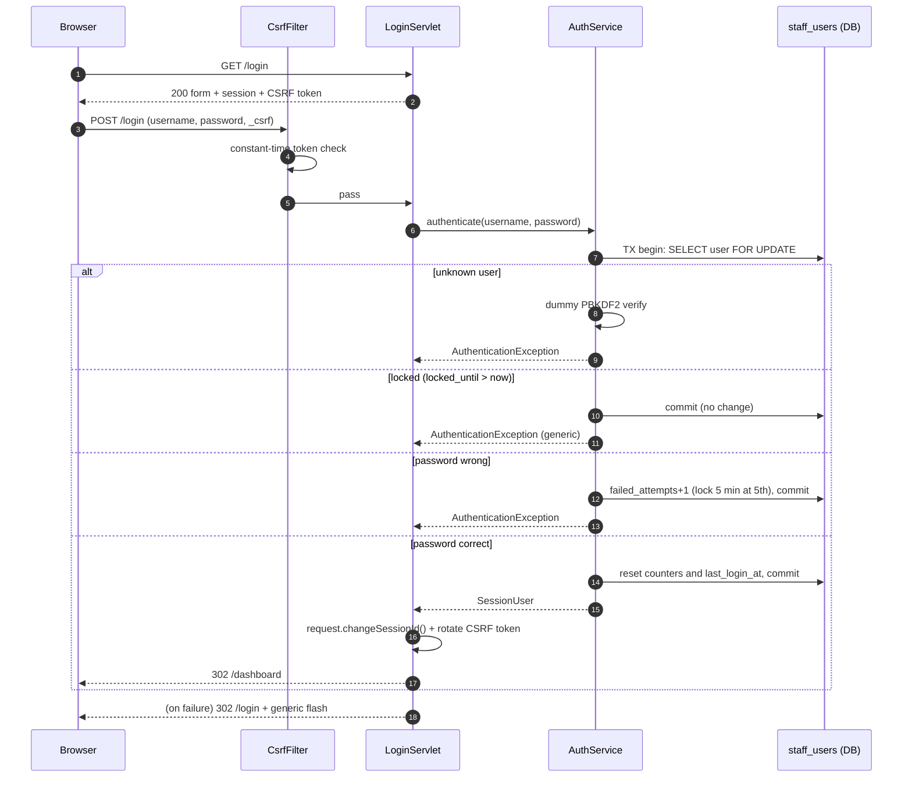

### 12.3 Sessions and cookies
See §10.4. Timeout 30 minutes; `changeSessionId()` at login; full `invalidate()` at logout; cookie `HttpOnly`, `SameSite=Lax`, `Secure` via config (HTTPS itself is out of scope, so the default is `false` for local use).

### 12.4 CSRF
Synchronizer token per session on every POST (including login and logout); `CsrfTokens.ensure(session)`, `CsrfTokens.matches(session, candidate)`; hidden field via the `csrf.tag` tag file; failures return 403 without revealing expected values. `SameSite=Lax` is defence in depth, not a replacement.

### 12.5 Authorisation
Account status and role are re-read from the database on every protected request (§12.10). Deny by default: `RoutePolicy` returns "not found in table" for unknown routes -> treated as protected ADMIN-only until mapped (unknown paths still 404 from the container). Checks happen in filters, not inside JSPs.

### 12.6 Injection and output encoding
* SQL: `PreparedStatement` only; the single `Statement` use is `SchemaInitializer` running trusted classpath scripts; no dynamic identifiers; `LIKE` patterns built from escaped user input (`%`/`_`/`\` escaped) for search; multi-statement mode off.
* XSS: JSP output escaping, CSP `script-src 'none'`, no inline event handlers.
* Header/response splitting: no user data in headers except `Content-Disposition` file name built from a validated date.
* CSV injection: §8.2. Log injection: values sanitised (§8.1).
* Deserialization: §9.

### 12.7 Secrets and configuration
`config/application.properties`, `data/`, `logs/`, `snapshots/`, `reports/`, `target/` are git-ignored. Secrets in config: DB password, snapshot HMAC secret, bootstrap passwords. `AppConfig.toString()` masks them; `NoPiiInLogsTest`/secret scan verify. HMAC secret minimum length 32 characters.

### 12.8 Error handling
Generic pages only; the user sees an error id, the log has the stack trace. `Server` header and Tomcat version are hidden in the connector (`server=""`), and the error report valve is configured with `showReport=false`, `showServerInfo=false` (embedded: set on the `StandardHost`'s `ErrorReportValve`).

### 12.9 Threats and mitigations (summary)

| Threat | Mitigation |
|---|---|
| Credential guessing | PBKDF2 cost, lockout, uniform responses |
| Session fixation / theft | `changeSessionId`, HttpOnly, SameSite, timeout, invalidate at logout |
| CSRF | Token on every POST, SameSite=Lax |
| Privilege escalation | Filters with single route table, deny-by-default, matrix tests |
| SQL injection | Prepared statements only, `ArchitectureRulesTest` |
| XSS | Escaping, CSP |
| Data leakage in logs/errors | No PII in logs, generic error pages |
| Malicious snapshot | HMAC, allowlist filter, size limits, never from the web |
| Replay of duplicate orders | Unique constraint + in-flight guard |
| Use of a disabled or demoted account through an old session | Per-request `validateSession` with `session_version` (§12.10) |
| Resource exhaustion by order flood | Bounded queues, offer timeout, compensation, simulator max rate |

### 12.10 Account status enforcement and session revocation

Decision D-033 (user-approved 2026-10-10): a disabled account must stop working on its **next request**, not at session timeout.

* **State.** `staff_users` has `enabled` and `session_version` (DATABASE_DESIGN §3.7). `SessionUser(userId, username, role, sessionVersion)` is stored in the HTTP session at login with the version read in the login transaction.
* **Check on every protected request.** `AuthFilter`, after confirming a `SessionUser` exists, calls `AuthService.validateSession(SessionUser)`, which runs `StaffUserDao.findSessionState(c, userId)` (one primary-key lookup returning `enabled`, `user_role`, `session_version`; no caching, so the effect is immediate). It returns an empty result when the user is missing, disabled, or `session_version` differs. On empty: `session.invalidate()`, redirect to `/login` (no `returnTo`), generic message on the login page ("Please sign in again."). On a database error the filter fails closed (generic 500, request not served). `RoleFilter` uses the *current* role returned by that check (stored as request attribute `ck.currentUser`), so role changes also apply on the next request. Public routes skip the check.
* **Cost.** One indexed lookup per protected request; with a handful of staff and a 5-second dashboard refresh this is negligible. A cache is deliberately not used (it would reintroduce a delay window).
* **When `session_version` changes.** On disable, on re-enable, and on admin password reset (so every session opened earlier becomes invalid and re-enabling does not revive old sessions). Login lockout from failed attempts does **not** touch existing sessions (otherwise an attacker could log a victim out by failing logins).
* **Login.** `AuthService.authenticate` refuses disabled accounts with the same generic message and still verifies the hash (similar timing).
* **Admin operations** (`/admin/users`, SHOULD): `AuthService.setEnabled(actorUserId, targetUserId, enabled)` in one transaction (TX10): refuses to disable the acting admin and refuses to disable the last enabled `ADMIN` (guard query with `FOR UPDATE`), then updates `enabled` and increments `session_version`.
* **Race window.** A request already past the filter when the account is disabled completes; the next one is rejected.
* **Logging.** Rejections log the user id and reason code only (no username, no session id).

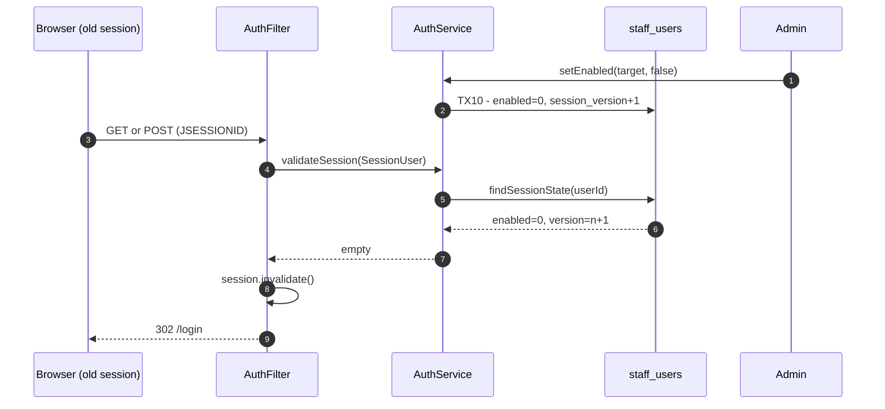

---

## 13. Transaction boundaries

Isolation: InnoDB default `REPEATABLE READ`; correctness relies on atomic conditional statements and row locks, not on isolation level. `autoCommit=false` inside `Database.inTransaction`. Deadlock (SQLState `40001` / error `1213`) -> rollback and rerun the whole work up to 3 times.

| ID | Transaction | Scope (all in one DB transaction) | Retry | On failure |
|---|---|---|---|---|
| TX1 | **Order creation** (`OrderService.submitOrder`) | 1) insert `orders` (status `PLACED`, `stock_deducted=0`); 2) insert `order_items`; 3) insert history (`null -> PLACED`); 4) for each item in **ascending `item_id`**: `StockDao.deduct` (0 rows => `InsufficientStockException`); 5) `markStockDeducted`; 6) conditional `PLACED -> VALIDATED`; 7) history (`PLACED -> VALIDATED`); commit | deadlock x3 | Rollback: no order, no deduction. Unique violation -> `DuplicateOrderException` (look up id after rollback). |
| TX2 | **Routing update** (submitter or worker) | conditional `VALIDATED -> ROUTED` + history | deadlock x3 | 0 rows is benign; an exception after a successful `offer` is only logged (RR-1, RR-2); the worker routes the order itself if the submitter did not |
| TX3 | **Transition** (worker steps, cancel, fail) | `OrderService.transition`: conditional status update; if 1 row: history insert; if `from.isStockRestorableTo(to)`: `claimStockRestore` and, when true, restore each item (ascending id); commit | deadlock x3 | Rollback leaves status unchanged; caller treats as failure |
| TX4 | **Queue-full / dispatch-failure compensation** (only when `offer` did not insert the id) | Same as TX3 with `from = VALIDATED`, `to = FAILED`, actor `SYSTEM`, note `QUEUE_FULL` / `INTERRUPTED` / `STATION_UNAVAILABLE` / `QUEUE_CLOSED` | deadlock x3, plus `compensation.retry.max` further attempts (RR-10) | If it still fails the order remains `VALIDATED` and is enqueued by the next recovery; `COMPENSATION_PENDING` logged |
| TX5 | **Stock adjustment** (admin) | `StockDao.set` | none | Rollback |
| TX6 | **Menu change** (admin) | insert/update `menu_items` (+ `inventory` row on create) | none | Rollback |
| TX7 | **Login attempt** | `SELECT ... FOR UPDATE` user; update counters/`last_login_at`; commit | deadlock x3 | Rollback; login fails generically |
| TX8 | **Snapshot recovery insert** (per order) | insert order (+ items, history) if missing | none | Per-order rollback, others continue |
| TX9 | **Schema/seed** | Each script statement executed with auto-commit (DDL commits implicitly); `schema_version` insert last | none | Startup aborts with message |
| TX10 | **Account enable/disable** | guard `SELECT ... FOR UPDATE` on enabled admins; `UPDATE staff_users SET enabled, session_version = session_version + 1` | none | Rollback: account unchanged |
| R1 | Read-only queries (dashboard, lists, recovery load) | `Database.withConnection` (auto-commit, no transaction) | none | Error page |

Atomicity, idempotency and crash behaviour of every workflow above are specified in §13.1; conditional updates and unique indexes are guards inside these transactions, not substitutes for them. Rules: a transaction never spans a queue `offer` (TX1 commits before dispatch) and never holds a connection while sleeping; workers hold no connection during simulated preparation time; each task borrows its own connection.

### 13.1 Atomicity, idempotency and crash recovery by workflow

**Principle.** Conditional updates and unique constraints are *guards*; they are **not** what makes a multi-step workflow atomic. Atomicity comes only from running every step of the workflow in **one database transaction** (`Database.inTransaction`): all statements commit together or none do. The guards decide *who wins* and *reject duplicates* inside that transaction. Work that happens outside the database (queue insertion, metrics, `orders.log`, flash messages) is never inside a transaction and is therefore designed to be recoverable from the database alone.

#### 13.1.1 What each mechanism guarantees, and what it does not

| Mechanism | Guarantees | Does **not** guarantee |
|---|---|---|
| Database transaction | All-or-nothing for every statement in it; durability after commit (relies on `innodb_flush_log_at_trx_commit = 1`, checked in spike S-17) | Anything outside the database |
| Conditional `UPDATE ... WHERE status = ?` / `AND stock_qty >= ?` | Mutual exclusion on one row and one transition; the row count tells the caller whether it won; an `UPDATE` uses a *current read*, so it sees the latest committed value even inside a `REPEATABLE READ` transaction | Atomicity with other statements: if a later statement fails, only the enclosing transaction's rollback undoes the update. A plain `SELECT` inside the transaction may see an older snapshot, so decisions are taken from the update's row count, never from a prior `SELECT` |
| `UNIQUE (source, external_ref)` | No second order for the same external reference, across restarts | Cleanup of other rows written before the violation (the transaction rollback does that) |
| `UNIQUE (order_id, from_status, to_status)` | No duplicate history edge even if application logic is wrong | That the status update and the history row happen together (only the transaction does) |
| `orders.stock_deducted` flag | Exactly-once restore **if and only if** the flag flip and the inventory restore are in the same transaction | Protection if flag and stock were changed in different transactions (a crash between them would lose or duplicate stock; that is why they never are) |
| `InFlightRegistry` | Suppresses concurrent duplicates within one JVM | Anything across restarts or processes |
| DB lease + epoch (fencing token) | Only one live owner per order; a replaced or hung worker cannot change the order afterwards (its updates carry a stale epoch and change 0 rows) | Atomicity of anything beyond one statement; correctness if the owner's clock and the lease clock differ (single JVM assumed) |
| `compensation_state` marker | Durable "do not process, compensate" intent, checked by database predicates | That compensation succeeds (it is retried until it does) |
| Station queue | Hands ids to workers | Durability (memory only): it is a hint, the database is the truth |

#### 13.1.2 Transaction rules (TXR-n, tested by `TransactionAtomicityTest`)

| ID | Rule |
|---|---|
| TXR-1 | Each workflow below is exactly one transaction; no workflow is split across transactions or across a queue operation. |
| TXR-2 | A claim flag and the effect it protects change in the same transaction (`claimStockRestore` + inventory restore + status update + history insert). |
| TXR-3 | Inside a transaction the conditional status update comes first; if it returns 0 rows the transaction ends without executing any further statement. |
| TXR-4 | A `TxWork` body only touches the database and local variables; metrics, log events, queue operations and flash messages are performed by the caller **after** `inTransaction` returned (post-commit actions, §13.1.4). This also makes the deadlock re-execution of the whole body safe. |
| TXR-5 | Decisions are taken from update row counts and from fresh auto-commit reads, never from a stale `SELECT` inside a long transaction. |
| TXR-6 | Exceptions roll back everything; the connection is returned to the pool with auto-commit restored. |
| TXR-7 | The embedded database keeps its default durability (`innodb_flush_log_at_trx_commit = 1`); `DbBootstrap` must not relax it. |
| TXR-8 | Ownership of an order by a worker is a database lease with a fencing epoch; every worker status update carries the epoch predicate. In-memory sets never decide ownership (§7.11). Lease operations are single statements; the lease columns are updated in the same statement as the status for worker steps, so "status advanced but lease stale" cannot be committed. |
| TXR-9 | The compensation marker is resolved in the same `UPDATE` that moves the order out of `VALIDATED`; it is set by its own single-statement transaction that touches no inventory (§7.10.3). |
| TXR-10 | **First-statement rule.** Every worker transaction starts with the fenced conditional `UPDATE` of the order row; all later statements (history, restore flag, inventory) run only if it changed exactly one row, inside the same transaction, while its row lock is held (F-1..F-3, §7.11.12). The same rule applies to every non-owner status transition. |

#### 13.1.3 Workflow table

| Workflow | Statements in the single transaction (in order) | Rollback behaviour | Idempotency key and effect of a repeat | Crash before commit | Crash after commit | Recovery |
|---|---|---|---|---|---|---|
| **TX1 create order** | insert order(`PLACED`, flag 0); insert items; history `null->PLACED`; deduct stock per item (ascending id); `markStockDeducted`; `PLACED->VALIDATED`; history `PLACED->VALIDATED` | Any failure (including insufficient stock, duplicate key) rolls back all: no order, no deduction | `(source, external_ref)`: repeat -> `DUPLICATE(existing id)`, no second deduction | Server rolls back: nothing exists; the caller retries | `VALIDATED`, stock deducted once, queue entry lost | Reloaded by startup recovery or the sweeper; processed normally |
| **TX2 route** | conditional `VALIDATED->ROUTED`; history row | Both or neither | Repeat/other winner -> 0 rows, no effect | Order stays `VALIDATED` | `ROUTED` | Normal processing |
| **TX3 transition** (worker step, cancel, fail) | conditional status update; **if 1 row:** history insert; **if** `from.isStockRestorableTo(to)`: `claimStockRestore`; **if it returned true:** inventory restore for each item (ascending id) | A failure anywhere (e.g. after the status update, after the claim) rolls back status, history, flag and stock together | The conditional update: repeat -> 0 rows, nothing else executes | Previous state intact, stock intact | New state, history row and (if applicable) restored stock all visible; flag 0 iff stock restored | Next worker pass, restart recovery or sweeper continues from the committed status |
| **TX4 compensation** | TX3 with `VALIDATED->FAILED`; the status `UPDATE` also resolves the PENDING marker (TXR-9) | As TX3; repeated up to `compensation.retry.max` extra times; the whole body re-executes safely (TXR-4) | 0 rows on repeat (already terminal) | Order stays `VALIDATED`, deducted (consistent live state) | `FAILED`, flag 0, stock restored, marker `RESOLVED` | If TX4 cannot commit: **TXC1** marker (below); completed by the sweeper with backoff or at startup before any enqueue (§7.10) |
| **TXC1 mark pending** | one `UPDATE ... SET compensation_state = 'PENDING', ... WHERE status = 'VALIDATED' AND compensation_state IS NULL` | Single statement | 0 rows: already moved/marked (no effect) | Not marked: nothing was promised to the caller (DC-1) | Marker durable; caller answered `QUEUE_FULL(compensated=false)` | Resolved first at restart, never enqueued while pending |
| **Lease acquire / renew / release / expire** | single `UPDATE`s on the lease columns; renew and fenced steps require epoch, owner and a valid lease (§7.11.13) | Single statement | Acquire is exclusive while a valid lease exists; renew/release are conditional on epoch and owner | Lease unchanged or expires by itself | Lease held until expiry or release | Cleared at startup; expired by the monitor for a retired generation (§7.11) |
| **Owner-fenced worker step / `failAsOwner`** | fenced status `UPDATE` (first statement) -> history insert -> [if from `VALIDATED`/`ROUTED` to `FAILED`: `claimStockRestore` -> inventory restore] | Whole transaction; a 0-row first statement ends it with no further statement | Epoch + owner + valid lease + status predicate | Previous state intact | New state, history row and (if applicable) restored stock together | Next worker/reconcile continues from the committed status |
| **Operator retry of compensation** | TX4 (first statement: conditional update that resolves the marker) | As TX4 | 0 rows if already resolved; double click harmless | Order stays `PENDING`, stock unchanged | `FAILED`, marker `RESOLVED`, stock restored once, history actor `admin:<username>` | n/a |
| **TX5 stock adjust** | one `UPDATE inventory ... SET stock_qty, reorder_level` | Single statement | Absolute value: repeat is a no-op | Unchanged | New value | n/a (admin may race in-flight deductions: TS-5) |
| **TX6 menu change** | insert/update `menu_items` (+ insert `inventory` row on create) | Both or neither | Create has `UNIQUE (station_id, name)` | Unchanged | Visible | n/a |
| **TX7 login attempt** | `SELECT ... FOR UPDATE` user; update counters/lock/`last_login_at` | Rolled back on error: counters unchanged | Not idempotent by design (each attempt counts) | Counter unchanged | Counter updated | n/a |
| **TX8 snapshot-recovery insert** (per order) | existence check; insert order, items, one history row | Per-order rollback; other orders continue | `(source, external_ref)`: present -> skipped | Not inserted | Inserted once | Re-run is safe |
| **TX10 account disable/enable** | lock enabled-admin rows (`FOR UPDATE`) for the guard; `UPDATE staff_users SET enabled, session_version = session_version + 1` | Both or neither: never "disabled but sessions still valid" | Disable twice -> second changes only the version counter (harmless) | Account unchanged | Disabled, all older sessions invalid on their next request | n/a |
| **Sweeper pass** | no transaction of its own; each action is TX3/TX4/TXC3 or a queue offer | Per action | Re-enqueue has no database effect | n/a | n/a | Next pass |
| **Final snapshot / report files** | files written to `*.tmp` then `ATOMIC_MOVE` (`.ser` first, `.hmac` last) | A partial file is ignored | Newest valid pair wins | Temp file left, ignored | Complete pair | n/a |

#### 13.1.4 Post-commit actions (not atomic with the database, by design)

| Action | Performed | Lost on a crash between commit and the action? | Consequence | Source of truth |
|---|---|---|---|---|
| `metrics.rejected/failed/processed` increments | after the transaction returned and only by the caller whose update changed a row | Yes (also reset at every restart, L-02) | A counter may under-count; it cannot over-count or double count | Database |
| `orders.log` event lines | same rule; best-effort (F-27) | Yes | A line may be missing | `order_status_history` |
| Queue `offer` (after TX1) | after TX1 commit, never inside a transaction | Entry is lost | Order stays non-terminal in the database and is recovered | Database |
| Flash message / HTTP response | after the service call | Yes | User sees no message; state is already correct | Database |
| `submitted` counter | at call entry (counts attempts, not effects) | n/a | n/a | n/a |

Rule: a post-commit action is never allowed to change correctness, and it is skipped when the transaction rolled back or the conditional update returned 0 rows (`PostCommitSideEffectsTest`).

#### 13.1.5 Stock-ledger argument

For every order and item, deduction happens once (TX1) and restoration happens in at most one transaction, the one that (1) wins the status update from `VALIDATED`/`ROUTED` to `CANCELLED`/`FAILED`, (2) wins `claimStockRestore` (flag 1 -> 0) and (3) adds the quantities back, all committed together (TXR-2). Therefore at any committed point: `stock_deducted = 1` iff the order currently holds or has consumed its stock (live, or it reached `PREPARING` or later), and `stock_deducted = 0` iff the stock was restored or never deducted (snapshot-recovered orders, L-05). `TestSupport.assertStockLedger` checks `initial = remaining + sum(quantities of orders with flag 1)` after every concurrency and crash test.

#### 13.1.6 Crash points inside TX3 with stock restore (the most delicate workflow)

| Crash point | Visible after restart |
|---|---|
| Before the status update | Nothing changed (order live, stock deducted) |
| After the status update, before the history insert / claim / inventory restore | The transaction was never committed: nothing changed |
| After commit | `CANCELLED`/`FAILED` + history row + flag 0 + stock restored, all together |
| After commit, before the `failed++` / log line | Same database state; only the in-memory counter or log line is missing |

There is no committed state with a changed status but no history row, a flag flip without restored stock, or restored stock without a status change.

#### 13.1.7 Durability and isolation notes
* Durability: spike S-17 reads `@@innodb_flush_log_at_trx_commit` (expected 1) and `@@sync_binlog`/binlog settings are irrelevant (no replication); if the embedded configuration weakens durability the setting is overridden in `DbBootstrap` or the deviation is reported.
* Isolation: default `REPEATABLE READ`; conditional `UPDATE`s and `SELECT ... FOR UPDATE` are current reads; plain reads in the worker, sweeper and dashboard use fresh auto-commit connections (RR-4). Documented in `DatabaseTransactionTest`.

---

## 14. Failure scenarios

| ID | Scenario | Detection | System behaviour | State afterwards | Test |
|---|---|---|---|---|---|
| F-01 | Invalid request | `OrderValidator` | `REJECTED(VALIDATION)`, errors returned, event logged, `rejected++` | No rows | `OrderValidatorTest`, `OrderServiceTest` |
| F-02 | Duplicate (in flight) | `InFlightRegistry.tryAcquire` false | `DUPLICATE`, no DB access | Unchanged | `DuplicateSubmissionConcurrencyTest` |
| F-03 | Duplicate (DB) | unique violation 23000/1062 | Rollback, find existing id, `DUPLICATE(existingId)` | One order | `OrderServiceTest` |
| F-04 | Insufficient stock | deduct updates 0 rows | Rollback TX1, `REJECTED(INSUFFICIENT_STOCK)` | No rows, stock unchanged | `OrderServiceTest`, `StockDeductionConcurrencyTest` |
| F-05 | Deadlock in TX1 | SQLState 40001 / 1213 | Rollback, retry (max 3), then `TEMPORARY_FAILURE` | No rows | `DeadlockRetryTest` |
| F-06 | Queue full | `offer` timeout | TX4 compensation, `QUEUE_FULL`, `failed++` | FAILED, stock restored | `QueueFullCompensationTest` |
| F-07 | Interrupt during `offer` | `InterruptedException` | Restore flag, treat as queue failure (TX4) | FAILED, stock restored | `QueueFullCompensationTest` |
| F-08 | Worker order exception | `catch Exception` in loop | Log with error id, `failOrder` if legal, `failed++`, continue | FAILED (stock policy by status) | `WorkerResilienceTest` |
| F-09 | Worker interrupted | `InterruptedException` | Restore flag, exit loop, state STOPPED | Order stays non-terminal in DB | `WorkerInterruptTest` |
| F-10 | Worker dequeues before the `ROUTED` update | Claim reads `VALIDATED` | Worker performs the conditional `VALIDATED -> ROUTED` itself (RR-3), submitter's later update is benign | One `VALIDATED->ROUTED` row, same final state | `RoutingRaceTest`, `StationWorkerTest` |
| F-11 | Cancel vs worker | conditional update 0 rows | Loser reports/skips | Consistent final state, stock restored at most once | `CancelVsWorkerRaceTest` |
| F-12 | Duplicate id in queue | claim fails / terminal status | Skip, DEBUG log | No double effect | `StationWorkerTest` |
| F-13 | Database unreachable at runtime | `SQLException` (connection) | Workers: FAILED attempt retried by next recovery (order stays in current status); web: generic 500; submissions `TEMPORARY_FAILURE` | No loss | `ErrorPagesWebTest` (E-25) |
| F-14 | JVM crash / kill -9 | n/a | On restart `RecoveryService` reloads non-terminal orders | Orders continue | `CrashRecoveryTest` |
| F-15 | Snapshot tampered | HMAC mismatch | `SnapshotIntegrityException`, `SNAPSHOT_REJECTED`, ignore file, fall back to DB | DB recovery only | `SnapshotTamperTest` |
| F-16 | Snapshot has unlisted class | `ObjectInputFilter` rejects | Same as F-15 | Same | `SnapshotFilterTest` |
| F-17 | Snapshot write fails (disk full, permissions) | `IOException` | Logged, task continues next interval; final snapshot failure does not block shutdown | DB unaffected | `SnapshotTaskTest` |
| F-18 | Shutdown during load | `accepting=false` | New submissions `SHUTTING_DOWN`; queues drained up to timeout; remainder persisted | Non-terminal rows + snapshot | `GracefulShutdownTest` |
| F-19 | Shutdown triggered twice | `AtomicBoolean` | Second caller waits | Steps ran once | `ShutdownCoordinatorTest` |
| F-20 | Stuck worker at shutdown | `awaitTermination` timeout | `shutdownNow()` interrupt | Order recovered next start | `ShutdownCoordinatorTest` |
| F-21 | Recovery with more orders than capacity | `putBlocking` waits | Loader blocks while workers drain; `accepting` false until done | All eventually processed | `RecoveryServiceTest` |
| F-22 | Config missing/invalid | `ConfigurationException` | Startup aborts with message (no secrets) | n/a | `AppConfigTest` |
| F-23 | Embedded DB port busy / binary missing | `DbBootstrap` exception | Abort with clear message and doc pointer | n/a | Phase 1 spike |
| F-24 | Simulator tick throws | `catch` in `tick()` | Logged, next tick continues | Unchanged | `FeedSimulatorTest` |
| F-25 | CSRF failure | `CsrfFilter` | 403 generic page | Unchanged | `CsrfWebTest` |
| F-26 | Unknown order id in URL | `Optional.empty` | 404 generic page | Unchanged | `OrderDetailWebTest` |
| F-28 | Submitter's `ROUTED` update fails or returns 0 rows after a successful `offer` | 0 rows / `SQLException` | Benign, WARN at most, result `ACCEPTED`, no compensation (RR-1, RR-2) | Order owned by the worker | `RoutingRaceTest`, `TransientFailureRecoveryTest` |
| F-29 | Transient DB failure in a worker step | `SqlErrors.isTransient` | Retry in place with backoff, park after `worker.retry.max`, `ORDER_STALLED` log, never `FAILED` for an outage (RR-8) | Order unchanged in DB, never dropped | `TransientFailureRecoveryTest` |
| F-30 | Compensation transaction keeps failing | TX4 exception after retries | `COMPENSATION_PENDING` log, result `QUEUE_FULL(compensated=false)` (RR-10) | `VALIDATED`, deducted, recovered at restart | `QueueFullCompensationTest` |
| F-31 | Crash between TX1 commit and `ROUTED` update | restart | Recovery reloads the non-terminal order (RR-9) | Processed normally, stock deducted once | `RoutingCrashWindowTest` |
| F-32 | Recovered order has no running station | recovery | Move to `FAILED`, note `STATION_UNAVAILABLE`, restore if `VALIDATED`/`ROUTED` (RR-9) | `FAILED` | `RecoveryServiceTest` |
| F-33 | Terminal order id reaches a worker | status read | Skip with `ORDER_SKIPPED_TERMINAL` (RR-5) | Unchanged | `TerminalOrderNeverResumedTest` |
| F-27 | Event log write fails | `IOException` | Logged via SLF4J once per minute, order flow continues (logging is best-effort and must not fail an order) | Unchanged | `NioOrderEventLogTest` |
| F-41 | Worker thread died (Error, bug outside the per-order try) | `WorkerMonitor` D1 (task done) | `WORKER_DIED`, replacement generation on the same queue, leases of the old owner expired in the DB, ids re-offered (§7.11.5) | Orders continue, none lost | `WorkerMonitorTest`, `DeadWorkerRaceTest` |
| F-42 | Worker hung or blocked (no heartbeat) | `WorkerMonitor` D2 | `WORKER_STALLED`, retire + replace; the zombie is fenced by the epoch | Order delivered once | `WorkerHangRecoveryTest` |
| F-43 | Restart budget exhausted | `WorkerMonitor` | `WORKER_GAVE_UP`, state `DEAD`, ERROR; admin *Restart* | Orders stay queued/non-terminal | `WorkerMonitorTest` |
| F-44 | Zombie worker acts after replacement | epoch predicate | 0 rows, stands down (`LEASE_LOST`) | No duplicate edge or side effect | `WorkerHangRecoveryTest`, `LeaseFencingTest` |
| F-45 | Worker meets a foreign unexpired lease / pending-compensation order | `acquireLease` returns empty | Skip (`ORDER_SKIPPED_LEASED` / `ORDER_SKIPPED_PENDING_COMPENSATION`) | Owner or compensation path continues | `StationWorkerTest`, `PendingCompensationRaceTest` |
| F-46 | Both TX4 and the marker write fail | exceptions | `INDETERMINATE(orderId)`; nothing promised; order continues as ordinary | Consistent live order | `DurableCompensationTest` |
| F-47 | Restart with pending compensations | `RecoveryService` | Leases cleared, compensation attempted before any enqueue, still-pending orders excluded from enqueue | Never processed while pending | `PendingCompensationRestartTest` |
| F-48 | Stale worker wakes after its lease expired and was taken over | epoch / lease predicate in the first statement | 0 rows, no further statement, stands down (L-5), no re-offer | No change in orders, history, inventory, metrics, log | `StaleWorkerWakeTest`, `WorkerMutationFencingTest` |
| F-49 | Lease expired but nobody superseded (database blip, GC pause) | 0-row renew/step, fresh read shows same epoch and free lease | Non-retired worker re-acquires (epoch+1) and continues (L-5), bounded by `worker.reacquire.max`; retired worker re-registers the id | Delivered once | `LeaseExpiryReacquireTest` |
| F-50 | Renewal after the monitor cleared the lease or after supersession | owner/epoch/valid predicates | 0 rows, no revival | Lease stays cleared/with the new owner | `LeaseFencingTest` |
| F-51 | Worker dies after `poll` or after the lease commit | monitor D1 + reconcile | Re-offer from durable state within one health interval (§7.11.14) | Delivered once, no wait for the orphan threshold | `PollToLeaseCrashWindowTest`, `DeadWorkerRaceTest` |
| F-52 | Monitor dies between `expireLeasesOf` and the re-offer | next monitor pass | Reconcile re-offers (idempotent) | No loss | `WorkerMonitorTest` |
| F-53 | Duplicate queue entries (reconcile, sweeper, parking, restart overlap) | admission checks, lease, fencing | Skip or sequential no-op | No duplicate edge or effect | `DuplicateQueueEntryTest`, `QueueReconcileTest` |
| F-54 | Operator retry races sweeper / restart / cancel attempt | first-statement conditional update | One wins, loser gets 0 rows; cancel refused for PENDING | Stock restored once, one terminal edge | `CompensationOperatorTest`, `PendingCompensationRaceTest` |
| F-55 | Attempt to resolve a PENDING order without the restore guard | no such operation; call-site rules | n/a (`ArchitectureRulesTest` fails the build) | n/a | `ArchitectureRulesTest`, `CompensationOperatorTest` |
| F-56 | Renewal or step executes (or commits) later than the guard budget after its stamp | stamp guard S-5 | `LeaseStampStaleException`, rollback, retry with a fresh stamp; renewal after expiry fails and the worker re-acquires (L-5) | Lease never revived, no partial effect | `LeaseRenewalFreshStampTest`, `LeaseStampGuardTest` |
| F-34 | Sweeper meets an order with an unexpired lease, or queued on a healthy worker | lease column / `queuedOnHealthyWorker` | Skipped | Unchanged | `OrphanSweeperTest` |
| F-35 | Genuine orphan (non-terminal, stale, no unexpired lease, not queued on a healthy worker) | Sweeper query + fresh re-read | Re-enqueued (`ORDER_REENQUEUED`), processed normally | Delivered, each effect once | `OrphanSweeperTest`, `OrphanSweeperRaceTest` |
| F-36 | Sweep pass throws | `try/catch` in `runOnce` | Logged, next pass runs | Unchanged | `OrphanSweeperTest` |
| F-37 | Durable pending compensation completes, loses a race, or keeps failing | TX4 result / attempts | Resolved + `COMPENSATION_COMPLETED`, or silent, or backoff and `COMPENSATION_STUCK` after the alert threshold (§7.10.8) | `FAILED` + stock restored once, or already terminal, or still `PENDING` (never processed) | `CompensationPendingSweepTest`, `CompensationBackoffTest` |
| F-38 | Request with the session of a disabled/unknown account or stale `session_version` | `AuthService.validateSession` | Session invalidated, 302 `/login` | Unchanged | `AccountDisableWebTest` |
| F-39 | Database error during `validateSession` | `PersistenceException` | Fail closed: generic 500, request not served | Unchanged | `AccountDisableWebTest` |
| F-40 | Fault between steps of a multi-step workflow | any exception inside `inTransaction` | Whole transaction rolled back (§13.1) | Previous consistent state | `TransactionAtomicityTest` |

---

## 15. Configuration reference (`config/application.properties`)

Loaded by `AppConfig` (typed getters, defaults, validation). `# secret` values are masked in `toString()` and never logged. The committed `config/application.properties.example` lists every key with safe placeholders (placeholders for secrets are rejected at startup).

| Key | Default | Meaning |
|---|---|---|
| `server.port` | `8080` | Embedded Tomcat port (`0` = random, tests) |
| `server.session.cookie.secure` | `false` | Sets the `Secure` flag on the session cookie |
| `db.mode` | `embedded` | `embedded` (MariaDB4j) or `external` (MySQL/MariaDB reachable at `db.url`) |
| `db.url` | derived for embedded | JDBC URL (required for `external`) |
| `db.name` | `cloudkitchen` | Database name |
| `db.user` | `ckapp` | Application DB user |
| `db.password` | none (required) | secret |
| `db.embedded.port` | `3307` | Port of the embedded server (`0` = random) |
| `db.embedded.data.dir` | `./data/db` | Embedded DB data directory (git-ignored) |
| `db.embedded.base.dir` | `./data/runtime` | Extracted binaries/work dir (git-ignored) |
| `db.pool.max.size` | `10` | HikariCP maximum pool size |
| `db.pool.connection.timeout.ms` | `5000` | Pool wait timeout |
| `tx.retry.max` | `3` | Deadlock retries |
| `tx.retry.backoff.ms` | `25` | Base backoff between retries |
| `station.queue.capacity` | `50` | Capacity of each station queue |
| `queue.offer.timeout.ms` | `500` | `offer` timeout before compensation |
| `worker.prep.ms` | `3000` | Simulated preparation time |
| `worker.pack.ms` | `1000` | Simulated packing time |
| `worker.delivery.ms` | `4000` | Simulated delivery time |
| `worker.retry.max` | `8` | Consecutive transient failures before a worker parks an order (RR-8) |
| `worker.retry.backoff.ms` | `200` | Initial backoff for transient failures (doubles, capped at 5000) |
| `worker.lease.ttl.seconds` | `30` | Lease validity (§7.11) |
| `worker.lease.renew.seconds` | `10` | Heartbeat/renewal period (must satisfy 3 x renew <= ttl) |
| `worker.health.interval.seconds` | `10` | Period of `WorkerMonitor` |
| `worker.stall.seconds` | `60` | No heartbeat for this long = stalled (must exceed ttl) |
| `worker.restart.max` | `5` | Automatic restarts per station within the window before `DEAD` |
| `worker.restart.window.seconds` | `300` | Window for the restart budget |
| `compensation.backoff.seconds` | `30` | Base backoff between compensation attempts (exponential) |
| `compensation.backoff.max.seconds` | `600` | Backoff cap |
| `compensation.alert.attempts` | `10` | Attempts before `COMPENSATION_STUCK` is logged |
| `worker.lease.margin.ms` | `200` | Margin `M` of the usable predicate; guard budget is `M/2` (50-2000; `10 x M <= worker.lease.renew.seconds`) |
| `worker.lease.stamp.retry` | `3` | Retries of an operation aborted by `LeaseStampStaleException` |
| `worker.reacquire.max` | `3` | Lease re-acquisitions per processing session before parking (L-5) |
| `worker.reconcile.batch` | `200` | Maximum orders examined per station per reconcile pass (§7.11.14) |
| `recovery.dispatch.window.seconds` | `30` | A `VALIDATED` order younger than this is left to the submitter; must exceed `queue.offer.timeout.ms` plus the compensation retry window |
| `compensation.retry.max` | `3` | Extra attempts of the compensation transaction (RR-10) |
| `recovery.sweep.enabled` | `true` | Run the orphan sweeper (§7.9) |
| `recovery.sweep.initial.delay.seconds` | `30` | Delay before the first pass (after startup recovery) |
| `recovery.sweep.interval.seconds` | `60` | Fixed delay between passes (minimum 5) |
| `recovery.orphan.after.seconds` | `120` | An order is only a candidate if not modified for this long (minimum 30 and at least 10 x `queue.offer.timeout.ms`) |
| `recovery.sweep.batch` | `100` | Maximum candidates per pass |
| `simulator.default.rate.per.minute` | `30` | Initial simulator rate |
| `simulator.max.rate.per.minute` | `600` | Upper bound |
| `simulator.autostart` | `false` | Start simulator at boot |
| `snapshot.dir` | `./snapshots` | Snapshot directory |
| `snapshot.interval.seconds` | `30` | Period of `SnapshotTask` |
| `snapshot.retain.count` | `10` | Snapshots kept |
| `snapshot.max.bytes` | `5242880` | Maximum accepted snapshot file size |
| `snapshot.hmac.secret` | none (required, >= 32 chars) | secret |
| `shutdown.drain.seconds` | `20` | Drain budget |
| `shutdown.await.seconds` | `10` | `awaitTermination` budget before `shutdownNow` |
| `log.orders.path` | `./logs/orders.log` | Structured order event log |
| `report.export.dir` | `./reports` | CSV output directory |
| `security.pbkdf2.iterations` | `600000` | PBKDF2 iterations (minimum 600000) |
| `security.lockout.max.attempts` | `5` | Failed logins before lock |
| `security.lockout.minutes` | `5` | Lock duration |
| `bootstrap.admin.username` / `bootstrap.admin.password` | none | First-bootstrap ADMIN; password is a secret |
| `bootstrap.staff.username` / `bootstrap.staff.password` | none | First-bootstrap KITCHEN_STAFF; password is a secret |
| `dashboard.refresh.seconds` | `5` | Locked value; key exists only so the JSP reads one number |

System property `-Dck.config=<path>` overrides the file location.

---

## 16. Exception to response mapping

| Exception | Service-level result | Web result |
|---|---|---|
| `ValidationException` / validation errors | `SubmissionResult.REJECTED(VALIDATION)` | Flash errors + retained form (PRG) |
| `InsufficientStockException` | `REJECTED(INSUFFICIENT_STOCK)` | Flash error |
| `DuplicateOrderException` | `DUPLICATE` | Flash info linking to the existing order |
| `QueueFullException` | `QUEUE_FULL` after compensation | Flash error; order page shows FAILED |
| `InvalidStatusTransitionException` | `false` from `cancelOrder`/`transition` (callers pre-check) | Flash error |
| `PersistenceException` | `REJECTED(TEMPORARY_FAILURE)` or propagated | Generic 500 page |
| `AuthenticationException` / `AccountLockedException` | login failure | Same generic flash |
| `SnapshotIntegrityException` | Snapshot skipped | Not user-visible |
| `ConfigurationException` | Startup abort | n/a |
| Any other `RuntimeException` | - | `ErrorServlet` -> generic 500 + error id |

---

## 17. Open design points (resolved in the phase noted, or require the user's decision)

| # | Point | Proposed resolution | Decide by |
|---|---|---|---|
| O-1 | JDBC driver: MySQL Connector/J first, MariaDB Connector/J if the spike shows incompatibility | Phase 1 spike checklist in IMPLEMENTATION_ROADMAP | Phase 1 |
| O-2 | `exec:java` classpath scope for `provided` embedded artifacts | Use `<classpathScope>test</classpathScope>`; fallback: Maven profile | Phase 1 |
| O-3 | Embedded Tomcat attribute hand-over (`ck.config`) vs property file reload in listener | Attribute if the spike proves it works, else `-Dck.config` | Phase 1 |
| O-4 | Brands and menu seed names | Placeholders in `V002` (3 brands, 5 items each); user may rename | Phase 3 |
| O-5 | ~~Disabled/locked user keeps an existing session until timeout~~ **Resolved 2026-10-10 (user decision):** account status is enforced on every protected request and sessions of disabled accounts are rejected and invalidated (§12.10, FR-AUT-10) | Done in docs; implemented Phase 3 (service) and Phase 7 (filter) | - |
| O-6 | Metrics are in-memory (reset on restart) | Accepted limitation | - |
| O-7 | Stock after snapshot-only recovery is not re-deducted | Accepted limitation, documented in §9.4 | - |
| O-8 | ~~Orphan sweeper~~ **Approved 2026-10-10 and included in the baseline** (decision D-032): design in §7.9, requirements FR-RES-06..08, tests `OrphanSweeperTest`, `OrphanSweeperRaceTest`, `CompensationPendingSweepTest`; implemented in Phase 5 | Done in docs | - |
